<h1 align="center"> Rotavital 💉🩸🏥🚑<br>
 <br>


[](https://github.com/viictorpaes/Rotavital/blob/main/LICENSE)

</h1>

<p align="center">
Sistema de logística de distribuição de hemocomponentes entre hospitais e bancos de sangue — estoque com
regras de validade, requisições hospitalares com alocação por <b>FEFO + compatibilidade ABO/Rh</b>,
roteirização de entregas e telemetria da cadeia fria.
</p>

<h2 align="center" id="docentes">👥👨🏻‍🏫 Docentes Responsáveis: <br>

</h2>
<ul>
  <li><strong>José Maurício da Silva Júnior</strong> — Algoritmos e Estrutura de Dados</li>
  <li><strong>Raoni Monteiro de Oliveira</strong> — Infraestrutura de Software (SO)</li>
  <li><strong>Robson Godoi de Albuquerque Maranhão</strong> — Projeto 3</li>
  <li><strong>Maurício da Motta Braga</strong> — Programação Orientada a Objetos</li>
  <li><strong>Luiz Filipe Guimarães Novaes</strong> — Infraestrutura de Comunicação (RSD)</li>
  <li><strong>André Luiz da Silva Xavier</strong> — Estatística e Probabilidade</li>
</ul>

<h2 align="center" id="integrantes">👤👨‍🎓 Integrantes do Projeto: </h2>
<ul>
<li><b>Victor José Paes e Silva (Líder 👑)</b> <a href="https://www.linkedin.com/in/viictorpaes/" target="_blank"></a> <a href="https://github.com/viictorpaes" target="_blank"></a></li>
<li>Eduardo de Souza Cavalcanti Junior <a href="https://www.linkedin.com/in/eduardoscavalcantij/" target="_blank"></a> <a href="https://github.com/eduardo-scavalcanti" target="_blank"></a></li>
<li>Felipe Franca Alves de Lima <a href="https://www.linkedin.com/in/felipefrancaal/" target="_blank"></a> <a href="https://github.com/ffrancaal" target="_blank"></a></li>
<li>Helamã Leone de Lima Procídio <a href="https://www.linkedin.com/in/helam%C3%A3-procidio-428772367/" target="_blank"></a> <a href="https://github.com/procidiohelama-star" target="_blank"></a></li>
<li>João Pedro Arruda Guimarães <a href="https://www.linkedin.com/in/jo%C3%A3o-pedro-arruda-guimar%C3%A3es-157952287/" target="_blank"></a> <a href="https://github.com/Jp230603" target="_blank"></a></li>
<li>Júlia Oliveira Veríssimo (<b>Entrou em: 26/09/2026</b>)</li>
<li>Lucas Paguetti Pereira <a href="https://www.linkedin.com/in/lucas-paguetti-pereira" target="_blank"></a> <a href="https://github.com/wqiluc" target="_blank"></a></li>
<li>Tiago Luiz Moreira de Vasconcelos <a href="https://www.linkedin.com/in/tiagoluiz23/" target="_blank"></a> <a href="https://github.com/tlmv23" target="_blank"></a></li>
</ul>

<h2 align="center" id="tecnologias"> ⛏️💻 Tecnologias Utilizadas: <br>

</h2>
<p align="center">
   <br>
  
  
  
  
  
  
   <br>
  
  
  
  
  
   <br>
  
  
  
  
  
  
  
    
  
  
   <br>
  
  
   <br>
</p>

<h2 align="center" id="entregas">🚀 Entregas do Projeto Integrador <br>

</h2>

<p align="center">
Cada entrega do Projeto Integrador tem sua própria seção abaixo, com link direto para os artefatos
produzidos (histórias de usuário, protótipo, screencasts). Datas conforme o roadmap do 3º semestre.
</p>

<h3 id="-entrega-01" align="center">📌 Entrega 01 — 31/08 <br>
<a href="https://letter-raven-07178463.figma.site" target="_blank"></a>
<a href="https://youtu.be/SRvAFkqi4Nc" target="_blank"></a>

</h3>

| Artefato | Descrição | Link |
| :--- | :--- | :--- |
| 🎨 Protótipo low-Fi (Figma Make) | 10 histórias navegadas e confirmadas ponta a ponta (HU‑01 a HU‑10) | [Abrir protótipo](https://letter-raven-07178463.figma.site) |
| 🎬 Screencast (YouTube) | Demonstração do protótipo, explicando cada história implementada | [Assistir vídeo](https://youtu.be/SRvAFkqi4Nc) |

<h4 align="center">📋 Histórias de Usuário — Rota Vital 🩸<br>
Login, Estoque, Requisições, Rede Hospitalar, Pacientes e <b>Doações</b></h4>

> **Formato:** Como `[papel]`, quero `[funcionalidade]`, para que `[benefício]`.

<p align="center">


</p>

<h5 align="left">🖥️ Telas do Protótipo ↔ Histórias</h5>

| # | Tela do Figma | Papel | HUs |
| :---: | :--- | :--- | :--- |
| 1 | 🔐 Login / Seleção de acesso | Médico e Doador | HU‑01 |
| 2 | 📊 Painel Operacional (Início) | Médico | HU‑02 |
| 3 | 📦 Estoque por tipo sanguíneo | Médico | HU‑03 |
| 4 | 🏥 Requisição — Solicitar / Recebidas / Campanha | Médico | HU‑04, HU‑05, HU‑06 |
| 5 | 🚚 Rede hospitalar (mapa + plano de transporte) | Médico | HU‑07 |
| 6 | 🩺 Pacientes | Médico | HU‑08 |
| 7 | ❤️ Doações (pessoas que precisam + agendar) | Médico e Doador | HU‑09 |
| 8 | 👤 Portal do Doador | Doador | HU‑10 |

> Parte da lógica por trás de algumas telas (FEFO, compatibilidade ABO/Rh, grafo de rotas) já existe no
> backend Java — ver [`docs/MODULOS.md`](./docs/MODULOS.md). O que ainda é só protótipo está anotado como
> "Nível de código" em cada história abaixo; isso não é o foco desta entrega, só uma referência rápida.

<h5 align="left">✅ Implementadas</h5>

**🔐 Login e Painel**

| # | História |
| :---: | :--- |
| HU‑01 | Como **usuário do RotaVital (médico ou doador)**, quero escolher meu tipo de acesso e informar meu nome na tela inicial, para que eu entre direto na experiência certa para o meu papel, sem um cadastro completo. |
| HU‑02 | Como **médico**, quero ver um painel com números rápidos e uma caixa de avisos com alertas críticos em tempo real, para que eu identifique pacientes em risco e problemas de estoque sem navegar por todas as telas. |

**📦 Estoque**

| # | História |
| :---: | :--- |
| HU‑03 | Como **médico**, quero consultar o estoque agrupado por tipo sanguíneo, com o detalhe de cada lote (validade, temperatura e localização física), para que eu saiba exatamente quais lotes estão em risco de vencer ou fora da faixa de temperatura ideal. |

**🏥 Requisição**

| # | História |
| :---: | :--- |
| HU‑04 | Como **médico**, quero preencher uma requisição informando hemocomponente, tipo sanguíneo, ala de destino, quantidade, paciente e urgência, para que o sistema me sugira automaticamente o lote certo pela regra FEFO. |
| HU‑05 | Como **médico**, quero registrar o recebimento físico de hemocomponentes vindos de outras instituições, para que essas unidades sejam somadas automaticamente ao estoque, sem lançamento manual. |
| HU‑06 | Como **médico**, quero publicar uma campanha de doação para um paciente específico, para que doadores voluntários o vejam nas telas de Doações e Pacientes e se cadastrem para ajudar diretamente. |

**🚚 Rede Hospitalar**

| # | História |
| :---: | :--- |
| HU‑07 | Como **médico**, quero visualizar o mapa de hospitais conectados, escolher um destino e ver o plano de transporte com a rota calculada e as exigências da cadeia fria, para que a entrega siga pelo caminho mais eficiente, no veículo certo e na temperatura ideal. |

**🩺 Pacientes**

| # | História |
| :---: | :--- |
| HU‑08 | Como **médico**, quero, ao concluir o atendimento de um paciente, informar se o hemocomponente usado veio do estoque interno (com baixa automática por FEFO) ou de uma doação externa (sem baixa), para que o estoque reflita com exatidão o que foi realmente consumido. |

**❤️ Doações**

| # | História |
| :---: | :--- |
| HU‑09 | Como **médico ou doador**, quero visualizar as pessoas que precisam de doação — filtráveis por tipo sanguíneo — e agendar uma doação para uma delas, para que doadores compatíveis sejam direcionados a quem precisa com mais urgência. |
| HU‑10 | Como **doador**, quero acessar, após o login, uma versão simplificada da tela de Doações, sem o menu operacional do hospital, para que minha experiência seja direta: ver quem precisa e agendar minha doação. |

<h5 align="left">🚀 Podem Ser Implementadas no Futuro</h5>

> Identificadas navegando o próprio protótipo — coisas que ele hoje **não** cobre e que fariam sentido como
> próximo passo, seja no Figma ou já direto no backend.

| # | História |
| :---: | :--- |
| HU‑F01 | Como **administrador do sistema**, quero que o login exija senha e verificação de identidade (hoje a tela só pede um nome), para que o acesso a dados clínicos e de estoque seja de fato seguro. |
| HU‑F02 | Como **gestor da rede de sangue**, quero um painel que cruze indicadores de vários hemocentros (o painel atual mostra números de um só), para que eu identifique desequilíbrios regionais de estoque e demanda. |
| HU‑F03 | Como **médico**, quero receber uma notificação (push ou e-mail) quando um alerta crítico entrar na Caixa de Avisos, para que eu não dependa de estar com o painel aberto para ser avisado. |
| HU‑F04 | Como **médico**, quero acompanhar a localização em tempo real do veículo refrigerado durante o transporte (o Plano de Transporte hoje só mostra a rota calculada, não o rastreamento ao vivo), para que eu saiba exatamente quando a entrega vai chegar. |
| HU‑F05 | Como **gestor**, quero exportar relatórios de estoque e demanda em CSV/PDF a partir do Painel Operacional, para que eu leve esses números para reuniões e prestação de contas fora do sistema. |
| HU‑F06 | Como **doador**, quero que o sistema verifique minha elegibilidade (intervalo mínimo entre doações, idade, etc.) antes de confirmar o agendamento em "Fazer doação", para que eu não vá até o hemocentro para descobrir lá que não posso doar. |

<h5 align="left">📋 Resumo</h5>

| Status | Quantidade |
| :--- | :---: |
| ✅ Implementadas | 10 histórias |
| 🚀 Futuras | 6 histórias |
| **Total** | **16 histórias** |

<h5 align="left">🔍 Detalhamento:</h5>

<p align="center">
Cada história implementada abaixo traz o detalhamento completo — ator, ação, benefício, a tela do protótipo
onde ela vive, uma nota (curta) do que já existe em código, e <b>2 cenários de validação</b> em BDD com os
dados reais vistos no protótipo. Clique em <b>▶️</b> + no emoji da tela para expandir.
</p>

<details>
<summary>▶️🔐 <b>HU‑01</b> — Login e seleção de tipo de acesso</summary>

| Campo | Detalhe |
| :--- | :--- |
| **Ator** | Usuário do sistema (médico ou doador) |
| **Quero** | Escolher meu tipo de acesso ("Médico — acesso hospitalar completo" ou "Doador — portal de doações") e informar meu nome |
| **Para que** | Eu veja a tela adequada ao meu papel sem precisar de um cadastro completo |
| **Tela do Figma** | Tela inicial "Cesar Life · Estoque Inteligente" — cartões `Médico`/`Doador`, campo `Nome`, botão `Entrar` |
| **Nível de código** | Desde a PI3-183/184, a entrada é por **e-mail e senha**: `POST /api/v1/acessos` confere as credenciais no Supabase Auth e devolve o perfil (médico, doador ou admin) e a tela inicial. Os cards do protótipo saíram da tela; ver [`PERFIS_DE_ACESSO.md`](./docs/PERFIS_DE_ACESSO.md) |

| Cenário | Dado | Quando | Então |
| :--- | :--- | :--- | :--- |
| Acesso como médico | Estou na tela inicial do Cesar Life | Seleciono o cartão "Médico", informo "Dra. Ana Souza" e clico em "Entrar" | Vejo o Painel Operacional do HEMOPE (Recife — PE), com o menu Início / Estoque / Requisição / Rede / Pacientes / Doações |
| Acesso como doador | Estou na tela inicial | Seleciono o cartão "Doador", informo "João Doador" e clico em "Entrar" | Vejo o cabeçalho "Cesar Life · Portal do Doador" e a lista de pessoas que precisam, sem o menu operacional do hospital |

</details>

<details>
<summary>▶️📊 <b>HU‑02</b> — Painel operacional com alertas em tempo real</summary>

| Campo | Detalhe |
| :--- | :--- |
| **Ator** | Médico |
| **Quero** | Ver um painel com números rápidos e uma caixa de avisos com alertas críticos em tempo real |
| **Para que** | Eu identifique rapidamente pacientes em risco e problemas de estoque sem navegar por todas as telas |
| **Tela do Figma** | "Início" — Números Rápidos (Unidades em Estoque, Tipos em Risco, Vencendo em 7 dias, Alertas Críticos) + Caixa de Avisos (9 ativos) |
| **Nível de código** | Sem equivalente no contrato/domínio hoje — é um gap real também descrito na visão original do projeto (painel de indicadores) |

| Cenário | Dado | Quando | Então |
| :--- | :--- | :--- | :--- |
| Alerta crítico de paciente | A paciente "Mariana Alves" precisa de sangue O- com urgência, em cirurgia cardíaca no Centro Cirúrgico | Entro no Painel Operacional | Vejo o aviso "CRÍTICO · Paciente Mariana Alves precisa de sangue O− urgente" na Caixa de Avisos |
| Alerta de estoque baixo | O tipo AB+ está com apenas 3 unidades de Concentrado de Hemácias | Entro no Painel Operacional | Vejo o aviso "Estoque de sangue tipo AB+ próximo do desabastecimento" e o contador "Tipos em Risco" reflete essa contagem |

</details>

<details>
<summary>▶️📦 <b>HU‑03</b> — Estoque por tipo sanguíneo com detalhe de lote</summary>

| Campo | Detalhe |
| :--- | :--- |
| **Ator** | Médico |
| **Quero** | Consultar o estoque agrupado por tipo sanguíneo, com detalhe de cada lote (validade, temperatura, localização) |
| **Para que** | Eu saiba exatamente quais lotes estão em risco de vencer ou fora da faixa de temperatura ideal |
| **Tela do Figma** | "Estoque" — filtro por tipo sanguíneo (A+ … O-), cartão de lote com código, unidades, volume, validade e temperatura (com etiqueta "FORA DA FAIXA") |
| **Nível de código** | Parcialmente coberto por `Estoque`/`BolsaHemocomponente` e `GET /api/v1/bancos/{bancoId}/estoque` — mas o contrato atual não tem campos de localização física (rack/posição) nem de temperatura por lote |

| Cenário | Dado | Quando | Então |
| :--- | :--- | :--- | :--- |
| Lote fora da faixa de temperatura | O lote "PQ-3014" (Concentrado de Plaquetas, A+) está a 25,6°C, fora da faixa ideal de 20–24°C | Abro a tela de Estoque e filtro por "A+" | Vejo o lote "PQ-3014" marcado com a etiqueta "FORA DA FAIXA" |
| Filtrar por tipo sanguíneo específico | Existem lotes de vários tipos sanguíneos no estoque | Clico no filtro "O-" | Vejo apenas os 3 lotes de O- ("CH-1042", "CH-1043", "CR-4002"), totalizando 13 unidades |

</details>

<details>
<summary>▶️🏥 <b>HU‑04</b> — Solicitar requisição com sugestão de lote por FEFO</summary>

| Campo | Detalhe |
| :--- | :--- |
| **Ator** | Médico |
| **Quero** | Preencher uma requisição informando hemocomponente, tipo sanguíneo, ala de destino, quantidade, paciente e urgência |
| **Para que** | Eu atenda o paciente rapidamente usando o lote mais próximo do vencimento, sem precisar escolher manualmente |
| **Tela do Figma** | "Requisição" → aba "Solicitar" — formulário completo + painel lateral "Lote Sugerido (FEFO)" |
| **Nível de código** | Corresponde a `POST /api/v1/requisicoes` + à lógica de FEFO já em `Estoque.buscarDisponiveis()`; o contrato atual não modela `alaMedica` nem `nomePaciente` |

| Cenário | Dado | Quando | Então |
| :--- | :--- | :--- | :--- |
| Sugestão automática do lote mais próximo do vencimento | Estou solicitando Concentrado de Hemácias tipo O- para a Emergência | Preencho o formulário na aba "Solicitar" | O sistema sugere o lote "CH-1042" com a etiqueta "3D P/ Vencer" e a localização "R1 · P3 · N2" |
| Requisição de emergência | Um paciente precisa de sangue com urgência "Emergência" | Envio a requisição pelo botão "Enviar requisição" | Ela é registrada vinculada ao paciente e à ala médica informados |

</details>

<details>
<summary>▶️🏥 <b>HU‑05</b> — Registrar recebimento de hemocomponentes (aba Recebidas)</summary>

| Campo | Detalhe |
| :--- | :--- |
| **Ator** | Médico |
| **Quero** | Registrar o recebimento físico de hemocomponentes vindos de outras instituições |
| **Para que** | As unidades recebidas sejam somadas automaticamente ao estoque, sem lançamento manual |
| **Tela do Figma** | "Requisição" → aba "Recebidas" — lista de recebimentos (`INC-001`…`INC-004`) com origem, tipo e quantidade |
| **Nível de código** | Sem endpoint equivalente — é um fluxo de entrada diferente do cadastro manual de `POST /api/v1/hemocomponentes` |

| Cenário | Dado | Quando | Então |
| :--- | :--- | :--- | :--- |
| Recebimento de intercâmbio entre hemocentros | Chegaram 8 unidades de Concentrado de Hemácias O- do "HEMORIO — Intercâmbio Nordeste" | Confirmo o recebimento "INC-001" na aba "Recebidas" | As 8 unidades são somadas automaticamente ao estoque de O- |
| Recebimento de doação coletiva corporativa | A empresa "Nordeste Energia S.A." fez uma doação coletiva de 4 unidades de Concentrado de Plaquetas AB+ | Confirmo o recebimento "INC-003" | Essas 4 unidades entram no estoque de AB+ |

</details>

<details>
<summary>▶️🏥 <b>HU‑06</b> — Publicar campanha de doação para um paciente</summary>

| Campo | Detalhe |
| :--- | :--- |
| **Ator** | Médico |
| **Quero** | Publicar uma campanha de doação informando idade, sexo, tipo sanguíneo, componente necessário, diagnóstico e gravidade do paciente |
| **Para que** | Doadores voluntários vejam esse paciente nas telas de Doações e Pacientes e se cadastrem para ajudar diretamente |
| **Tela do Figma** | "Requisição" → aba "Campanha" — formulário de publicação, com aviso de que ela aparece em Doações e Pacientes |
| **Nível de código** | Sem equivalente no domínio/contrato — não existe conceito de campanha pública nem de doador no backend hoje |

| Cenário | Dado | Quando | Então |
| :--- | :--- | :--- | :--- |
| Publicar campanha para paciente crítico | Um paciente com diagnóstico "Insuficiência cardíaca aguda" precisa de sangue O- com urgência | Preencho e publico o formulário na aba "Campanha" | O paciente passa a aparecer nas telas "Doações" e "Pacientes" para possíveis doadores |
| Campanha exige causa/diagnóstico | Estou preenchendo uma campanha de doação | Tento publicar sem informar "Causa/Diagnóstico" | O sistema deveria bloquear a publicação até o campo ser preenchido — regra a confirmar/reforçar na próxima iteração do protótipo |

</details>

<details>
<summary>▶️🚚 <b>HU‑07</b> — Rede hospitalar e plano de transporte na cadeia fria</summary>

| Campo | Detalhe |
| :--- | :--- |
| **Ator** | Médico |
| **Quero** | Visualizar o mapa de hospitais conectados, escolher um destino e ver o plano de transporte com a rota calculada |
| **Para que** | A entrega siga o caminho mais eficiente, no veículo certo e respeitando a temperatura ideal de transporte |
| **Tela do Figma** | "Rede" — mapa de hospitais conectados (distância/tempo) + painel "Plano de Transporte" (rota, veículo, checklist de hemocomponentes, prioridade de envio por FEFO) |
| **Nível de código** | Corresponde ao módulo de Rotas (`PontoDeRede`, `Conexao`, Dijkstra em `RedeDistribuicao`/`RotaCalculada`) — mas o backend ainda não modela tipo de veículo nem checklist de envio |

| Cenário | Dado | Quando | Então |
| :--- | :--- | :--- | :--- |
| Selecionar hospital e calcular rota | O "Hospital das Clínicas de PE" está a 7,8 km / 18 min do hemocentro | Eu o seleciono no mapa da Rede | O Plano de Transporte exibe destino, endereço, melhor rota, "Veículo refrigerado monitorado" e temperatura ideal de 2 a 6°C |
| Priorização de envio por FEFO no transporte | Os lotes "CH-1042" (O-, vence em 3 dias), "CH-1080" (AB+, vence em 6 dias) e "CH-1061" (A-, vence em 9 dias) estão disponíveis para envio | Visualizo a "Prioridade de Envio (FEFO)" do Plano de Transporte | Eles aparecem ranqueados nessa ordem, do mais próximo do vencimento para o mais distante |

</details>

<details>
<summary>▶️🩺 <b>HU‑08</b> — Concluir procedimento com baixa por FEFO ou doação externa</summary>

| Campo | Detalhe |
| :--- | :--- |
| **Ator** | Médico |
| **Quero** | Ao concluir o atendimento de um paciente, informar se o hemocomponente veio do estoque interno ou de uma doação externa |
| **Para que** | O estoque reflita com exatidão o que foi realmente consumido, sem duplicar ou perder unidades |
| **Tela do Figma** | "Pacientes" → botão "Concluir procedimento" → modal com as opções "Utilizou hemocomponentes do estoque" (deduz por FEFO) e "Paciente recebeu doação externa" (não deduz) |
| **Nível de código** | A baixa por FEFO já existe conceitualmente em `Estoque.reservar()` + `RequisicaoHospitalar.marcarComoAlocada()`, mas não há classe de domínio para Paciente nem para o registro de conclusão de procedimento |

| Cenário | Dado | Quando | Então |
| :--- | :--- | :--- | :--- |
| Concluir procedimento usando estoque interno | A paciente "Mariana Alves" (O-, Concentrado de Hemácias, crítico) está em atendimento | Concluo o procedimento e seleciono "Utilizou hemocomponentes do estoque" | 1 unidade de Concentrado de Hemácias O- é deduzida do estoque seguindo FEFO |
| Concluir procedimento com doação externa | A mesma paciente recebeu sangue por uma doação externa emergencial | Concluo o procedimento e seleciono "Paciente recebeu doação externa" | Nenhuma unidade é deduzida do estoque |

</details>

<details>
<summary>▶️❤️ <b>HU‑09</b> — Ver quem precisa de doação e agendar</summary>

| Campo | Detalhe |
| :--- | :--- |
| **Ator** | Médico ou doador |
| **Quero** | Visualizar as pessoas que precisam de doação, filtráveis por tipo sanguíneo, e agendar uma doação para uma delas |
| **Para que** | Doadores compatíveis sejam direcionados a quem precisa com mais urgência, com local e horário claros |
| **Tela do Figma** | "Doações" — lista de pessoas com filtro por tipo sanguíneo, botão "Fazer doação" → modal "Agende sua doação" (endereço, horário, "Confirmar e traçar rota no celular") |
| **Nível de código** | Sem equivalente no domínio/contrato — não existe conceito de doador nem de matching paciente↔doador no backend |

| Cenário | Dado | Quando | Então |
| :--- | :--- | :--- | :--- |
| Agendar doação para paciente crítico | "Mariana Alves" (O-, Concentrado de Hemácias, crítico, a 1,8 km) aparece na lista de Doações | Clico em "Fazer doação" para ela | Vejo a tela "Agende sua doação" com endereço do hemocentro, horário de funcionamento e a opção "Confirmar e traçar rota no celular" |
| Filtrar pessoas que precisam por tipo sanguíneo | Existem 6 pessoas cadastradas, com tipos sanguíneos diferentes | Filtro por "AB+" | Vejo apenas "Beatriz Carvalho" na lista |

</details>

<details>
<summary>▶️👤 <b>HU‑10</b> — Portal do Doador simplificado</summary>

| Campo | Detalhe |
| :--- | :--- |
| **Ator** | Doador |
| **Quero** | Acessar, após o login, uma versão simplificada da tela de Doações, sem o menu operacional do hospital |
| **Para que** | Minha experiência como doador seja direta — só ver quem precisa e agendar minha doação |
| **Tela do Figma** | "Portal do Doador" — mesmo header "Cesar Life · Portal do Doador", sem o menu Início/Estoque/Requisição/Rede/Pacientes |
| **Nível de código** | Sem equivalente — perfis de acesso (Médico/Doador) não existem no backend ainda |

| Cenário | Dado | Quando | Então |
| :--- | :--- | :--- | :--- |
| Doador vê apenas o portal de doações | Fiz login como "Doador" com o nome "João Doador" | Acesso o sistema | Vejo o cabeçalho "Cesar Life · Portal do Doador" e a lista de pessoas que precisam, sem os menus Início/Estoque/Requisição/Rede/Pacientes |
| Doador consegue agendar doação do mesmo jeito que o médico | Estou logado como doador | Clico em "Fazer doação" para uma pessoa da lista | Vejo a mesma tela "Agende sua doação", com endereço e horário do hemocentro |

</details>

<h3 id="-entrega-02" align="center">📌 Entrega 02 — 21/09 <br>


<a href="https://youtu.be/3RlgYAGPyaE" target="_blank"></a>

</h3>

<p align="center">
Segunda entrega do Projeto Integrador — sai do protótipo Figma e liga o domínio a código rodando de
verdade: back-end em <b>Spring Boot</b> (HU‑01, HU‑03 — vindas do <a href="https://github.com/viictorpaes/Rotavital/pull/2">PR #2</a>,
já mesclado na <code>main</code>) e front-end em <b>React</b> (HU‑01, HU‑09, HU‑10), somando 5 histórias
com código real, acima do mínimo de 2 exigido. Screencast de uso do sistema e explicação do código
publicado no <a href="https://youtu.be/3RlgYAGPyaE" target="_blank">YouTube</a>, fechando a entrega.
</p>

| Requisito da entrega | Descrição | Status |
| :--- | :--- | :---: |
| ✅ Histórias implementadas | Mínimo de 2 HUs em código real (não só Figma) |  **Feito** |
| 🔁 Versionamento atuante | Commits de código direto na `main`, no mínimo semanais |  **Feito** — PRs #2 e #10 mesclados na `main` em 14/09, com commits também em 23/08, 09/09 e 12/09, mantendo cadência semanal |
| 🐞 Issue/Bug Tracker | GitHub Issues atualizado todas as semanas + print no README |  **Feito** — 7 issues registradas no GitHub (label `bug`), 2 já fechadas (#2 e #5), com prints na seção [Issue/Bug Tracker](#issue-tracker) abaixo |

| Artefato | Descrição | Link |
| :--- | :--- | :--- |
| 🎬 Screencast — Uso do sistema | Aplicação Spring Boot rodando, explicando as HUs implementadas | [Assistir vídeo](https://youtu.be/3RlgYAGPyaE) |
| 💻 Screencast — Explicação do código | Código da aplicação Spring Boot e das HUs implementadas | [Assistir vídeo](https://youtu.be/3RlgYAGPyaE) |

<h4 align="center">📝 Histórias Implementadas — Entrega 02</h4>

<p align="center">
Resumo em formato <b>post-it</b> (como visto em sala) das histórias já rodando em código — Spring Boot
no backend, React no frontend. O detalhamento completo (ator, tela, BDD) de cada HU está na
<a href="#-entrega-01">Entrega 01</a> acima.
</p>

> 🟨 **HU‑01** — Como **usuário (médico ou doador)**, preciso escolher meu tipo de acesso e informar meu
> nome, para entrar direto na experiência certa para o meu papel, sem um cadastro completo.
>
> ✅ Frontend — [`PaginaLogin.tsx`](./frontend/src/pages/Login/PaginaLogin.tsx)
> ✅ Backend — `POST /api/v1/acessos` via [`AcessoController.java`](./backend/src/main/java/com/rotavital/api/AcessoController.java) (PR #2, mesclado)

> 🟨 **HU‑03** — Como **médico**, preciso consultar o estoque por tipo sanguíneo, com validade, temperatura
> e localização de cada lote, para saber quais estão em risco de vencer ou fora da faixa ideal.
>
> ✅ Backend — `GET /api/v1/bancos/{bancoId}/estoque?tipoSanguineo=` via [`EstoqueController.java`](./backend/src/main/java/com/rotavital/api/EstoqueController.java) (PR #2, mesclado)
> ✅ Frontend — [`PaginaEstoque.tsx`](./frontend/src/pages/Estoque/PaginaEstoque.tsx), entregue depois da Entrega 02; hoje lista as bolsas de `GET /api/v1/hemocomponentes`, com filtros de tipo sanguíneo, componente e status e paginação (PI3-180), e o botão **Nova bolsa** cadastra pelo `POST /api/v1/hemocomponentes`, mostrando no formulário os erros 400/422 da API (PI3-179; ver [Figma × Sistema Real](#figma-vs-real))

> 🟨 **HU‑09** — Como **médico ou doador**, preciso visualizar as pessoas que precisam de doação — filtráveis
> por tipo sanguíneo — e agendar uma doação, para direcionar doadores compatíveis a quem precisa com urgência.
>
> ✅ Frontend — [`PaginaDoacoes.tsx`](./frontend/src/pages/Doacoes/PaginaDoacoes.tsx) + [`ModalAgendarDoacao.tsx`](./frontend/src/components/donations/ModalAgendarDoacao.tsx)

> 🟨 **HU‑10** — Como **doador**, preciso acessar uma versão simplificada da tela de Doações, sem o menu
> operacional do hospital, para uma experiência direta: ver quem precisa e agendar minha doação.
>
> ✅ Frontend — [`PaginaPortalDoador.tsx`](./frontend/src/pages/PortalDoador/PaginaPortalDoador.tsx)

<h4 align="center" id="issue-tracker">🐛 Issue/Bug Tracker — Entrega 02 <br>


</h4>

<p align="center">
7 issues registradas no <a href="https://github.com/viictorpaes/Rotavital/issues" target="_blank">GitHub Issues</a> do repositório,
todas com a label <code>bug</code>, registrando gaps reais encontrados entre o protótipo Figma, a documentação
técnica (<code>docs/</code>) e o código que de fato roda hoje (backend Spring Boot + frontend React). As Issues #2 e #5
já foram fechadas; as demais viram trabalho de entrada da Entrega 03.
</p>

<p align="center">
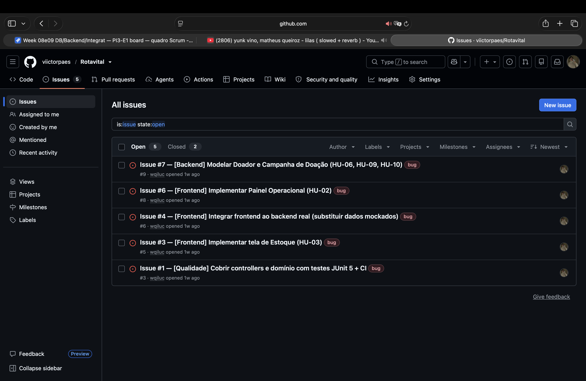
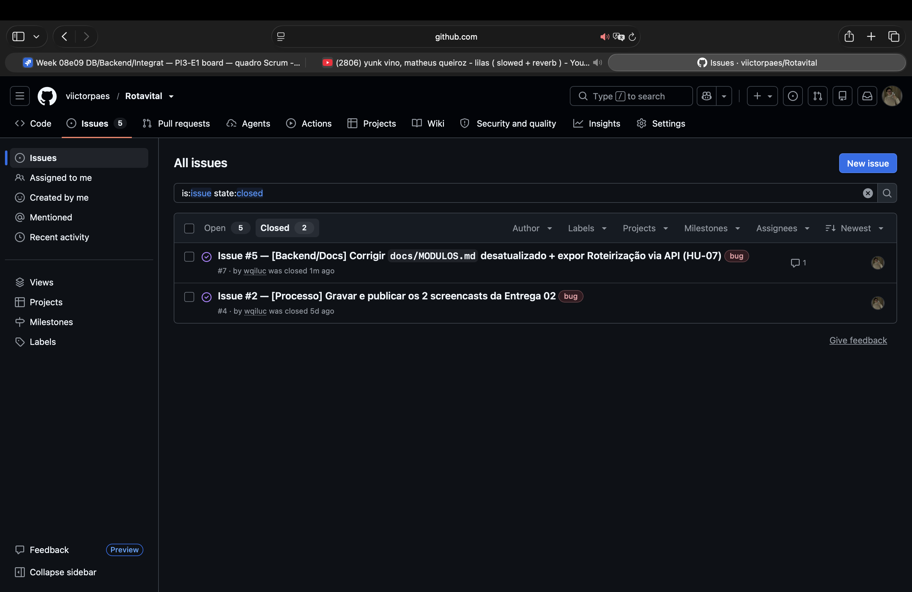
</p>

| Imagem | Título | Descrição |
| :---: | :--- | :--- |
| 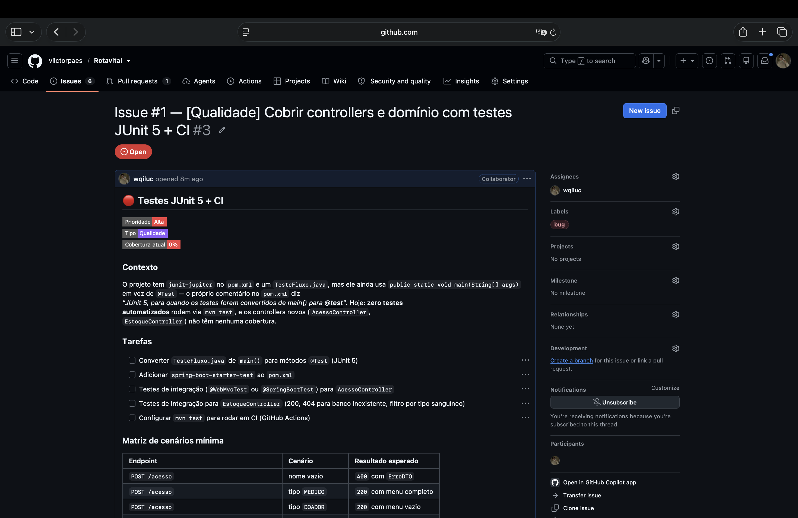 | 🔴 Issue #1 — Testes JUnit 5 + CI (contexto) | Cobertura de testes em 0%: o projeto já tem `junit-jupiter` no `pom.xml`, mas `TesteFluxo.java` ainda usa `main()` em vez de `@Test`. Tarefas para convertê-lo, adicionar `spring-boot-starter-test` e cobrir `AcessoController`/`EstoqueController`. |
| 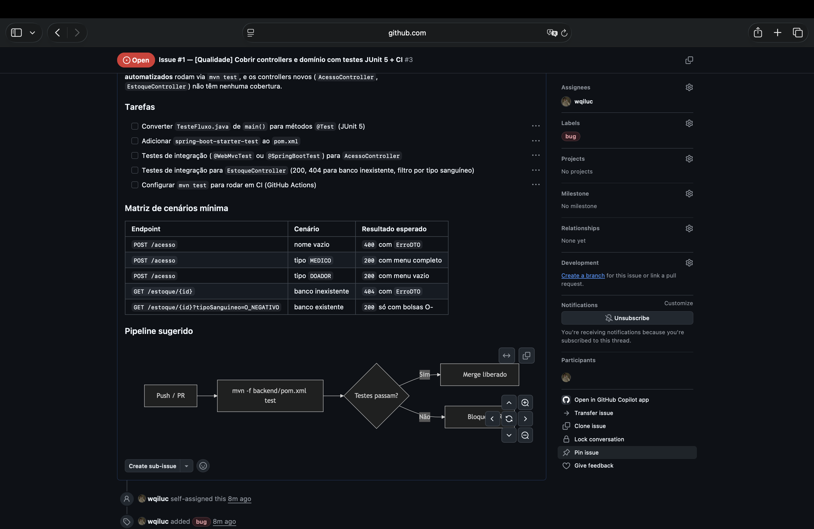 | 🔴 Issue #1 — Testes JUnit 5 + CI (cenários e pipeline) | Matriz mínima de cenários de teste por endpoint (`POST /api/v1/acessos`, `GET /api/v1/bancos/{id}/estoque`) e pipeline de CI sugerido, bloqueando o merge quando `mvn test` falha. |
| 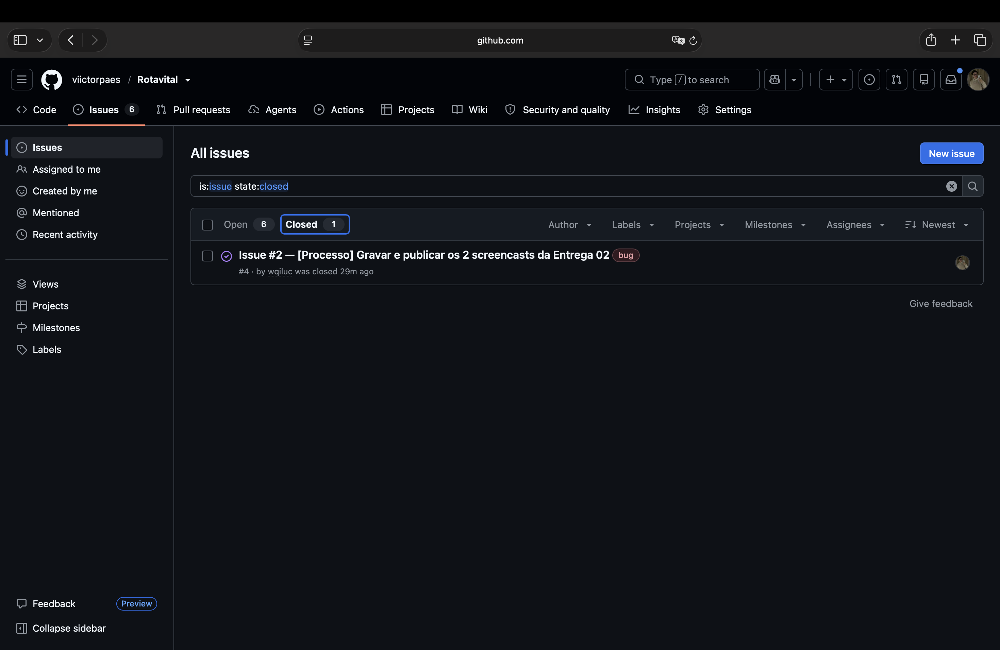 | ✅ Issue #2 — Screencasts da Entrega 02 (fechada) | Checklist para gravar e publicar os 2 vídeos exigidos nesta entrega (uso do sistema rodando e explicação do código) concluído; vídeos publicados no YouTube e issue fechada no GitHub. |
| 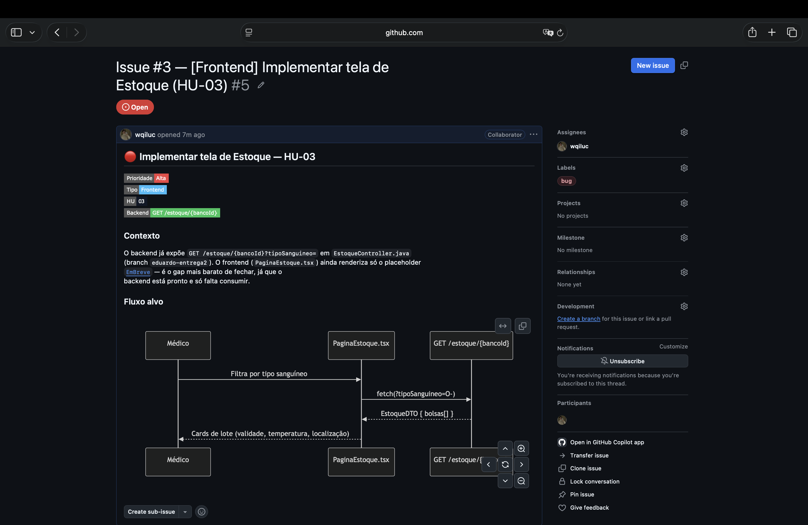 | 🔴 Issue #3 — Implementar tela de Estoque (HU‑03) | O backend já expõe `GET /api/v1/bancos/{bancoId}/estoque?tipoSanguineo=`; falta a `PaginaEstoque.tsx` sair do placeholder `EmBreve` e consumir esse endpoint de verdade. |
| 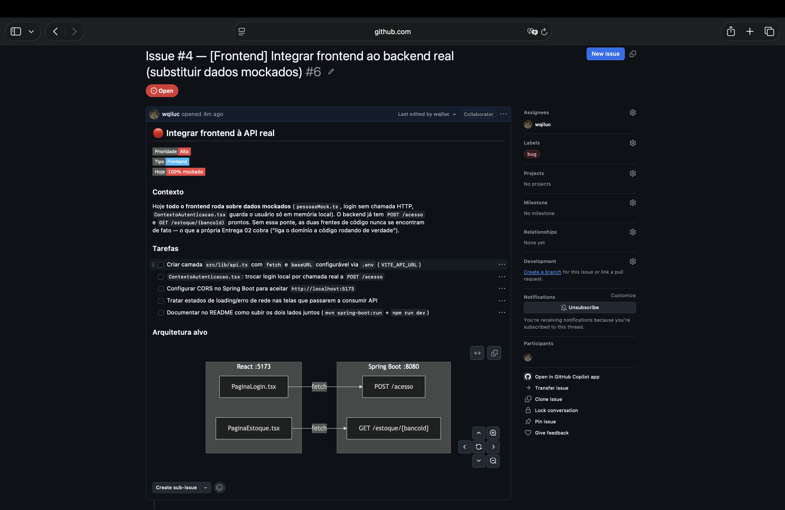 | 🔴 Issue #4 — Integrar frontend ao backend real | Hoje o frontend roda 100% sobre dados mockados (`pessoasMock.ts`, login só em memória). Plano para criar uma camada `api.ts`, trocar login/estoque por chamadas HTTP reais e configurar CORS no Spring Boot. |
| 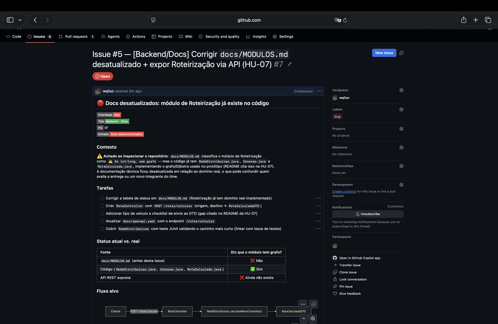 | ✅ Issue #5 — Docs desatualizados sobre Roteirização (fechada) | `docs/MODULOS.md` classifica o módulo de Roteirização como "só lat/long, sem grafo", mas o código já implementa o grafo/Dijkstra (`RedeDistribuicao`, `Conexao`, `RotaCalculada`) usado no protótipo. |
| 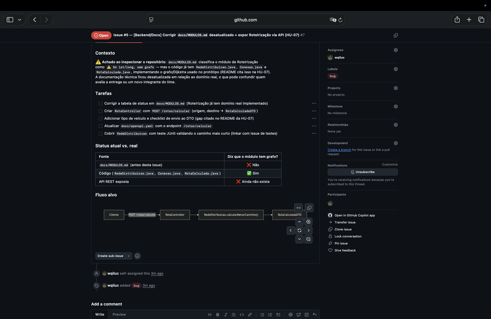 | ✅ Issue #5 — Docs desatualizados sobre Roteirização (resolução) | Resolvida com o novo `RotaController`, que expõe `GET /api/v1/pontos`, `GET /api/v1/conexoes` e `GET /api/v1/rotas?origemId=&destinoId=` (o `POST /rotas/calcular` proposto virou consulta `GET` idempotente), e com o `docs/MODULOS.md` marcando o módulo como implementado (grafo + Dijkstra). |
| 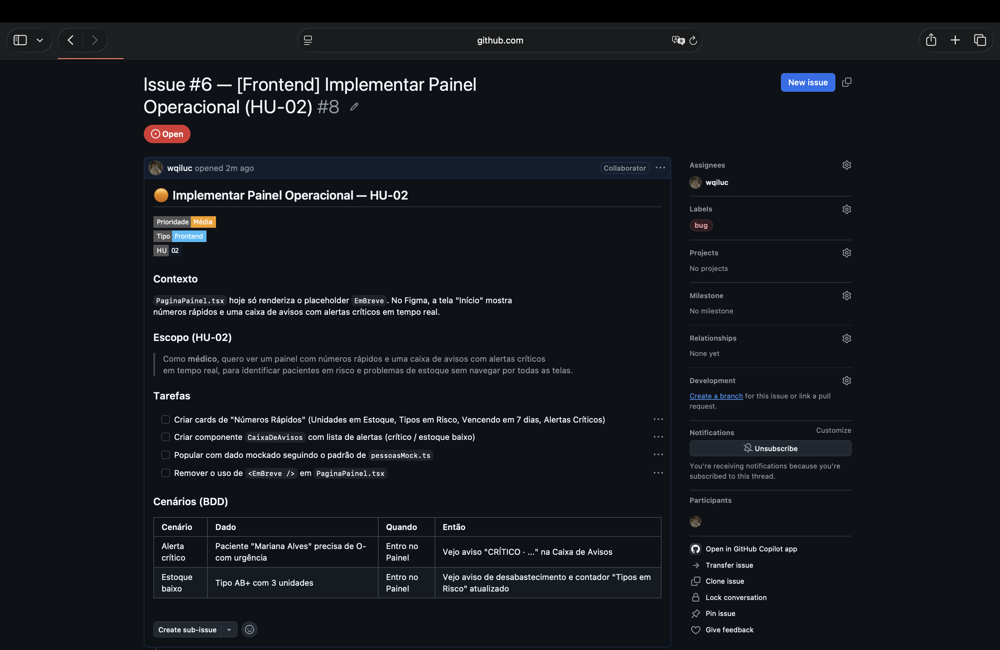 | 🟠 Issue #6 — Implementar Painel Operacional (HU‑02) | Escopo e cenários BDD para tirar a `PaginaPainel.tsx` do placeholder `EmBreve` e implementar os cards de "Números Rápidos" e a caixa de avisos com alertas críticos. |
| 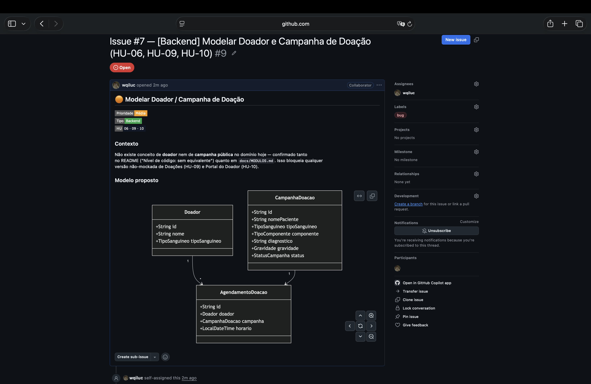 | 🟠 Issue #7 — Modelar Doador e Campanha de Doação | Diagrama de classes proposto (`Doador`, `CampanhaDoacao`, `AgendamentoDoacao`) — hoje não existe conceito de doador nem de campanha pública no domínio, o que bloqueia versões não mockadas de HU‑06, HU‑09 e HU‑10. |

<h2 align="center" id="modulos">📦 Módulos do Sistema <br>

</h2>

<p align="center">
4 módulos — Estoque, Requisições e Alocação, Roteirização e Telemetria — catalogados em detalhe, com
endpoints, classes de domínio e tabelas do banco, em <a href="./docs/MODULOS.md"><code>docs/MODULOS.md</code></a>.
</p>

| Módulo | Endpoints implementados | Domínio | Status |
| :--- | :--- | :--- | :---: |
| 📦 Estoque e Hemocomponentes | `GET /api/v1/bancos/{bancoId}/estoque` · `/resumo` · `/sugestao-lote` · `/alertas`, `GET`/`PATCH /api/v1/hemocomponentes/{id}` | `Estoque`, `BolsaHemocomponente`, `CompatibilidadeSanguinea`, `AlertaDeEstoque` | ⚠️ Parcial |
| 🏥 Requisições e Alocação | — (só contrato) | `Hospital`, `RequisicaoHospitalar` | ⚠️ Sem controller |
| 🚚 Roteirização e Logística | `GET /api/v1/pontos`, `/conexoes`, `/rotas` | `RedeDistribuicao` (grafo + Dijkstra), `Conexao`, `RotaCalculada` | ✅ Implementado |
| 🌡️ Telemetria e Cadeia Fria | — (só contrato + tabelas) | *(nenhuma)* | ⚠️ Gap de domínio |
| 🔑 Acesso (HU‑01) | `POST /api/v1/acessos` | *(fora do domínio)* | ✅ Implementado |
| 📊 Benchmarks (paralelismo) | `GET`/`POST /api/v1/benchmarks/auditoria-telemetria` | `com.rotavital.benchmark` | ✅ Implementado |

<h2 align="center" id="arquitetura">🏰 Arquitetura do Projeto <br>

</h2>
<pre>
Rotavital🩸/
├── backend   /
│   ├── pom.xml 
│   ├── Dockerfile 
│   ├── .dockerignore 
│   ├── .env.example 
│   ├── .gitignore 
│   └── src /
│       ├── main /
│       │   ├── resources /
│       │   │   └── application.properties 
│       │   └── java/com/rotavital /
│       │       ├── RotaVitalApplication.java 
│       │       ├── api /
│       │       │   ├── AlertasDoEstoqueController.java  
│       │       │   ├── AcessoController.java  
│       │       │   ├── EstoqueController.java   
│       │       │   ├── MovimentacaoDeBolsaController.java  
│       │       │   ├── RotaController.java  
│       │       │   ├── SugestaoDeLoteController.java  
│       │       │   ├── TratadorDeErros.java 
│       │       │   └── dto /
│       │       │       ├── acesso /
│       │       │       │   ├── AcessoDTO.java 
│       │       │       │   ├── NovoAcessoRequest.java 
│       │       │       │   └── TipoAcesso.java 
│       │       │       ├── comum /
│       │       │       │   └── ErroDTO.java 
│       │       │       ├── estoque /
│       │       │       │   ├── AlertaDTO.java 
│       │       │       │   ├── AlertasDoEstoqueDTO.java 
│       │       │       │   ├── AtualizarStatusBolsaRequest.java 
│       │       │       │   ├── BolsaHemocomponenteDTO.java 
│       │       │       │   ├── EstoqueDTO.java 
│       │       │       │   ├── NovaBolsaHemocomponenteRequest.java 
│       │       │       │   ├── ResumoEstoqueDTO.java 
│       │       │       │   ├── SugestaoDeLoteDTO.java 
│       │       │       │   ├── TotalPorComponenteDTO.java 
│       │       │       │   └── TotalPorTipoSanguineoDTO.java 
│       │       │       ├── requisicao /
│       │       │       │   ├── AlocacaoDTO.java 
│       │       │       │   ├── AtualizarStatusRequisicaoRequest.java 
│       │       │       │   ├── NivelUrgencia.java 
│       │       │       │   ├── NovaRequisicaoRequest.java 
│       │       │       │   └── RequisicaoHospitalarDTO.java 
│       │       │       ├── rota /
│       │       │       │   ├── ConexaoDTO.java 
│       │       │       │   ├── PontoRedeDTO.java 
│       │       │       │   ├── RotaCalculadaDTO.java 
│       │       │       │   └── TipoPontoRede.java 
│       │       │       └── telemetria /
│       │       │           ├── LeituraTelemetriaDTO.java 
│       │       │           ├── MonitoramentoEntregaDTO.java 
│       │       │           └── RegistrarTelemetriaRequest.java 
│       │       ├── benchmark /
│       │       │   ├── controller /
│       │       │   │   └── BenchmarkController.java 
│       │       │   ├── dto /
│       │       │   │   ├── BenchmarkRequest.java 
│       │       │   │   ├── BenchmarkResponse.java 
│       │       │   │   └── ItemExecucaoDTO.java 
│       │       │   ├── model /
│       │       │   │   ├── RegistroTelemetria.java 
│       │       │   │   └── ResultadoAuditoria.java 
│       │       │   └── service /
│       │       │       └── AuditoriaTelemetriaService.java 
│       │       ├── config /
│       │       │   ├── CorsConfig.java 
│       │       │   ├── RelogioConfig.java 
│       │       │   └── HttpLoggingFilter.java 
│       │       ├── diagnostico /
│       │       │   ├── DiagnosticoController.java 
│       │       │   ├── DiagnosticoResponse.java 
│       │       │   ├── LogHttpItem.java 
│       │       │   └── LogHttpService.java 
│       │       ├── dominio /
│       │       │   ├── PontoDeRede.java 
│       │       │   ├── PontoDeRedeBase.java 
│       │       │   ├── AlertaDeEstoque.java  
│       │       │   ├── CompatibilidadeSanguinea.java  
│       │       │   ├── MovimentacaoInvalidaException.java 
│       │       │   ├── Endereco.java 
│       │       │   ├── Hospital.java 
│       │       │   ├── BancoDeSangue.java 
│       │       │   ├── Estoque.java  
│       │       │   ├── BolsaHemocomponente.java 
│       │       │   ├── RequisicaoHospitalar.java  
│       │       │   ├── RedeDistribuicao.java  
│       │       │   ├── Conexao.java 
│       │       │   ├── RotaCalculada.java 
│       │       │   ├── FilaRequisicoesHospitalares.java  
│       │       │   ├── PilhaOperacoes.java  
│       │       │   ├── TipoComponente.java 
│       │       │   ├── TipoSanguineo.java 
│       │       │   ├── StatusBolsa.java 
│       │       │   └── StatusRequisicao.java 
│       │       ├── repositorio /
│       │       │   ├── BancoDeSangueRepository.java 
│       │       │   ├── BolsaHemocomponenteRepository.java 
│       │       │   ├── ConexaoRepository.java 
│       │       │   ├── PontoDeRedeRepository.java 
│       │       │   └── ResumoEstoqueRepository.java 
│       │       └── servico /
│       │           ├── AlertasDoEstoqueService.java 
│       │           ├── DadosInvalidosException.java 
│       │           ├── EstoqueService.java 
│       │           ├── MovimentacaoDeBolsaService.java 
│       │           ├── RecursoNaoEncontradoException.java 
│       │           ├── RedeDistribuicaoService.java 
│       │           ├── RegraDeNegocioException.java 
│       │           ├── ResumoEstoqueService.java 
│       │           └── SugestaoDeLoteService.java 
│       └── test   /
│           ├── resources/features /
│           │   ├── hu02_alertas_do_painel.feature
│           │   ├── hu03_estoque_por_tipo.feature
│           │   ├── hu04_sugestao_de_lote.feature
│           │   └── hu08_baixa_da_bolsa.feature
│           └── java/com/rotavital/
│           ├── aceitacao /
│           │   ├── AceitacaoIT.java 
│           │   └── Passos*.java · Vocabulario.java 
│           ├── integracao /
│           │   ├── EstoqueIT.java · BaixaDaBolsaIT.java 
│           │   └── PostgresDeTeste.java · RelogioDeTeste.java · DadosDeTeste.java
│           ├── api /
│           │   └── ErrosDoEstoqueTest.java 
│           ├── benchmark /
│           │   └── AuditoriaTelemetriaTest.java 
│           ├── dominio /
│           │   ├── AlertasDoEstoqueTest.java 
│           │   ├── BolsaHemocomponenteTest.java 
│           │   ├── CompatibilidadeSanguineaTest.java 
│           │   ├── MovimentacaoDaBolsaTest.java 
│           │   ├── SugestaoDeLoteTest.java 
│           │   ├── EstoqueTest.java 
│           │   ├── FilaRequisicoesHospitalaresTest.java 
│           │   ├── PilhaOperacoesTest.java 
│           │   ├── PontoDeRedeTest.java 
│           │   ├── RedeDistribuicaoTest.java 
│           │   └── TesteFluxoTest.java 
│           └── servico /
│               ├── EstoqueServiceTest.java 
│               ├── RedeDistribuicaoServiceTest.java 
│               ├── RepositorioFalso.java 
│               ├── ResumoEstoqueServiceTest.java 
│               └── ValidacaoNovaBolsaTest.java 
│
├── c  /
│   ├── Makefile 
│   ├── README.md 
│   ├── rotavital_tipos.h 
│   ├── rotavital_tipos.c 
│   ├── lista_estoque.h 
│   ├── lista_estoque.c 
│   ├── fila_requisicoes.h 
│   ├── fila_requisicoes.c 
│   ├── pilha_operacoes.h 
│   ├── pilha_operacoes.c 
│   └── main.c 
│
├── frontend    /
│   ├── Dockerfile 
│   ├── .dockerignore 
│   ├── .env.example 
│   ├── nginx/default.conf.template 
│   ├── vercel.json 
│   ├── .gitignore 
│   ├── index.html 
│   ├── package.json 
│   ├── vite.config.ts 
│   ├── tailwind.config.ts 
│   ├── postcss.config.js 
│   ├── eslint.config.js 
│   ├── tsconfig.json 
│   ├── tsconfig.node.json 
│   └── src /
│       ├── main.tsx 
│       ├── App.tsx 
│       ├── index.css 
│       ├── vite-env.d.ts 
│       ├── routes /
│       │   └── index.tsx 
│       ├── context /
│       │   ├── ContextoAutenticacao.tsx  
│       │   ├── ContextoDados.tsx 
│       │   └── ContextoNotificacao.tsx 
│       ├── components /
│       │   ├── layout /
│       │   │   ├── LayoutPrincipal.tsx 
│       │   │   └── BarraLateral.tsx 
│       │   ├── painel  /
│       │   │   ├── CartaoIndicador.tsx 
│       │   │   ├── CaixaAvisos.tsx 
│       │   │   └── AcoesRapidas.tsx 
│       │   ├── estoque  /
│       │   │   ├── CartaoLote.tsx 
│       │   │   ├── FiltroTipoEstoque.tsx 
│       │   │   ├── ModalNovaBolsa.tsx 
│       │   │   ├── PaginacaoEstoque.tsx 
│       │   │   └── SeletorFiltro.tsx 
│       │   ├── requisicao  /
│       │   │   ├── FormularioRequisicao.tsx 
│       │   │   ├── ListaRecebimentos.tsx 
│       │   │   ├── FormularioCampanha.tsx 
│       │   │   ├── SeletorUrgencia.tsx 
│       │   │   └── CampoFormulario.tsx 
│       │   ├── rede  /
│       │   │   ├── MapaRede.tsx 
│       │   │   ├── ListaHospitais.tsx 
│       │   │   ├── PlanoTransporte.tsx 
│       │   │   └── PrioridadeEnvio.tsx 
│       │   ├── pacientes  /
│       │   │   ├── CartaoPaciente.tsx 
│       │   │   └── ModalConcluirProcedimento.tsx 
│       │   ├── donations  /
│       │   │   ├── CartaoPessoa.tsx 
│       │   │   ├── FiltroTipoSanguineo.tsx 
│       │   │   └── ModalAgendarDoacao.tsx 
│       │   └── ui /
│       │       ├── SeloTipoSanguineo.tsx 
│       │       ├── PontoStatus.tsx 
│       │       └── EmBreve.tsx 
│       ├── pages /
│       │   ├── Admin /
│       │   │   └── PaginaAdmin.tsx  
│       │   ├── Login /
│       │   │   └── PaginaLogin.tsx  
│       │   ├── PainelOperacional /
│       │   │   └── PaginaPainel.tsx  
│       │   ├── Estoque /
│       │   │   └── PaginaEstoque.tsx   
│       │   ├── Requisicao /
│       │   │   └── PaginaRequisicao.tsx  
│       │   ├── RedeHospitalar /
│       │   │   └── PaginaRede.tsx  
│       │   ├── Pacientes /
│       │   │   └── PaginaPacientes.tsx  
│       │   ├── Doacoes /
│       │   │   └── PaginaDoacoes.tsx  
│       │   └── PortalDoador /
│       │       └── PaginaPortalDoador.tsx  
│       ├── data /
│       │   ├── estoqueMock.ts 
│       │   ├── pessoasMock.ts 
│       │   ├── redeMock.ts 
│       │   └── requisicoesMock.ts 
│       ├── hooks /
│       │   └── useRotasDaRede.ts  
│       ├── lib /
│       │   ├── estoque.ts 
│       │   ├── painel.ts 
│       │   ├── pacientes.ts 
│       │   ├── rede.ts 
│       │   ├── requisicao.ts 
│       │   ├── roteirizacao.ts 
│       │   └── utilitarios.ts 
│       ├── services /
│       │   ├── clienteHttp.ts 
│       │   └── api.ts 
│       └── types /
│           ├── dtos.ts 
│           └── index.ts 
│
├── docs /
│   ├── DOCUMENTACAO.md 
│   ├── MODELO_DE_DOMINIO.md 
│   ├── CONTRATOS_DE_API.md 
│   ├── openapi.yaml 
│   ├── MODULOS.md 
│   ├── DER.md 
│   ├── PERFIS_DE_ACESSO.md 
│   ├── SUPABASE.md 
│   ├── LIGACOES_E_REDES.md 
│   ├── INVENTARIO_COMPONENTES.md 
│   ├── DIAGRAMA_ROTAVITAL.md 
│   ├── arquitetura-rotavital-paes-silva.drawio 
│   ├── arquitetura-rotavital-paes-silva.png 
│   ├── REDES_SUBREDES_ROTAVITAL.svg 
│   ├── MONTAGEM_PDF_FINAL.md 
│   ├── RELATORIO_ATIVIDADE_PARALELISMO.md 
│   ├── TRADUCAO_C_JAVA_AV1.md 
│   └── evidencias /
│       ├── PI3-14_endpoints_rest.md 
│       ├── PI3-182_perfis_de_acesso.md 
│       ├── PI3-182 /
│       ├── drawio(fluxo).png 
│       └── drawio_atualizado.png 
│
├── pdf /
│   ├── arquitetura-rotavital-paes-silva.pdf 
│   └── Entrega-Projetos-3-ADS-RSD.pdf 
│
├── supabase  /
│   ├── img /
│   ├── migrations /
│   │   ├── 20260924120000_schema_inicial.sql 
│   │   ├── 20260924120100_constraints_integridade.sql 
│   │   ├── 20260925120000_ajustes_schema_existente.sql 
│   │   ├── 20260925120100_escopo_clinico.sql 
│   │   └── 20260925120200_views_painel.sql 
│   └── seed.sql 
│
├── db /
│   ├── Dockerfile 
│   └── 00_rotavital.sh 
│
├── .github /
│   ├── workflows/esteira.yml 
│   └── scripts 
│
├── img /
├── compose.yaml 
├── .env.example 
├── render.yaml 
├── package-lock.json 
├── .gitignore 
├── LICENSE 
├── RotaVital.fig 
└── README.md 
</pre>

> [!NOTE]
> **Backend:** Spring Boot 3.3 (Java 21) com 8 controllers — `AcessoController`, `EstoqueController`,
> `RotaController`, `BenchmarkController`, `DiagnosticoController` (`GET /api/v1/diagnostico`, usado pela tela
> de admin) e os três que nasceram por TDD no [Desafio do PI](#container-tdd-deploy): `SugestaoDeLoteController`
> (HU‑04), `AlertasDoEstoqueController` (HU‑02) e `MovimentacaoDeBolsaController` (HU‑08). Os controllers de domínio leem do **banco (Supabase)** via JPA: bolsas pelo `EstoqueService`,
> totais do estoque pelo `ResumoEstoqueService` (views do painel) e rede/rotas pelo `RedeDistribuicaoService`;
> não há mais dados fixos em memória. Os erros saem no formato RFC 7807 pelo `TratadorDeErros`, com a
> explicação no `detail` (dado inválido → 400, recurso inexistente → 404, regra de negócio → 422). O CORS fica em
> `config/CorsConfig` e o `HttpLoggingFilter` registra cada requisição HTTP. Requisições e Telemetria têm
> contrato em `openapi.yaml`, mas nenhum controller. O domínio também tem `FilaRequisicoesHospitalares` (FIFO)
> e `PilhaOperacoes` (LIFO), as versões Java das estruturas do módulo em C.
>
> **Frontend:** as 10 histórias da Entrega 01 (**HU‑01** a **HU‑10**) têm tela em React. O **Estoque (HU‑03)**, com filtros e
> paginação em `GET /hemocomponentes` e cadastro de bolsa em `POST /hemocomponentes`, e a tela de **Admin** já consomem a API `/api/v1` por `src/services/api.ts` (cliente em `clienteHttp.ts`, erros
> exibidos pelo `ContextoNotificacao`); as demais telas e o login continuam sobre dados **mockados**
> (`src/data/*Mock.ts` + `ContextoDados`). A roteirização da HU‑07 consulta o OSRM público e cai nos valores
> mockados se ele não responder. O restante da integração segue na Issue #4.
>
> **Estruturas de dados em C (AV1):** `c/` reimplementa em C99 a lista encadeada do estoque, a fila FIFO de
> requisições e a pilha LIFO do histórico de operações, com alocação manual (`malloc`/`free`) e testes com
> `assert()` em `main.c` (`make run`), sem vazamento de memória. Estruturas, testes e como compilar em
> [`c/README.md`](./c/README.md); a tradução comentada C ↔ Java está em
> [`docs/TRADUCAO_C_JAVA_AV1.md`](./docs/TRADUCAO_C_JAVA_AV1.md).
>
> **Banco:** Supabase (PostgreSQL), conectado pelo Session Pooler (`application.properties`, senha em
> `backend/.env`). As 5 migrations em `supabase/migrations/` criam **14 tabelas e 2 views**, com PKs, FKs,
> constraints de integridade, gatilhos e RLS ligado. DER e catálogo de constraints em
> [`docs/DER.md`](./docs/DER.md); conexão, variáveis, RLS e prints em [`docs/SUPABASE.md`](./docs/SUPABASE.md).

<h2 align="center" id="supabase">🟢 Banco de Dados — Supabase <br>


<br>

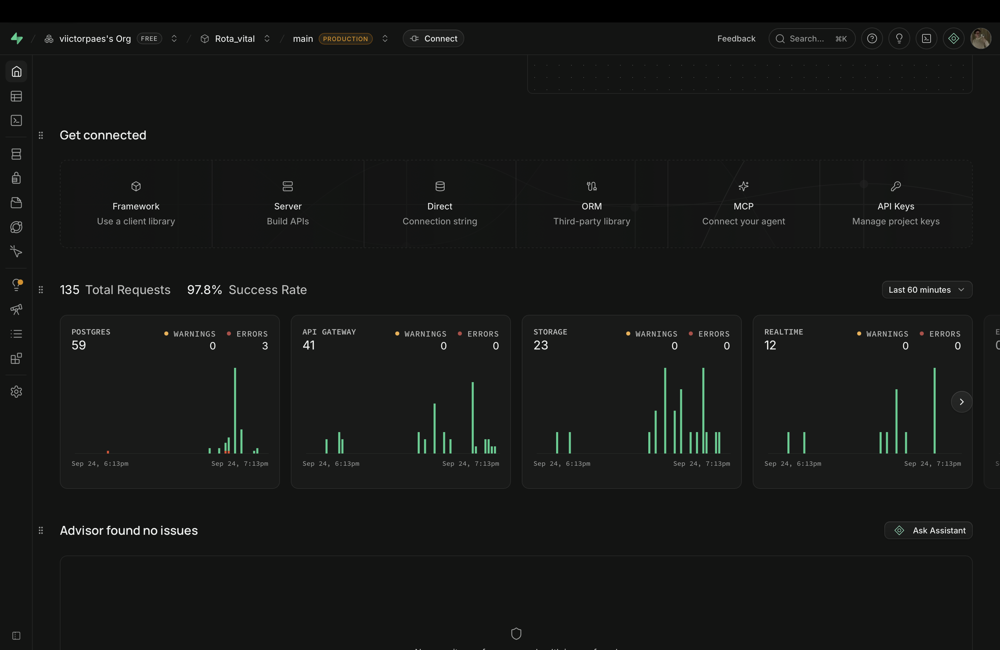
</h2>

<p align="center">
A persistência do Rota Vital fica no <b>Supabase</b> (PostgreSQL gerenciado). O backend é o único cliente do
banco; o frontend consome só a API <code>/api/v1</code>. Detalhamento completo em
<a href="./docs/SUPABASE.md"><code>docs/SUPABASE.md</code></a> e DER em
<a href="./docs/DER.md"><code>docs/DER.md</code></a>.
</p>

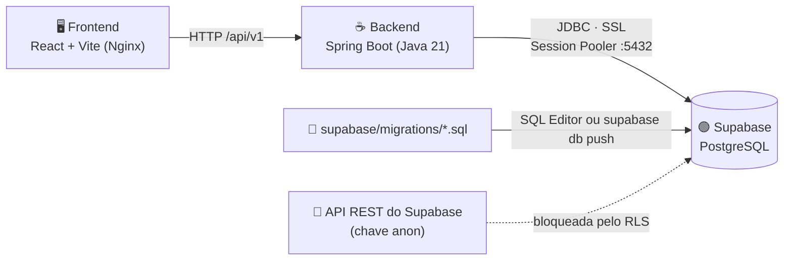

| Item | Valor |
| :--- | :--- |
| 🆔 Project ref | `gilyfswvezmvtmlxgvrd` |
| 🌍 URL do projeto | `https://gilyfswvezmvtmlxgvrd.supabase.co` |
| 📍 Região | AWS `us-east-2` (Ohio) |
| 🐘 Banco | PostgreSQL, database `postgres`, schema `public` |
| 🔌 Pooler | `aws-0-us-east-2.pooler.supabase.com:5432` (Session mode, IPv4) |

<details>
<summary>▶️🔌 <b>Conexão do backend</b> (<code>application.properties</code>)</summary>

```properties
spring.datasource.url=jdbc:postgresql://aws-0-us-east-2.pooler.supabase.com:5432/postgres?sslmode=require
spring.datasource.username=postgres.gilyfswvezmvtmlxgvrd
spring.datasource.password=${SUPABASE_DB_PASSWORD}
spring.datasource.driver-class-name=org.postgresql.Driver
spring.jpa.hibernate.ddl-auto=validate
```

- `sslmode=require` 🔒 — o Supabase só aceita conexões criptografadas.
- Session Pooler em vez da conexão direta — a direta é só IPv6; o pooler aceita IPv4 (rede da faculdade e Docker).
- `ddl-auto=validate` ✅ — o Hibernate só confere se as `@Entity` batem com as tabelas e nunca altera o banco: o schema vem só das migrations. Se algo não bater, a aplicação não sobe.
</details>

<details>
<summary>▶️🔑 <b>Variáveis de ambiente</b> (<code>backend/.env</code>)</summary>

Copie [`backend/.env.example`](./backend/.env.example) para `backend/.env` (já está no `.gitignore`) e preencha:

| Variável | Uso | Pode ir para o Git? |
| :--- | :--- | :---: |
| `SUPABASE_DB_PASSWORD` | Senha do banco (JDBC; no Render, variável secreta do serviço) | ❌ |
| `SUPABASE_URL` | URL pública do projeto (API REST/Auth); opcional, já tem o valor do projeto como padrão | ✅ |
| `SUPABASE_KEY` | Chave publicável (`sb_publishable_…` ou a `anon` antiga), usada pelo login no Supabase Auth (PI3-183). Sem ela, `POST /acessos` responde `503` | ⚠️ só a publicável/`anon` |

> [!WARNING]
> A chave **`service_role`** ignora o RLS e dá acesso total ao banco — nunca vai para `.env.example`, commit ou frontend.
</details>

<details>
<summary>▶️🗂️ <b>Tabelas e migrations</b></summary>

| Tabela | Classe de domínio | PK |
| :--- | :--- | :--- |
| 📍 `ponto_rede` | `Hospital`, `BancoDeSangue` (+ `Endereco`) | `id` (text, ex.: `BS-01`) |
| 🛣️ `conexao` | `Conexao` | `id` (identity) |
| 🩸 `bolsa_hemocomponente` | `BolsaHemocomponente` | `id` (text, ex.: `CH-1042`) |
| 🏥 `requisicao_hospitalar` | `RequisicaoHospitalar` | `id` (uuid) |
| 🔗 `alocacao` | `AlocacaoDTO` | `id` (uuid) |
| 🚑 `entrega` | `MonitoramentoEntregaDTO` | `id` (uuid) |
| 🌡️ `leitura_telemetria` | `LeituraTelemetriaDTO` | `id` (identity) |
| 👤 `usuario` | — (HU‑01, HU‑10) | `id` (uuid) |
| 🩺 `paciente` | — (HU‑02, HU‑09) | `id` (uuid) |
| 📥 `remessa` | — (HU‑05) | `id` (uuid) |
| 📣 `campanha_doacao` | — (HU‑06) | `id` (uuid) |
| 📅 `agendamento_doacao` | — (HU‑09, HU‑10) | `id` (uuid) |
| ✅ `procedimento` · `procedimento_bolsa` | — (HU‑08) | `id` (uuid) |
| 👁️ `vw_estoque_por_tipo` · `vw_estoque_agrupado` | views do Painel/Estoque (HU‑02, HU‑03) | — |

> As 7 tabelas novas da migration `escopo_clinico` ainda não têm classe de domínio nem `@Entity` no backend —
> modelam as telas que hoje só existem no frontend mockado. Detalhe coluna a coluna em [`docs/DER.md`](./docs/DER.md#4-dicionario).

| # | Migration | O que faz |
| :---: | :--- | :--- |
| 1️⃣ | [`20260924120000_schema_inicial.sql`](./supabase/migrations/20260924120000_schema_inicial.sql) | Cria as 7 tabelas, PKs, FKs e índices, e liga o RLS |
| 2️⃣ | [`20260924120100_constraints_integridade.sql`](./supabase/migrations/20260924120100_constraints_integridade.sql) | NOT NULL, DEFAULT, UNIQUE, 33 CHECK, 7 FKs compostas e o gatilho `trg_alocacao_validar` |
| 3️⃣ | [`20260925120000_ajustes_schema_existente.sql`](./supabase/migrations/20260925120000_ajustes_schema_existente.sql) | Colunas novas em `ponto_rede`, `bolsa_hemocomponente`, `requisicao_hospitalar` e `alocacao`, status `UTILIZADA`, alocação ativa única por bolsa e gatilho genérico de `atualizado_em` |
| 4️⃣ | [`20260925120100_escopo_clinico.sql`](./supabase/migrations/20260925120100_escopo_clinico.sql) | Cria as 7 tabelas do escopo clínico (`usuario`, `paciente`, `remessa`, `campanha_doacao`, `agendamento_doacao`, `procedimento`, `procedimento_bolsa`) |
| 5️⃣ | [`20260925120200_views_painel.sql`](./supabase/migrations/20260925120200_views_painel.sql) | Cria as views `vw_estoque_por_tipo` e `vw_estoque_agrupado` usadas pelo Painel e pelo Estoque |

> ⚠️ Os prints abaixo foram tirados depois das duas primeiras migrations (7 tabelas); as migrations 3 a 5 ainda não têm print.
</details>

<details>
<summary>▶️🛡️ <b>Row Level Security (RLS)</b></summary>

| Acesso | Role | Resultado hoje |
| :--- | :--- | :--- |
| ☕ Backend (JDBC) | `postgres` | ✅ lê e escreve (ignora RLS) |
| 🌐 API REST com chave `anon` | `anon` | 🚫 bloqueado (RLS ligado, sem políticas) |
| 👤 Usuário logado via Supabase Auth | `authenticated` | 🚫 bloqueado até existirem políticas |
</details>

<details>
<summary>▶️🚀 <b>Como aplicar as migrations</b></summary>

**Opção A — SQL Editor:** abrir o projeto → **SQL Editor** → rodar as 5 migrations em ordem (pelo prefixo de data) → rodar `supabase/seed.sql` para carregar os dados de exemplo → conferir em **Table Editor**.

**Opção B — Supabase CLI:**

```bash
npx supabase login
npx supabase link --project-ref gilyfswvezmvtmlxgvrd
npx supabase db push
```

> O `db push` aplica só as migrations. A carga inicial ([`supabase/seed.sql`](./supabase/seed.sql)) é rodada pelo
> **SQL Editor**; o script é idempotente e pode ser executado mais de uma vez sem duplicar dados.
</details>

<details>
<summary>▶️📸 <b>Prints do Supabase</b></summary>

| Tabelas | Colunas de `bolsa_hemocomponente` |
| :---: | :---: |
|  | 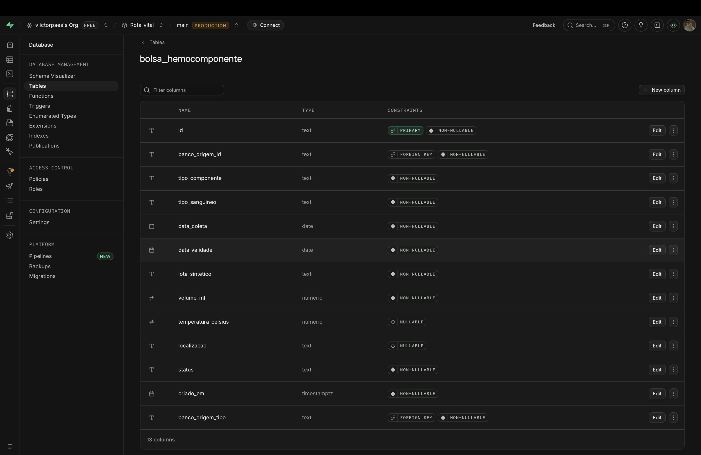 |
| **Schema Visualizer** | **Migrations** |
| 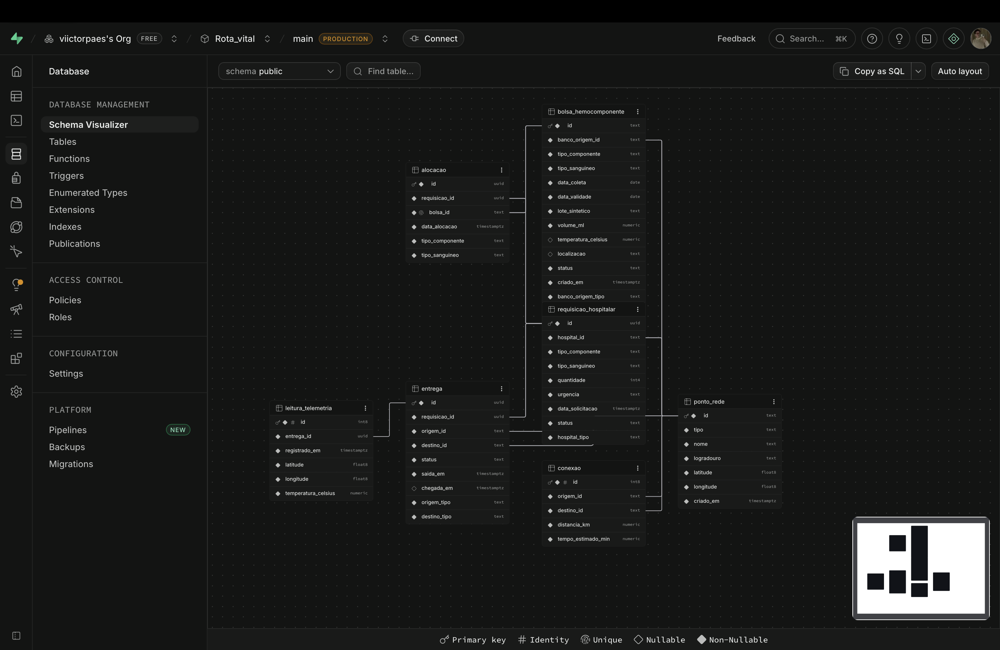 | 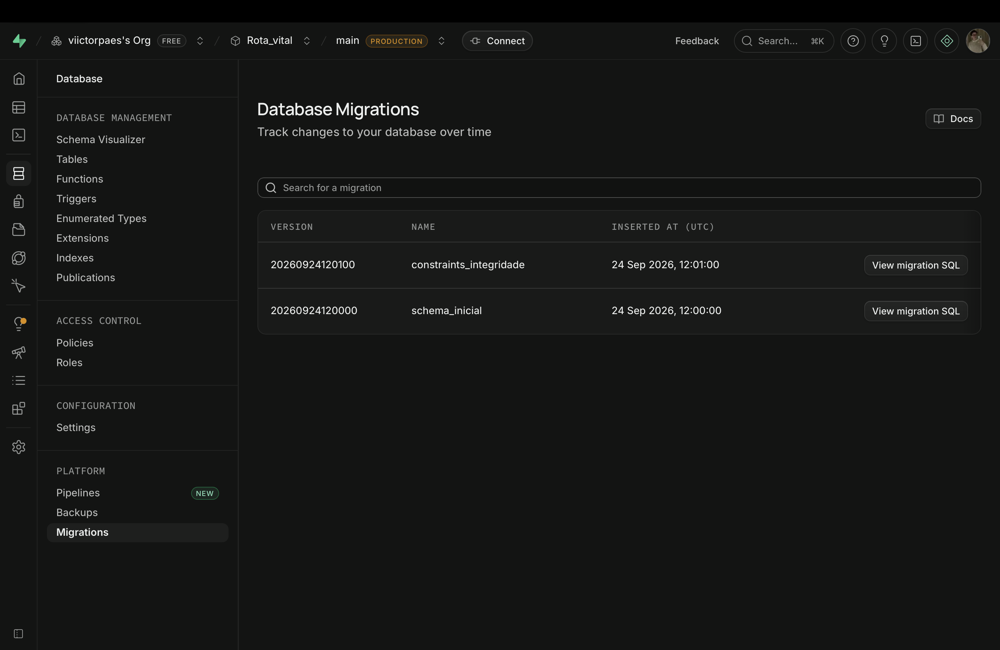 |
| **Logs do Postgres** | **Projeto** |
| 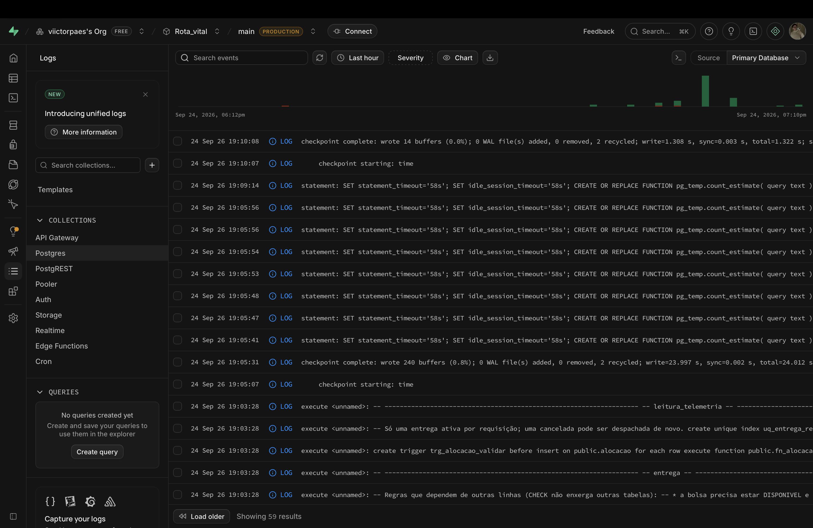 |  |
</details>

<h2 align="center" id="como-executar">🚀 Como Executar <br>

</h2>

**Pré-requisitos:** Java 21+, Maven 3.9+, Node.js 20+ e (opcional) Docker.

```bash
git clone https://github.com/viictorpaes/Rotavital.git
cd Rotavital
cp backend/.env.example backend/.env   # e preencha SUPABASE_DB_PASSWORD
```

<details>
<summary>🪟 <b>Windows (PowerShell)</b></summary>

```powershell
git clone https://github.com/viictorpaes/Rotavital.git
cd Rotavital
Copy-Item backend\.env.example backend\.env   # e preencha SUPABASE_DB_PASSWORD
```
</details>

**Backend** (Spring Boot, a partir de `Rotavital/`):

```bash
cd backend
mvn clean package              # compila, roda os testes JUnit e gera target/rotavital-backend-0.1.0-SNAPSHOT.jar
mvn spring-boot:run            # ou: java -jar target/rotavital-backend-0.1.0-SNAPSHOT.jar
```

<details>
<summary>🪟 <b>Windows (PowerShell)</b></summary>

```powershell
cd backend
mvn clean package
mvn spring-boot:run            # ou: java -jar target\rotavital-backend-0.1.0-SNAPSHOT.jar
```
</details>

> O `RotaVitalApplication` procura e carrega o `backend/.env` sozinho ao subir (variáveis já exportadas no
> ambiente têm prioridade) e imprime "✅ CONECTADO AO BANCO DE DADOS COM SUCESSO!" (com a URL do banco) quando o banco responde.
>
> A API sobe em `http://localhost:8080/api/v1`:
>
> | Método | Endpoint | Exemplo |
> | :--- | :--- | :--- |
> | `POST` | `/api/v1/acessos` | `curl -X POST localhost:8080/api/v1/acessos -H 'Content-Type: application/json' -d '{"nome":"Dra. Ana","tipoAcesso":"MEDICO"}'` |
> | `GET` | `/api/v1/bancos/{bancoId}/estoque?tipoSanguineo=` | `curl localhost:8080/api/v1/bancos/BS-01/estoque` |
> | `GET` | `/api/v1/bancos/{bancoId}/sugestao-lote?tipoComponente=&tipoSanguineo=&quantidade=` (HU‑04) | `curl "localhost:8080/api/v1/bancos/BS-01/sugestao-lote?tipoComponente=HEMACIAS&tipoSanguineo=A_NEGATIVO&quantidade=2"` |
> | `GET` | `/api/v1/bancos/{bancoId}/alertas` (HU‑02) | `curl localhost:8080/api/v1/bancos/BS-01/alertas` |
> | `PATCH` | `/api/v1/hemocomponentes/{id}` (HU‑08) | `curl -X PATCH localhost:8080/api/v1/hemocomponentes/CH-1042 -H 'Content-Type: application/json' -d '{"status":"RESERVADA"}'` |
> | `GET` | `/actuator/health` · `/actuator/info` | `curl localhost:8080/actuator/health` |
> | `GET` | `/api/v1/pontos` · `/api/v1/conexoes` | `curl localhost:8080/api/v1/pontos` |
> | `GET` | `/api/v1/rotas?origemId=&destinoId=` | `curl "localhost:8080/api/v1/rotas?origemId=BS-01&destinoId=HOSP-01"` |
> | `GET`/`POST` | `/api/v1/benchmarks/auditoria-telemetria` | `curl "localhost:8080/api/v1/benchmarks/auditoria-telemetria?tamanho=100000&modo=TODOS"` |

| Comando (em `backend/`) | Descrição |
| :--- | :--- |
| `mvn compile` | Só compila o código de `src/main/java` |
| `mvn test` | Compila e roda os testes unitários (JUnit 5): domínio e serviços, sem banco de dados (repositórios falsos) |
| `mvn verify` | Unitários + integração e aceitação (`*IT`, Cucumber) contra um Postgres 17 do Testcontainers — precisa de Docker ([detalhes](#cdt-testes)) |
| `mvn clean package` | Compila, testa e gera o `.jar` executável em `target/` |
| `mvn spring-boot:run` | Sobe a API (precisa do `backend/.env` com `SUPABASE_DB_PASSWORD`) |

**Fluxo de demonstração do domínio** (`TesteFluxo`: cria banco de sangue, popula estoque, abre requisição e
aloca por FEFO/ABO-Rh):

```bash
cd backend
mvn test-compile
java -cp target/classes:target/test-classes com.rotavital.dominio.TesteFluxo
```

<details>
<summary>🪟 <b>Windows (PowerShell)</b></summary>

No Windows o separador do classpath é `;` em vez de `:`:

```powershell
cd backend
mvn test-compile
java -cp "target/classes;target/test-classes" com.rotavital.dominio.TesteFluxo
```
</details>

<h2 align="center" id="como-executar-frontend">🖥️ Como Executar o Frontend <br>


</h2>

<p align="center">
Interface em <b>React + TypeScript + Vite + Tailwind CSS</b>, com as 10 telas do protótipo (HU‑01 a HU‑10)
rodando sobre dados mockados — ainda sem chamar a API do backend.
</p>

```bash
cd frontend        # a partir de Rotavital/
npm install
npm run dev
```

> O servidor de desenvolvimento sobe em `http://localhost:5173`.

| Comando | Descrição |
| :--- | :--- |
| `npm run dev` | Inicia o servidor de desenvolvimento, com hot reload |
| `npm run build` | Roda a checagem de tipos (`tsc -b`) e gera o build de produção em `frontend/dist` |
| `npm run preview` | Serve localmente o build de produção gerado por `npm run build` |
| `npm run lint` | Roda o ESLint sobre o código do frontend |

<h4 align="center"> 🚢🐳 Com Docker (banco + backend + frontend, sem instalar nada além do Docker) <br>
</h4>

<p align="center">
O <a href="./compose.yaml"><code>compose.yaml</code></a> na raiz sobe o sistema inteiro do zero: um Postgres 17 local
(com as migrations e o seed do Supabase), o backend Spring Boot e o frontend servido pelo Nginx. A senha do banco
local vem do <code>.env</code> da raiz (copiado de <a href="./.env.example"><code>.env.example</code></a>).
Passo a passo, healthchecks e evidências em <a href="#cdt-como-rodar">Desafio do PI › Como rodar</a>.
</p>

```bash
# a partir de Rotavital/
cp .env.example .env            # uma vez (e troque DB_PASSWORD)
docker compose up -d --build    # db → backend → frontend, cada um depois do healthcheck do anterior
docker compose logs -f backend  # acompanha os logs do Spring Boot
docker compose down             # derruba os containers (os dados ficam no volume)
```

> Frontend em `http://localhost` e backend em `http://localhost:8080`. O Nginx do frontend repassa
> `/api/` para o container do backend (`frontend/nginx/default.conf.template`), então no Docker a API também
> responde em `http://localhost/api/v1`.

<h2 align="center" id="figma-vs-real">🖼️ Figma × Sistema Real <br>
 vs 
</h2>

<p align="center">
Comparação lado a lado entre o protótipo do Figma e a mesma tela no sistema rodando de verdade
(frontend React em <code>localhost:5173</code> + backend Spring Boot ligado ao Supabase), cobrindo
HU‑01, HU‑02, HU‑03, HU‑04/05/06, HU‑07, HU‑08, HU‑09, HU‑10 e a tela de Admin.
Prints tirados com Playwright (Chromium headless, janela 1440×900): Painel, Estoque, Portal do Doador e
Admin vêm das <a href="./docs/evidencias/PI3-182_perfis_de_acesso.md">evidências do PI3-182</a>
(10/10/2026), e as demais telas foram capturadas do mesmo jeito em 11/10/2026.
</p>

<p align="center">
<sub>O Estoque e os números de estoque do Painel já vêm do Supabase; as demais telas ainda usam os dados de
exemplo do frontend (ver a nota da <a href="#arquitetura">Arquitetura</a>).</sub>
</p>

<h4 align="left">🔐 HU‑01 — Login (e-mail e senha)</h4>

| Figma | Sistema real |
| :---: | :---: |
| 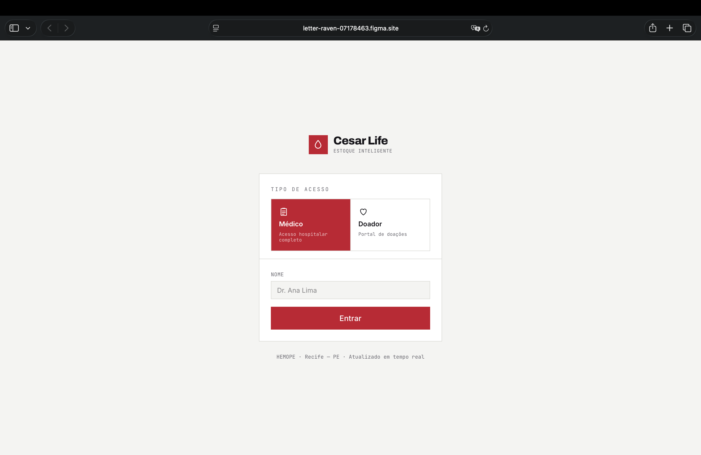 | 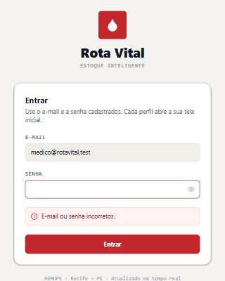 |

<sub>O Figma escolhe o perfil por cards; o sistema real pede e-mail e senha e descobre o perfil pela API
(PI3-183/184). O print mostra o aviso de senha errada (PI3-196); os cenários estão nas
<a href="./docs/evidencias/PI3-184_PI3-196_login.md">evidências da PI3-184/196</a>.</sub>

<details>
<summary>🩸 <a href="./frontend/src/pages/Login/PaginaLogin.tsx"><code>frontend/src/pages/Login/PaginaLogin.tsx</code></a></summary>

```tsx
async function handleEntrar(evento: FormEvent<HTMLFormElement>)
{
  evento.preventDefault();
  if (!email.trim() || !senha)
  {
    setAviso(AVISO_CAMPOS_VAZIOS);
    return;
  }

  setEntrando(true);
  try
  {
    const acesso = await autenticarUsuario(email.trim(), senha); // POST /api/v1/acessos
    const logado = login(acesso);
    navigate(logado.telaInicial, { replace: true });             // /painel, /portal-doador ou /admin
  }
  catch (erro)
  {
    setAviso(avisoDoErro(erro)); // 401: "E-mail ou senha incorretos." — o mesmo para senha errada e e-mail sem cadastro
    setSenha("");
    setEntrando(false);
  }
}
```
</details>

<h4 align="left">📊 HU‑02 — Painel Operacional (início)</h4>

| Figma | Sistema real |
| :---: | :---: |
| 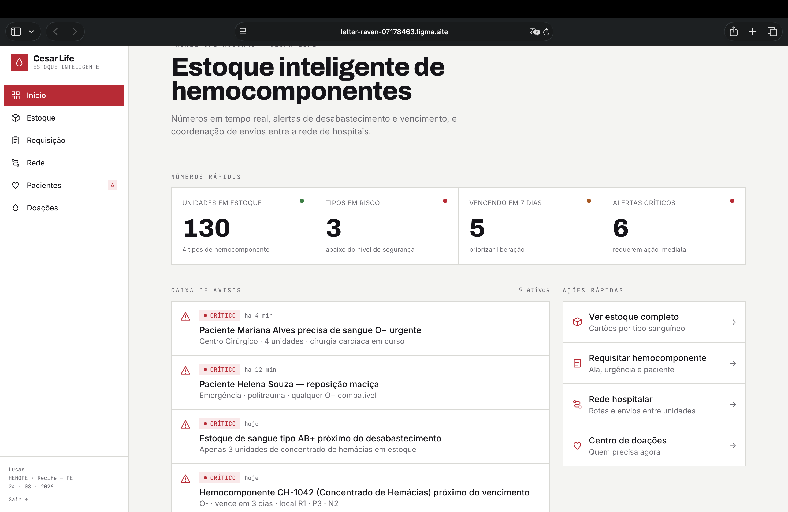 | 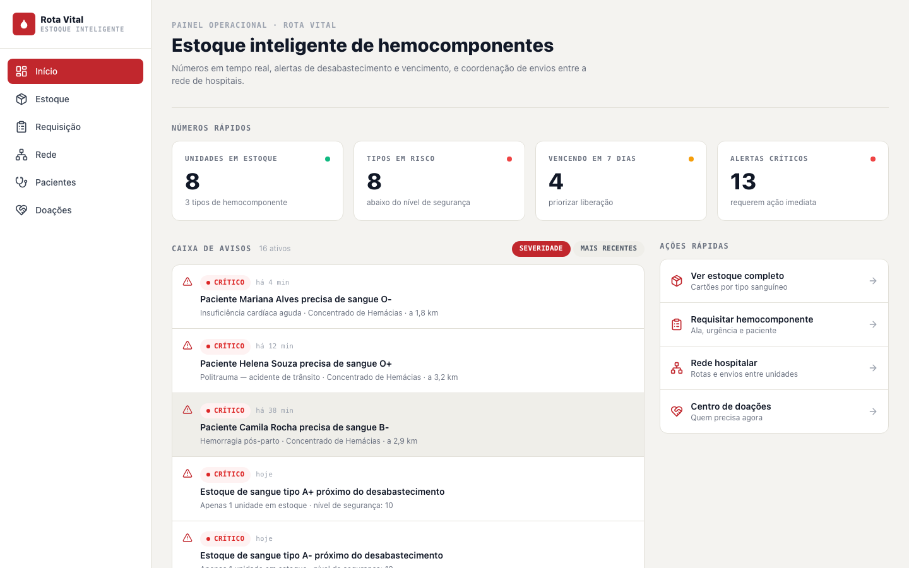 |

<details>
<summary>🩸 <a href="./frontend/src/pages/PainelOperacional/PaginaPainel.tsx"><code>frontend/src/pages/PainelOperacional/PaginaPainel.tsx</code></a></summary>

```tsx
/**
 * HU-02 — Painel operacional: números rápidos, caixa de avisos ordenável e
 * atalhos, para o médico agir sem percorrer todas as telas. Indicadores e
 * avisos derivam dos mocks de estoque e de pacientes (ver `lib/painel.ts`).
 */
export default function PaginaPainel()
{
  const { lotes, pacientes } = useDados();
  const [ordenacao, setOrdenacao] = useState<OrdenacaoAvisos>("severidade");

  const avisos = useMemo(() => montarAvisos(lotes, pacientes), [lotes, pacientes]);
  const indicadores = useMemo(() => montarIndicadores(lotes, avisos), [lotes, avisos]);
  const avisosOrdenados = useMemo(() => ordenarAvisos(avisos, ordenacao), [avisos, ordenacao]);
  // ...
}
```
</details>

<h4 align="left">📦 HU‑03 — Estoque (por tipo sanguíneo)</h4>

| Figma | Sistema real |
| :---: | :---: |
| 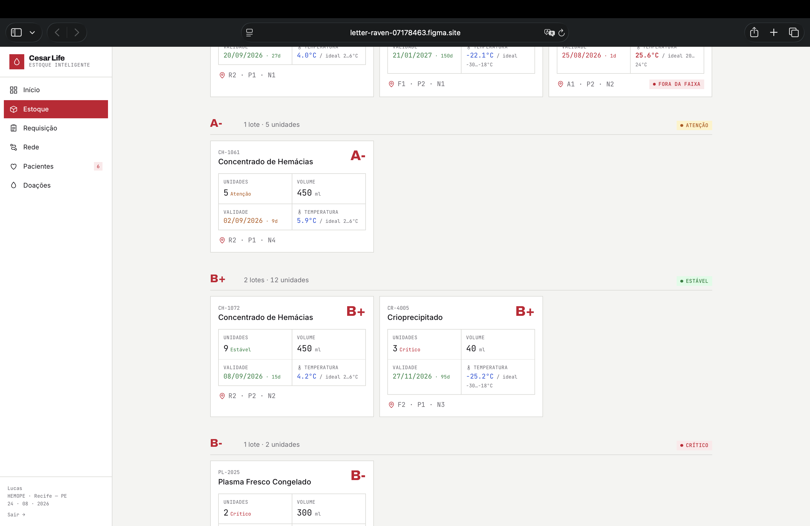 | 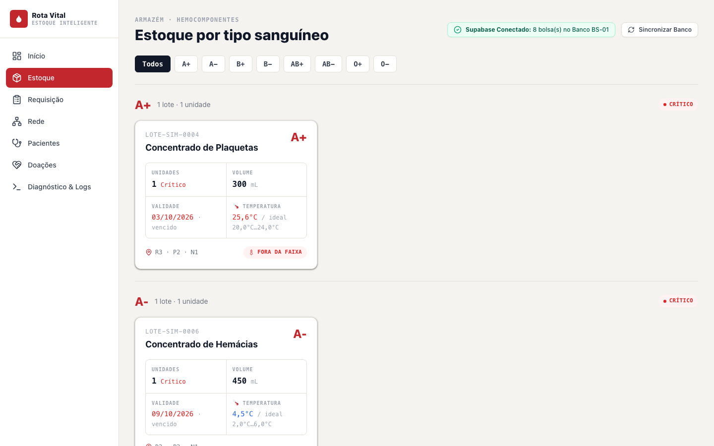 |

<sub>Print aberto pelo perfil admin, por isso o item "Diagnóstico & Logs" aparece no menu. As 8 bolsas são as do banco <code>BS-01</code> no Supabase.</sub>

<details>
<summary>🩸 <a href="./frontend/src/pages/Estoque/PaginaEstoque.tsx"><code>frontend/src/pages/Estoque/PaginaEstoque.tsx</code></a></summary>

```tsx
export default function PaginaEstoque()
{
  const [filtroTipo, setFiltroTipo] = useState<TipoSanguineo | "todos">("todos");
  const [filtroComponente, setFiltroComponente] = useState<TipoComponenteBackend | "todos">("todos");
  const [filtroStatus, setFiltroStatus] = useState<StatusBolsaBackend | "todos">("todos");
  const [pagina, setPagina] = useState(0);
  // ...

  useEffect(() =>
  {
    listarHemocomponentes({                       // GET /api/v1/hemocomponentes
      bancoId: BANCO_ID,
      tipoSanguineo: filtroTipo === "todos" ? undefined : paraTipoSanguineoBackend(filtroTipo),
      tipoComponente: filtroComponente === "todos" ? undefined : filtroComponente,
      status: filtroStatus === "todos" ? undefined : filtroStatus,
      page: pagina,
      size: TAMANHO_PAGINA,
    })
      .then((bolsas) => setLotes(bolsas.map(converterBolsaParaLote)))
      .catch((falha) => setErro(falha.message));  // mostra o erro; não troca por dados de exemplo
  }, [filtroTipo, filtroComponente, filtroStatus, pagina, recarga]);
  // ...
}
```
</details>

<details>
<summary>➕ <a href="./frontend/src/components/estoque/ModalNovaBolsa.tsx"><code>frontend/src/components/estoque/ModalNovaBolsa.tsx</code></a> — cadastro de bolsa (PI3-179)</summary>

```tsx
// noValidate no <form>: quem valida é a API, e o formulário mostra a mensagem que ela devolveu.
async function aoEnviar(evento: FormEvent<HTMLFormElement>)
{
  evento.preventDefault();
  try
  {
    const bolsa = await cadastrarHemocomponente({   // POST /api/v1/hemocomponentes
      tipoComponente: componente,
      tipoSanguineo: paraTipoSanguineoBackend(tipoSanguineo),
      dataColeta: dataColeta || null,              // em branco vai como null: a API diz qual campo falta
      dataValidade: dataValidade || null,
      loteSintetico: lote.trim(),
      volumeMl: paraNumero(volume),
      temperaturaCelsius: paraNumero(temperatura),
      localizacao: localizacao.trim() || undefined,
      bancoOrigemId: bancoId,
    });
    onCadastrada(bolsa);                           // a página fecha o modal, avisa e recarrega a lista
  }
  catch (falha: unknown)
  {
    setErro(falha instanceof ErroHttp ? falha.detalhe || falha.message : "Não foi possível conectar com o back-end. A bolsa não foi registrada.");
  }
}
```

Trocar o componente refaz as sugestões: a validade vira a coleta + o prazo máximo (hemácias 42 dias, plasma 730,
plaquetas 7, crioprecipitado 365) e a temperatura, o meio da faixa ideal. Depois do cadastro, a lista passa a filtrar
pelo tipo e componente da bolsa nova, da primeira página, para ela aparecer na tela.
</details>

<h4 align="left">📋 HU‑04/05/06 — Requisição de hemocomponente (solicitar)</h4>

| Figma | Sistema real |
| :---: | :---: |
| 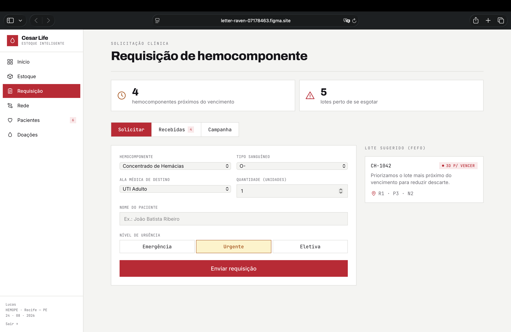 | 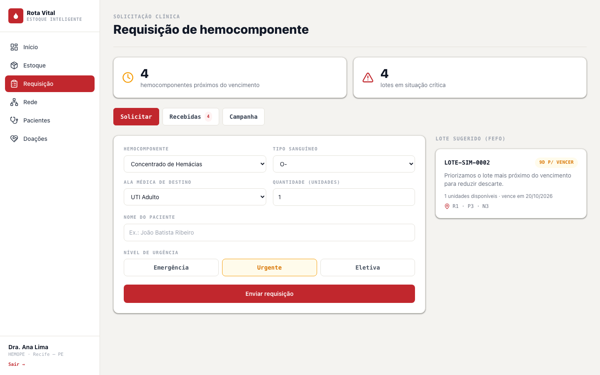 |

<h4 align="left">📋 HU‑04/05/06 — Requisição de hemocomponente (recebidas)</h4>

| Figma | Sistema real |
| :---: | :---: |
| 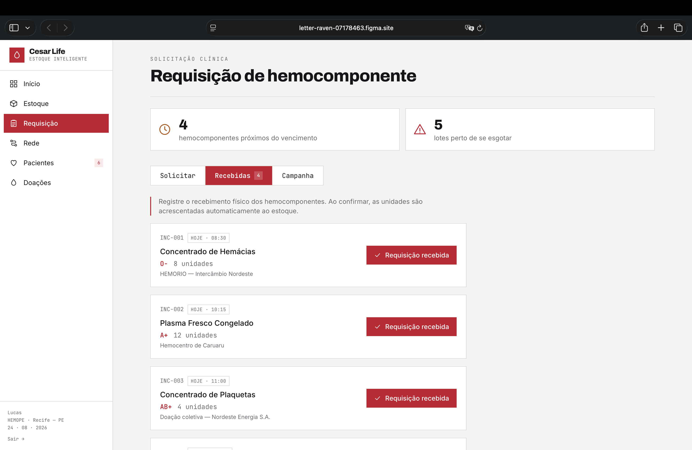 | 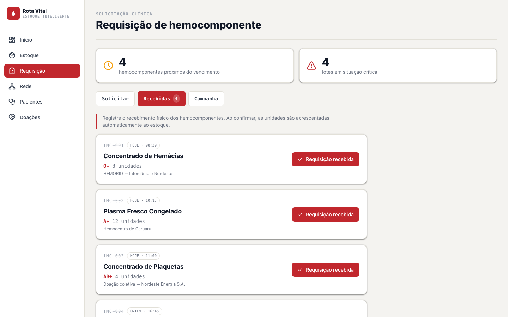 |

<h4 align="left">📋 HU‑04/05/06 — Requisição de hemocomponente (campanha)</h4>

| Figma | Sistema real |
| :---: | :---: |
| 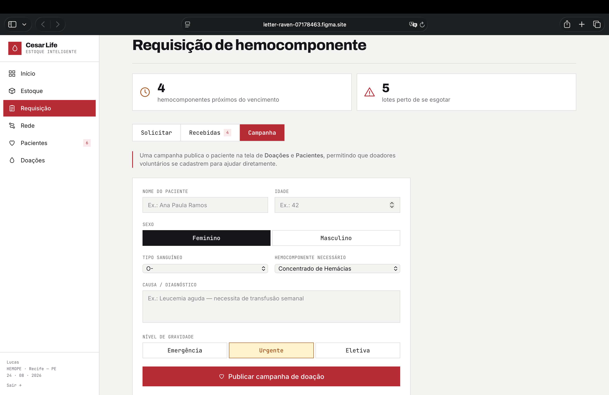 | 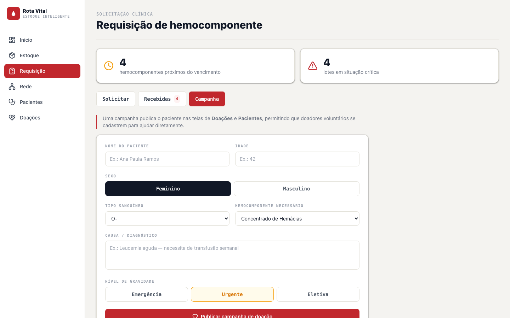 |

<details>
<summary>🩸 <a href="./frontend/src/pages/Requisicao/PaginaRequisicao.tsx"><code>frontend/src/pages/Requisicao/PaginaRequisicao.tsx</code></a></summary>

```tsx
/**
 * HU-04, HU-05 e HU-06 — Solicitação clínica em três abas: solicitar um
 * hemocomponente (com sugestão FEFO), conferir remessas recebidas e publicar
 * uma campanha de doação. Dados ainda mockados (ver `context/ContextoDados.tsx`).
 */
export default function PaginaRequisicao()
{
  const { lotes, recebimentosPendentes } = useDados();
  const [aba, setAba] = useState<Aba>("solicitar");

  const vencendo = useMemo
  (
    () => lotes.filter((lote) => diasAteVencer(lote) <= JANELA_VENCIMENTO_DIAS).length,
    [lotes],
  );
  // ...
}
```
</details>

<h4 align="left">🗺️ HU‑07 — Rede hospitalar (mapa e rota de transporte)</h4>

| Figma | Sistema real |
| :---: | :---: |
| 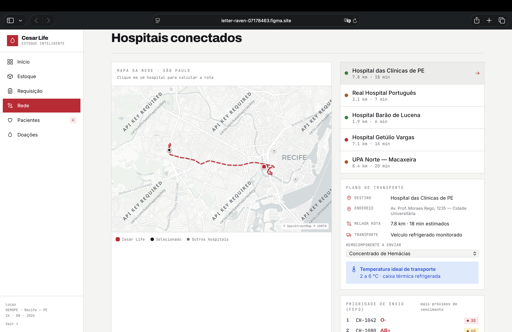 | 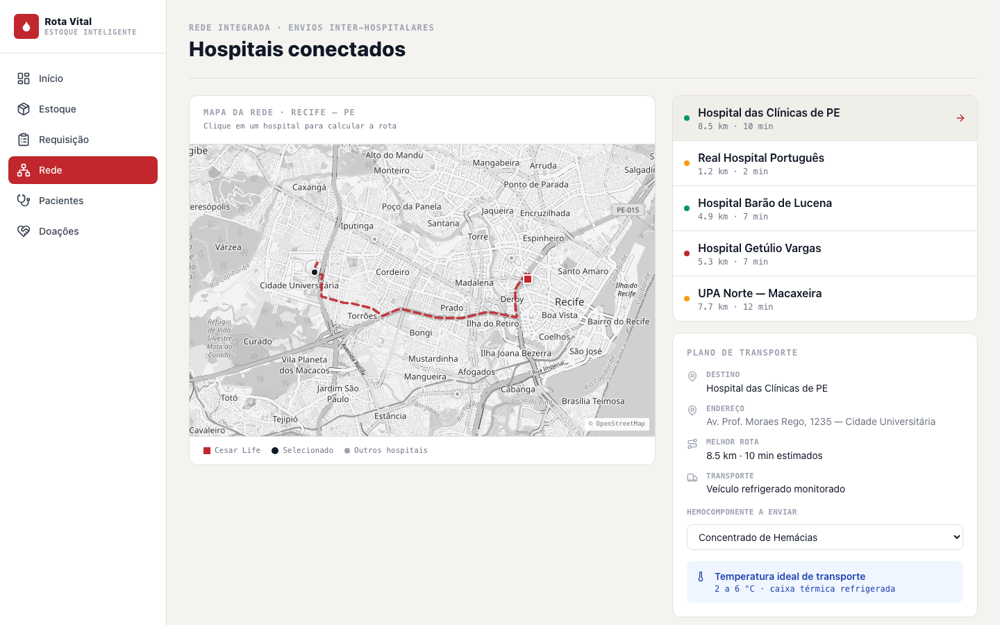 |

<details>
<summary>🩸 <a href="./frontend/src/pages/RedeHospitalar/PaginaRede.tsx"><code>frontend/src/pages/RedeHospitalar/PaginaRede.tsx</code></a></summary>

```tsx
/**
 * HU-07 — Mapa dos hospitais conectados e plano de transporte na cadeia fria.
 * Selecionar um hospital (no mapa ou na lista) recalcula a rota e o plano.
 * Dados mockados nesta primeira versão (ver `data/redeMock.ts`).
 */
export default function PaginaRede()
{
  const [selecionado, setSelecionado] = useState<PontoDeRede>(hospitais[0]);
  const [componente, setComponente] = useState<TipoComponente>("Concentrado de Hemácias");
  const { rotas, carregando } = useRotasDaRede();
  const rota = rotas[selecionado.id];
  // ...
}
```
</details>

<h4 align="left">🏥 HU‑08 — Pacientes (fila clínica)</h4>

| Figma | Sistema real |
| :---: | :---: |
| 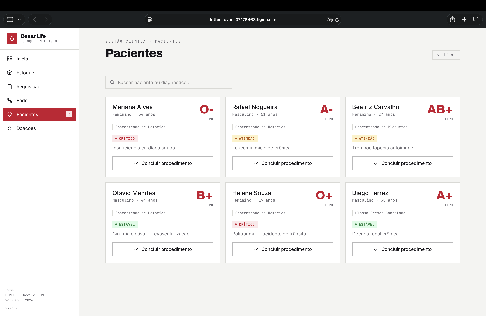 | 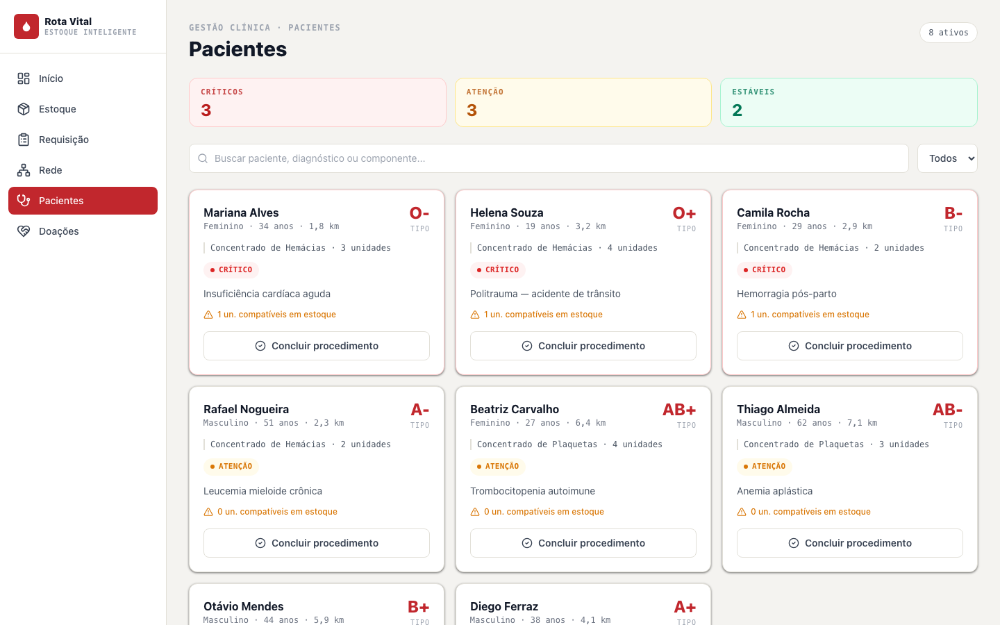 |

<h4 align="left">🏥 HU‑08 — Pacientes (concluir procedimento)</h4>

| Figma | Sistema real |
| :---: | :---: |
| 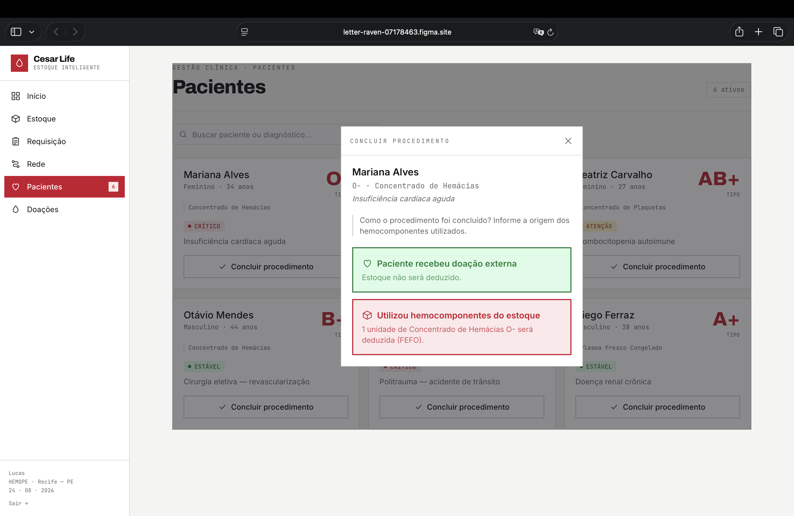 | 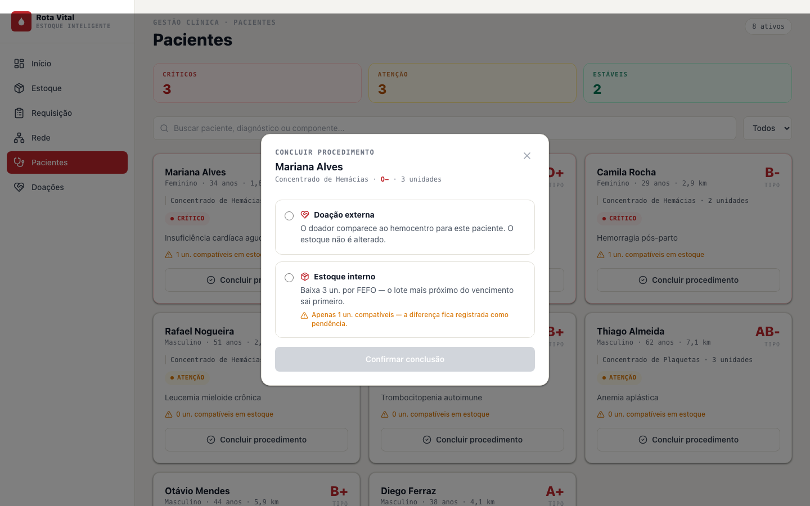 |

<details>
<summary>🩸 <a href="./frontend/src/pages/Pacientes/PaginaPacientes.tsx"><code>frontend/src/pages/Pacientes/PaginaPacientes.tsx</code></a></summary>

```tsx
/**
 * HU-08 — Fila clínica de pacientes com necessidade ativa. A conclusão do
 * procedimento tira o paciente da fila e, quando atendido pelo estoque interno,
 * baixa as unidades por FEFO.
 */
function handleConfirmar(origem: OrigemAtendimento)
{
  if (!selecionado) 
  {
    return undefined;
  }

  return concluirProcedimento(selecionado.id, origem);
}
```
</details>

<h4 align="left">❤️ HU‑09 — Doações (lista de pessoas que precisam)</h4>

| Figma | Sistema real |
| :---: | :---: |
| 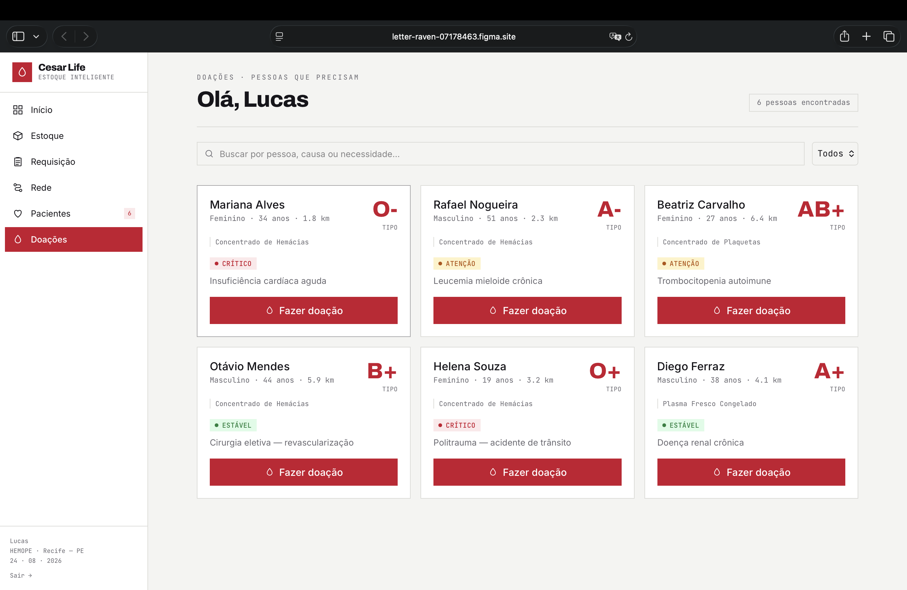 | 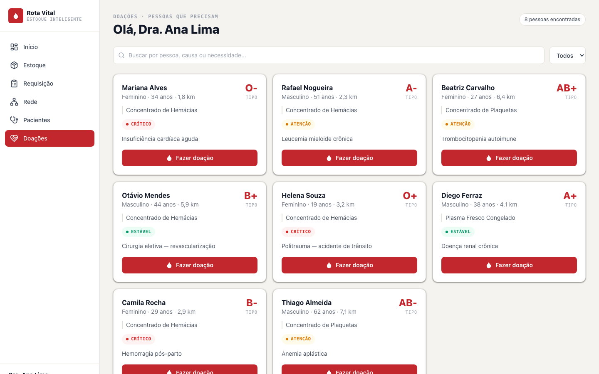 |

<details>
<summary>🩸 <a href="./frontend/src/pages/Doacoes/PaginaDoacoes.tsx"><code>frontend/src/pages/Doacoes/PaginaDoacoes.tsx</code></a></summary>

```tsx
const pessoasFiltradas = useMemo(() =>
{
  const termo = busca.trim().toLowerCase();

  return pessoasNecessitadas.filter((p) =>
  {
      const combinaTipo = filtroTipo === "todos" || p.tipoSanguineo === filtroTipo;
      const combinaBusca = 
      termo.length === 0 ||
      p.nome.toLowerCase().includes(termo) ||
      p.causa.toLowerCase().includes(termo) ||
      p.componente.toLowerCase().includes(termo);

    return combinaTipo && combinaBusca;
  });
}, [busca, filtroTipo]);
```

</details>

<h4 align="left">❤️ HU‑09 — Agende sua doação (modal)</h4>

| Figma | Sistema real |
| :---: | :---: |
| 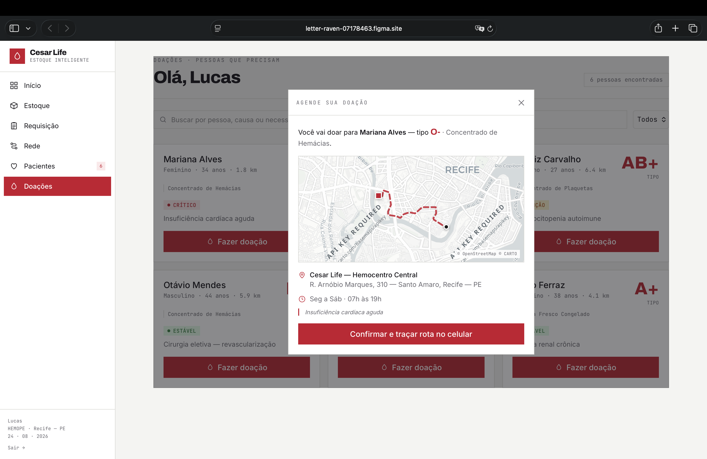 | 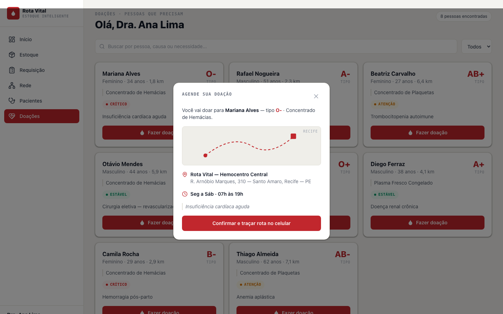 |

<details>
<summary>🩸 <a href="./frontend/src/components/donations/ModalAgendarDoacao.tsx"><code>frontend/src/components/donations/ModalAgendarDoacao.tsx</code></a></summary>

```tsx
export function ModalAgendarDoacao({ pessoa, onClose }: Readonly<Props>)
{
  const [confirmado, setConfirmado] = useState(false);
  // ...
  <button
    type="button"
    onClick={() => setConfirmado(true)}
    disabled={confirmado}
    className="w-full rounded-lg bg-rota-red px-4 py-3 text-sm font-semibold text-white transition-colors hover:bg-rota-redDark disabled:cursor-default disabled:bg-emerald-600"
  >
    {confirmado ? "Rota traçada — até logo! 👋🏻" : "Confirmar e traçar rota no celular ✅"}
  </button>
}
```
</details>

<h4 align="left">👤 HU‑10 — Portal do Doador</h4>

| Figma | Sistema real |
| :---: | :---: |
| 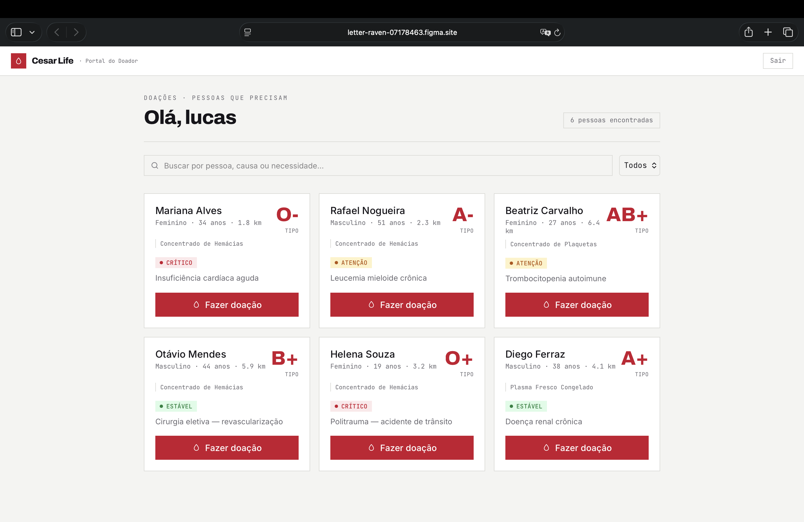 |  |

<details>
<summary>🩸 <a href="./frontend/src/pages/PortalDoador/PaginaPortalDoador.tsx"><code>frontend/src/pages/PortalDoador/PaginaPortalDoador.tsx</code></a></summary>

```tsx
export default function PaginaPortalDoador()
{
  const { usuario, logout } = useAutenticacao();
  // ...
  if (usuario?.papel !== "doador")
  {
    return <Navigate to="/login" replace />;
  }
  // ...
}
```
</details>

<h4 align="left">🛠️ Admin — Diagnóstico & Logs</h4>

| Figma | Sistema real |
| :---: | :---: |
| *(tela criada depois do protótipo)* | 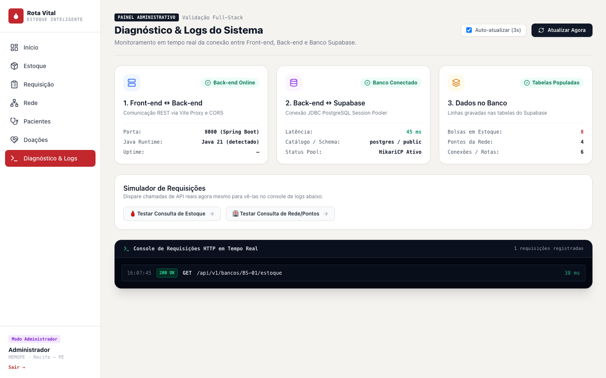 |

<sub>Mostra a conexão frontend ↔ backend ↔ Supabase e as últimas requisições HTTP. Só o perfil admin abre esta tela (<a href="./docs/PERFIS_DE_ACESSO.md">PI3-182</a>).</sub>


<h2 align="center" id="documentacao">📚 Documentação <br>

</h2>

<p align="center">
Índice completo dos documentos técnicos em <a href="./docs/DOCUMENTACAO.md"><code>docs/DOCUMENTACAO.md</code></a>.
</p>

| Documento | Descrição |
| :--- | :--- |
| 🧬 [`MODELO_DE_DOMINIO.md`](./docs/MODELO_DE_DOMINIO.md) | Classes do domínio (POO), grafo e Dijkstra |
| 🌐 [`CONTRATOS_DE_API.md`](./docs/CONTRATOS_DE_API.md) | Endpoints por módulo, padrões e erros |
| 📄 [`openapi.yaml`](./docs/openapi.yaml) | Contrato OpenAPI 3.0.3 |
| 📦 [`MODULOS.md`](./docs/MODULOS.md) | Contrato × domínio × banco, por módulo |
| 🗄️ [`DER.md`](./docs/DER.md) | 14 tabelas, 2 views e constraints |
| 🟢 [`SUPABASE.md`](./docs/SUPABASE.md) | Conexão, `.env`, RLS e prints |
| 🔌 [`LIGACOES_E_REDES.md`](./docs/LIGACOES_E_REDES.md) | Ligações e sub-redes (RSD) |
| 🗺️ [`DIAGRAMA_ROTAVITAL.md`](./docs/DIAGRAMA_ROTAVITAL.md) | Diagrama de arquitetura (draw.io) |
| 🧩 [`INVENTARIO_COMPONENTES.md`](./docs/INVENTARIO_COMPONENTES.md) | Componentes ativos × planejados |
| ⚙️ [`RELATORIO_ATIVIDADE_PARALELISMO.md`](./docs/RELATORIO_ATIVIDADE_PARALELISMO.md) | Auditoria sequencial × paralela (Atividade - Infraestrutura de Software (SO)) |
| 🧾 [`evidencias/`](./docs/evidencias/) | Chamadas reais aos endpoints |
| 📕 [`arquitetura-rotavital-paes-silva.pdf`](./pdf/arquitetura-rotavital-paes-silva.pdf) | PDF final entregue - Atividade de Infraestrutura de Redes (RSD) |
| 🗺️ [`arquitetura-rotavital-paes-silva.drawio`](./docs/arquitetura-rotavital-paes-silva.drawio) | Arquivo-fonte do diagrama entregue junto com o PDF (RSD) |

<h2 align="center" id="container-tdd-deploy">🐳🧪🚀 Desafio do PI — Container, TDD e Deploy automatizados <br>

</h2>

<p align="center">
Unidade 2 de <b>Infraestrutura de Software</b> (2026.2), com os mesmos <a href="#integrantes">integrantes</a> do PI.
A pergunta do desafio: <i>"se um colega clonar o repositório amanhã, ele consegue rodar, testar e publicar o sistema
sem pedir ajuda a ninguém?"</i>
</p>

| Entrega | Resumo | Status |
| :--- | :--- | :---: |
| 🐳 [**E1 · Container**](#cdt-como-rodar) | `docker compose up -d --build` sobe banco + API + site; o Dockerfile roda os testes antes de gerar a imagem | ✅ |
| 🧪 [**E2 · TDD**](#cdt-testes) | 3 histórias, 13 tarefas, 9 pares `test:` 🔴 → `feat:` 🟢; 208 unitários, 7 de integração e 13 cenários Gherkin | ✅ |
| 🚀 [**E3 · Deploy**](#cdt-pipeline) | GitHub Actions: testes → imagem → deploy (API no Render, site na Vercel), só na `main` e só com tudo verde | ⏳ falta ligar as contas |

> [!IMPORTANT]
> Falta o que só quem tem acesso às contas consegue fazer: proteger a `main`, criar a API no Render e o site na Vercel,
> cadastrar os segredos e colher as evidências. O passo a passo está em [Configuração única](#cdt-configuracao).

<p align="center">
<b>Seções pedidas no enunciado:</b>
<a href="#integrantes">Integrantes</a> ·
<a href="#cdt-como-rodar">Como rodar</a> ·
<a href="#cdt-testes">Testes</a> ·
<a href="#cdt-pipeline">Pipeline e deploy</a> ·
<a href="#cdt-decisoes">Decisões</a> ·
<a href="#cdt-ia">Uso de IA</a> ·
<a href="#cdt-jornada">Jornada TDD</a>
</p>

<h3 align="center" id="cdt-como-rodar">▶️ Como rodar — E1 · Container automatizado</h3>

Só precisa de **Git** e **Docker**. Java, Maven, Node e Postgres ficam dentro dos containers.

```bash
git clone https://github.com/viictorpaes/Rotavital.git && cd Rotavital
cp .env.example .env            # no Windows: Copy-Item .env.example .env — depois troque DB_PASSWORD
docker compose up -d --build    # compila, roda os testes e sobe db → backend → frontend
docker compose ps               # os três precisam aparecer como (healthy)
```

| Serviço | O que é | Healthcheck · só sobe depois de | Endereço |
| :--- | :--- | :--- | :--- |
| 🐘 `db` | Postgres 17 com as migrations de `supabase/migrations` e o seed ([`db/`](./db/)), dados no volume `dados-postgres` | `pg_isready` | só na rede interna |
| ☕ `backend` | API Spring Boot ([`backend/Dockerfile`](./backend/Dockerfile), 2 estágios) | `/actuator/health` = `UP` (inclui o banco) · `db` | `localhost:8080` |
| 🖥️ `frontend` | React no Nginx, com proxy `/api/` → `backend` ([`frontend/Dockerfile`](./frontend/Dockerfile)) | `GET /` · `backend` | `localhost` |

`docker compose down` mantém os dados no volume; `docker compose down -v` apaga, e a próxima subida recria o banco com o seed.

> [!NOTE]
> O Compose usa um Postgres próprio, então sobe sem a senha do Supabase e sem internet; em produção a API usa o
> Supabase. Por isso o **login**, que confere a senha no Supabase Auth, responde `503` no Compose: localmente se testa a API.

<details>
<summary>📸 <b>Evidências do E1</b> — saídas reais do terminal (macOS + Docker Desktop 29.7)</summary>

```text
# 18/10/2026, volume novo, com a main mesclada: o 1º estágio do Dockerfile roda os testes
#24 15.05 [INFO] Tests run: 208, Failures: 0, Errors: 0, Skipped: 0
#24 15.40 [INFO] BUILD SUCCESS

# 14/10/2026
$ docker compose ps
SERVICE    IMAGE                      STATUS                    PORTS
backend    rotavital-backend:local    Up 27 seconds (healthy)   0.0.0.0:8080->8080/tcp
db         rotavital-db:local         Up 32 seconds (healthy)   5432/tcp
frontend   rotavital-frontend:local   Up 16 seconds (healthy)   0.0.0.0:80->8080/tcp

$ curl localhost:8080/actuator/health
{"status":"UP"}
$ curl "localhost/api/v1/bancos/BS-01/sugestao-lote?tipoComponente=HEMACIAS&tipoSanguineo=A_NEGATIVO&quantidade=2"
{"bancoDeSangueId":"BS-01",...,"quantidadeSugerida":2,"faltam":0,"lotes":[{"id":"CH-1061",...},{"id":"CH-1042",...}]}

# os dados sobrevivem ao down (volume nomeado)
$ curl -X PATCH localhost/api/v1/hemocomponentes/CH-1080 -d {"status":"RESERVADA"}
$ docker compose down && docker compose up -d
$ curl localhost/api/v1/hemocomponentes/CH-1080
status: RESERVADA
```

Imagens finais, ambas sem root: `rotavital-backend` com 378 MB (usuário `rotavital`) e `rotavital-frontend` com 91 MB (usuário `101`).
</details>

<h3 align="center" id="cdt-testes">🧪 Testes — E2 · TDD</h3>

<h4 align="left">🗺️ Story map — backbone e Release 1</h4>

As colunas são o **backbone** (as atividades do médico e do doador, em ordem); as linhas são as releases. A Release 1
pegou, em cada atividade, a regra cujo erro machuca mais.

| | 🔐 Entrar | 📊 Painel | 📦 Estoque | 🏥 Requisitar | 🚚 Transportar | 🩺 Atender | ❤️ Doar |
| :--- | :--- | :--- | :--- | :--- | :--- | :--- | :--- |
| **Backbone** | entrar com o perfil | ver números e alertas | ver lotes por tipo | pedir hemocomponente | planejar a rota | concluir o procedimento | agendar a doação |
| ✅ **Fora do TDD** | HU‑01 · login no Supabase Auth (PI3‑183/184) | totais por tipo | HU‑03 · listagem e cadastro (PI3‑179/187) | — | HU‑07 rota (Dijkstra) | — | HU‑09/10 (mock) |
| 🟢 **Release 1 (TDD)** | — | **HU‑02** alertas | HU‑03 (caracterização) | **HU‑04** sugestão de lote | — | **HU‑08** baixa da bolsa | — |
| 🔵 **Release 2** | bloquear por perfil na API | HU‑F03 notificar alerta | HU‑05 recebimento | gravar alocação · HU‑06 | HU‑F04 rastreio · telemetria | ligar a baixa ao paciente | HU‑F06 elegibilidade |

<h4 align="left">🧩 Histórias → tarefas → red → green</h4>

- **HU‑04** — como médico, quero que o sistema sugira o lote compatível que vence primeiro, sem escolher na mão.
- **HU‑02** — como médico, quero ver no painel as bolsas vencidas, perto de vencer ou fora da temperatura.
- **HU‑08** — como médico, quero dar baixa na bolsa usada, para o estoque refletir o que foi consumido.

| HU | Tarefa | Regra | Teste (nível) | 🔴 `test:` → 🟢 `feat:` |
| :---: | :--- | :--- | :--- | :--- |
| 04 | T4.1 | ABO/Rh das hemácias (8 × 8): O− doa para todos, Rh+ nunca vai para Rh− | [`CompatibilidadeSanguineaTest`](./backend/src/test/java/com/rotavital/dominio/CompatibilidadeSanguineaTest.java) (unitário) | [`67d4c55`](https://github.com/viictorpaes/Rotavital/commit/67d4c55) 9 de 10 falham → [`1b9cd69`](https://github.com/viictorpaes/Rotavital/commit/1b9cd69) 69/69 |
| 04 | T4.2 | Plasma e crio: ABO invertido, Rh indiferente; plaquetas como hemácias | idem | [`9baea07`](https://github.com/viictorpaes/Rotavital/commit/9baea07) 8 falham → [`cbbd912`](https://github.com/viictorpaes/Rotavital/commit/cbbd912) 93/93 |
| 04 | T4.3 | Bolsa apta: disponível, na validade (vencer hoje vale) e na faixa de temperatura | [`BolsaHemocomponenteTest`](./backend/src/test/java/com/rotavital/dominio/BolsaHemocomponenteTest.java) (unitário) | [`e901034`](https://github.com/viictorpaes/Rotavital/commit/e901034) 3 de 9 → [`21c2312`](https://github.com/viictorpaes/Rotavital/commit/21c2312) 98/98 |
| 04 | T4.4 | Ordem: mesmo tipo primeiro (poupa o O−), FEFO, nunca incompatível | [`SugestaoDeLoteTest`](./backend/src/test/java/com/rotavital/dominio/SugestaoDeLoteTest.java) (unitário) | [`8c9fb6b`](https://github.com/viictorpaes/Rotavital/commit/8c9fb6b) 7 de 8 → [`e4d884b`](https://github.com/viictorpaes/Rotavital/commit/e4d884b) 106/106 |
| 04 | T4.5 | `GET /bancos/{bancoId}/sugestao-lote` | [`hu04_sugestao_de_lote.feature`](./backend/src/test/resources/features/hu04_sugestao_de_lote.feature) (aceitação, 6) | [`2dcd504`](https://github.com/viictorpaes/Rotavital/commit/2dcd504) 404 → [`547a00f`](https://github.com/viictorpaes/Rotavital/commit/547a00f) verdes |
| 02 | T2.1–T2.4 | Vencida ou fora da faixa = CRÍTICO; vence em 0 a 7 dias = ATENÇÃO; críticos primeiro | [`AlertasDoEstoqueTest`](./backend/src/test/java/com/rotavital/dominio/AlertasDoEstoqueTest.java) (unitário) | [`93980fa`](https://github.com/viictorpaes/Rotavital/commit/93980fa) 9 de 11 → [`5baca27`](https://github.com/viictorpaes/Rotavital/commit/5baca27) 117/117 |
| 02 | T2.5 | `GET /bancos/{bancoId}/alertas` | [`hu02_alertas_do_painel.feature`](./backend/src/test/resources/features/hu02_alertas_do_painel.feature) (aceitação, 2) | [`b82afdb`](https://github.com/viictorpaes/Rotavital/commit/b82afdb) 404 → [`591006a`](https://github.com/viictorpaes/Rotavital/commit/591006a) verdes |
| 08 | T8.1–T8.2 | 12 transições de status permitidas; bolsa vencida só pode ser descartada | [`MovimentacaoDaBolsaTest`](./backend/src/test/java/com/rotavital/dominio/MovimentacaoDaBolsaTest.java) (unitário) | [`60207da`](https://github.com/viictorpaes/Rotavital/commit/60207da) 29 de 40 → [`1dd60ba`](https://github.com/viictorpaes/Rotavital/commit/1dd60ba) 157/157 |
| 08 | T8.3 | `PATCH /hemocomponentes/{id}` grava no Postgres; recusa → 422 sem gravar | [`hu08_baixa_da_bolsa.feature`](./backend/src/test/resources/features/hu08_baixa_da_bolsa.feature) (aceitação, 3) + [`BaixaDaBolsaIT`](./backend/src/test/java/com/rotavital/integracao/BaixaDaBolsaIT.java) (integração, 4) | [`ec1c83d`](https://github.com/viictorpaes/Rotavital/commit/ec1c83d) 405 → [`f2d1e0f`](https://github.com/viictorpaes/Rotavital/commit/f2d1e0f) 157 + 20 verdes |

Cada `test:` foi commitado vermelho (o código só tinha a assinatura), e o `feat:` seguinte o deixou verde sem quebrar os
anteriores. Tarefas que compartilham o mesmo método viraram um único par.

> [!WARNING]
> Mescle o PR desta entrega com **"Create a merge commit"**: o *squash* junta tudo num commit só e apaga o red → green.

<h4 align="left">📶 Testes por nível</h4>

| Nível | Quantos | Como | Onde roda |
| :--- | :---: | :--- | :--- |
| 🧩 **Unitário** | **208** | JUnit 5, repositório falso e MockMvc. São 98 da Release 1, 59 que já existiam e 51 do login e do cadastro de bolsas, vindos da `main` | `mvn test`: 1º estágio do Dockerfile e esteira |
| 🔗 **Integração** | **7** | Testcontainers: Postgres 17 criado com as migrations do Supabase ([`EstoqueIT`](./backend/src/test/java/com/rotavital/integracao/EstoqueIT.java), [`BaixaDaBolsaIT`](./backend/src/test/java/com/rotavital/integracao/BaixaDaBolsaIT.java)) | `mvn verify`: esteira |
| ✅ **Aceitação** | **13** | Cucumber + Gherkin em português, chamando a API por HTTP ([`features/`](./backend/src/test/resources/features/)); os 2 cenários da HU‑03 são de caracterização | `mvn verify`: esteira |

<h4 align="left" id="cdt-risco">⚠️ Quais regras ganharam teste primeiro</h4>

| Ordem | Regra | Se der errado |
| :---: | :--- | :--- |
| 1️⃣ | Compatibilidade ABO/Rh | Reação hemolítica: o paciente pode morrer. E o código só aceitava bolsa do mesmo tipo |
| 2️⃣ | Bolsa apta; vencida só se descarta | Bolsa vencida ou com a cadeia fria rompida chega ao paciente |
| 3️⃣ | Baixa e transições de status | O estoque mente: bolsa usada duas vezes, descartada que volta |
| 4️⃣ | FEFO + mesmo tipo primeiro | Desperdício: bolsa vence na prateleira, O− gasto à toa |
| 5️⃣ | Alertas do painel | É aviso, não bloqueio: as regras acima já impedem o uso indevido |

<h4 align="left">🚧 O que ficou sem teste</h4>

- **Frontend:** sem testes; a esteira só garante que compila. O `npm run lint` tem 18 problemas herdados e ainda não é gate.
- **Login (veio da `main`):** tem testes unitários com o Supabase Auth simulado, mas ficou fora do red → green, e a API ainda não bloqueia por perfil.
- **Plaquetas:** seguem a regra das hemácias por precaução; falta validar com um hemoterapeuta.
- **Alocação gravada no banco:** a FK `fk_alocacao_bolsa_compativel` ainda exige o mesmo tipo (fica para a Release 2).
- **Produção:** o smoke test confere versão, saúde e site → API, mas não roda fluxos de negócio no Supabase.

<h3 align="center" id="cdt-pipeline">⚙️ Pipeline e deploy — E3 · Deploy automatizado</h3>

[`esteira.yml`](./.github/workflows/esteira.yml): **push ou PR → testes e build → imagens Docker → (só na `main`) GHCR →
deploy → smoke test.**

| Job | Quando | O que faz |
| :--- | :--- | :--- |
| ☕ Backend · testes | todo push e PR | `mvn verify` com os 3 níveis; um teste vermelho para a esteira aqui |
| 🖥️ Frontend · build | todo push e PR | `npm ci` + `npm run build` (checa os tipos) |
| 🐳 Imagens Docker | depois dos dois | builda os 2 Dockerfiles do E1; na `main`, publica a imagem da API no GHCR com a tag = sha |
| 🚀 Deploy · Render + Vercel | push na `main` | deploy hook do Render com a imagem do sha e `vercel deploy --prod` do site; o smoke test espera o sha novo em `/actuator/info` e no `/versao.json`, o health `UP` e o site chegando na API |
| ↩️ Rollback | manual (*Run workflow*) | reimplanta a imagem e o site de um sha anterior, sem recompilar |

**Fluxo de branch — GitHub Flow:** a `main` está sempre publicável; cada tarefa ganha uma branch, vira PR com a esteira
verde e, no merge, vai para produção. Os PRs #17 a #28 já seguiam isso. Na proteção da `main` (*Settings → Rules*), exigir
PR, os checks **Backend · testes**, **Frontend · build** e **Imagens Docker** e a branch atualizada, e bloquear *force push*.

| Segredo / configuração | Onde fica |
| :--- | :--- |
| `DB_PASSWORD` (Postgres local) | `.env` de cada um, no `.gitignore` (modelo em [`.env.example`](./.env.example)) |
| `SUPABASE_DB_PASSWORD`, `SUPABASE_KEY` | Variáveis do `rotavital-api` no **Render** ([`render.yaml`](./render.yaml)); sem a chave, o login responde `503` |
| `RENDER_DEPLOY_HOOK_API`, `VERCEL_TOKEN`, `VERCEL_ORG_ID`, `VERCEL_PROJECT_ID` | GitHub → Environments → `producao` → Secrets |
| `API_URL`, `WEB_URL` (não são segredo) | GitHub → Environments → `producao` → Variables |
| Login no GHCR | `GITHUB_TOKEN` automático do Actions |

**Rollback:** ⭐ *Actions → Esteira CI/CD → Run workflow* com o sha completo da versão boa (`git log --format=%H`). Se o
GitHub estiver fora, use os painéis (Render: *Events → Rollback*; Vercel: *Deployments → Instant Rollback*). Depois,
um `git revert` do commit ruim via PR, para a `main` não continuar com ele.

<h4 align="left" id="cdt-evidencias-e3">📸 Evidências do E3</h4>

| Evidência | Link / print |
| :--- | :--- |
| 🟢 Esteira verde nesta branch (testes + imagens) | ✅ [execução 38563433392](https://github.com/viictorpaes/Rotavital/actions/runs/38563433392), commit `f2d1e0f`, 14/10/2026 |
| 🔴 Execução **vermelha** que barrou o merge | ⏳ *a preencher* (passo 2 abaixo) |
| 🟢 Execução **verde** que publicou na `main` | ⏳ *a preencher* (passo 8) |
| 🌐 **URL pública** | ⏳ `https://rotavital-web.vercel.app` *(confirmar o domínio)* |
| ↩️ **Rollback** executado | ⏳ *a preencher* (passo 9) |

<h4 align="left" id="cdt-configuracao">🛠️ Configuração única (quem tem acesso às contas)</h4>

<details>
<summary>▶️ Passo a passo para ligar o deploy e colher as evidências</summary>

1. **Branch vermelha de demonstração:** `git push origin 67d4c55:refs/heads/demo/esteira-vermelha` e abra um PR dela para
   a `main`. O `67d4c55` é o teste de ABO/Rh antes do código.
2. Proteja a `main` (regras acima). No PR de demonstração, o **Backend · testes** fica vermelho e o merge é bloqueado →
   📸 **print 🔴**. Feche o PR sem mesclar e apague a branch.
3. Abra o PR de `feature/container-tdd-deploy` → esteira verde → merge com **"Create a merge commit"**. Desta vez o deploy
   falha por falta dos segredos, como esperado.
4. **GHCR:** em *Packages*, deixe o `rotavital-backend` como **Public**.
5. **Render:** *New → Blueprint →* este repositório. O `render.yaml` cria o `rotavital-api` e pede a `SUPABASE_DB_PASSWORD`
   e a `SUPABASE_KEY`; se o serviço já existia, cadastre a chave em *Environment*. Copie o *Deploy Hook* e apague o
   `rotavital-web` antigo, se ele existir.
6. **Vercel:** dentro de `frontend/`, rode `npx vercel@64.0.2 login` e `npx vercel@64.0.2 link` (projeto novo
   `rotavital-web`, diretório `./`). O `orgId` e o `projectId` ficam em `.vercel/project.json`. Crie também um token.
7. Cadastre os segredos e as variáveis da tabela acima no environment `producao`. Se a API ganhar outro domínio, ajuste o
   rewrite em [`frontend/vercel.json`](./frontend/vercel.json).
8. Em *Actions*, abra a execução do passo 3 e clique em *Re-run failed jobs* → 📸 **print 🟢** + **URL pública**.
9. Depois do próximo merge, rode *Run workflow* com o sha anterior → 📸 **print ↩️**. Salve os prints em
   `docs/evidencias/container-tdd-deploy/` e preencha a tabela acima.
</details>

<h3 align="center" id="cdt-decisoes">🧭 Decisões</h3>

| Decisão | Escolha | Alternativas | Por quê |
| :--- | :--- | :--- | :--- |
| 🐳 Imagem base | `eclipse-temurin:21-jre-alpine` (API) e `nginx-unprivileged:1.30-alpine` (site), sem root | `openjdk`, JDK completo, `nginx:alpine` | Só o runtime, em Alpine: menos pacotes e menos vulnerabilidades (378 MB e 91 MB). A `openjdk` foi descontinuada. |
| 🏗️ Multi-stage | 1º estágio: o Maven compila e **roda os testes**; 2º: só o `.jar` | 1 estágio; build fora do Docker | "Compila e passa nos testes" vale em qualquer máquina, e a produção não carrega Maven nem JDK. |
| 🐘 Banco no Compose | Postgres 17 próprio, com as migrations do Supabase | Compose apontando para o Supabase; H2 | Sobe sem internet e sem a senha de ninguém, e o schema continua com uma fonte só. |
| 💾 Dados | Volume nomeado `dados-postgres` | Bind mount; sem volume | Os dados sobrevivem ao `docker compose down` (testado) e não sujam o repositório. |
| 🔌 Rede | Rede padrão do Compose, pelo nome do serviço (`db`, `backend`) | IPs fixos; `network_mode: host` | O DNS do Compose resolve os nomes, e o banco nem publica porta para fora. |
| ⏱️ Ordem de subida | `healthcheck` + `depends_on: service_healthy` | `depends_on` simples; `sleep` | A API só sobe com o banco pronto, e o site só com a API `UP`. |
| 🔑 Configuração | `.env` + `.env.example`; banco e porta por variável de ambiente | Senha no `application.properties` | Nenhum segredo no Git, e a mesma imagem roda no Compose e no Render. |
| 🧪 Teste primeiro | ABO/Rh → bolsa apta → baixa → FEFO → alertas | Começar pelo mais fácil | Ordem de risco ao paciente ([tabela](#cdt-risco)): um erro na compatibilidade põe uma vida em risco. |
| 🗄️ Banco nos testes | Testcontainers: Postgres 17 + as mesmas migrations | H2 em memória | Mesmo SQL de produção (CHECKs, gatilhos, views), igual na máquina e na esteira. |
| 🥒 Aceitação | Cucumber + Gherkin em português | JUnit com nomes dado/quando/então | Os cenários BDD da Entrega 01 passam a rodar de verdade, e o médico consegue lê-los. |
| ⚙️ CI/CD | GitHub Actions + GHCR, com a tag = sha do commit | GitLab CI, Jenkins; Docker Hub | O código já está no GitHub, o `GITHUB_TOKEN` autentica e a tag por sha permite rollback exato. |
| 🌿 Fluxo de branch | GitHub Flow | Git Flow, GitLab Flow | Grupo pequeno, uma versão no ar e deploy a cada merge. Git Flow seria cerimônia sem release agendada. |
| ☁️ Deploy | API no Render (por imagem, Blueprint); site na Vercel, com rewrite `/api/` → Render; banco no Supabase | Tudo no Render; Railway, Fly.io, Koyeb | O Render roda a imagem de graça e na região do Supabase. O site não funcionou no Render, e a Vercel o serve pela CDN. O rewrite evita CORS. |
| 🔐 Segredos | Hook e token no environment `producao` do GitHub; senha e chave do Supabase só no Render | No repositório ou no workflow | Cada segredo fica só onde é usado. |
| ↩️ Rollback | *Run workflow* com o sha anterior | Só `git revert` + rebuild | Volta em minutos, sem recompilar, e fica registrado. |

<h3 align="center" id="cdt-ia">🤖 Uso de IA</h3>

<p align="center">Permitido pelo enunciado e declarado aqui: <b>a IA rascunha; o grupo valida e assina.</b></p>

| Item | Detalhe |
| :--- | :--- |
| 🛠️ Ferramenta | **Claude Code** (Claude Opus 5.5, da Anthropic), na extensão do VS Code |
| ✍️ O que rascunhou | Dockerfiles, `compose.yaml`, `db/`, a esteira e os scripts de deploy, `render.yaml` e `vercel.json`; o story map e as tarefas; os testes e o código das HU‑04, HU‑02 e HU‑08; esta seção; o merge da `main` |
| 🔎 Como foi verificado | Cada `test:` falhou antes do `feat:`; `mvn verify` completo; `docker compose` do zero; `actionlint`; deploy e rollback testados contra um servidor que simula o Render e a Vercel |
| ⚠️ O que errou e foi corrigido | Script do banco num bind mount, que o macOS bloqueia (→ `db/Dockerfile`); `${var,,}`, que o bash do macOS não tem; rollback aceitando sha curto |
| 👥 O que fica com o grupo | Configurar as contas, colher os prints, conferir as regras clínicas (principalmente a das plaquetas) e apresentar |

<details>
<summary>▶️ <b>Prompts principais</b></summary>

1. *"com base em: Desafio do PI - Container TDD e Deploy automatizados - 2026.2.pdf [...] Três entregas no projeto do PI,
   cada decisão justificada no README [...] Se usarem TDD, expliquem como foi a jornada de desenvolvimento e as lições
   aprendidas; use o final da sessão do README principal p fzr essa atividade"*
2. *"USE O README"*, confirmado depois como *"tudo no README, depois da última seção"*.
3. Quando o `pom.xml` voltou ao estado anterior no meio do trabalho, a IA perguntou antes de reaplicar as dependências de
   teste; a resposta foi *"Não, pode reaplicar"*.
4. *"me ajude a trazer os updates da main pra cá, e reconfira se está tudo de acordo com o pdf"*
5. *"sinterize o h2 do desafio [...] e enxuge a parte dele no README.md pra não ficar TÃÃÃÃO complexo"*
</details>

<h3 align="center" id="cdt-jornada">🧭 Jornada TDD e lições aprendidas</h3>

1. **O story map mostrou onde testar primeiro:** em cada atividade, a regra que mais machuca se der errado.
2. **O teste expôs um gap:** o README prometia "FEFO + ABO/Rh", mas o código só aceitava bolsa do mesmo tipo. Documento
   sozinho não garante nada.
3. **Triangulação:** o primeiro código verde tratava tudo como hemácias; só o teste do plasma obrigou a separar a regra
   por componente.
4. **Fronteiras e relógio:** "a bolsa que vence hoje ainda vale?" virou um teste com nome próprio, e o `LocalDate.now()`
   virou um `Clock` injetado ("Dado que hoje é 01/10/2026").
5. **Banco de verdade:** os testes com o Postgres das migrations pegaram constraints que um mock não pega (ex.: plaquetas
   valem no máximo 7 dias).
6. **Ver o teste falhar:** nos 9 pares, o `test:` falhou pelo motivo certo antes do `feat:`. Teste que nunca falhou pode
   não testar nada.
7. **A IA rascunha, o grupo confere:** os erros dela (o bind mount, o `${var,,}`) só apareceram rodando, no container e na esteira.