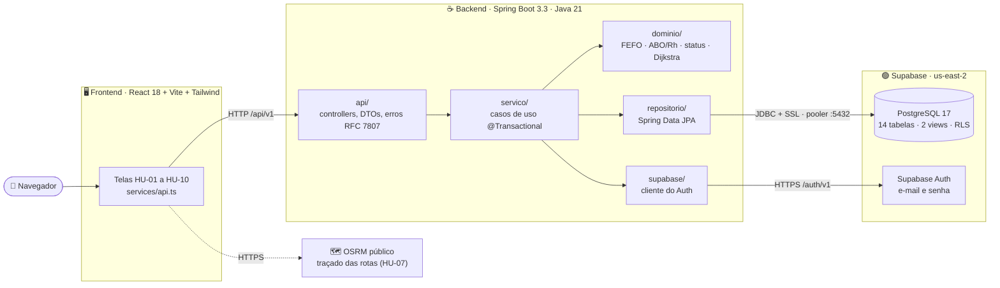

<h1 align="center"> Rotavital 💉🩸🏥🚑<br>
 <br>


[](https://github.com/viictorpaes/Rotavital/blob/main/LICENSE)

</h1>

<p align="center">
Sistema de logística de distribuição de hemocomponentes entre hospitais e bancos de sangue — estoque com
regras de validade, requisições hospitalares com alocação por <b>FEFO + compatibilidade ABO/Rh</b>,
roteirização de entregas e telemetria da cadeia fria.
</p>

<p align="center">
<a href="#integrantes">Integrantes</a> ·
<a href="#entregas">Entregas</a> ·
<a href="#arquitetura">Arquitetura</a> ·
<a href="#cdt-como-rodar">Como rodar</a> ·
<a href="#cdt-testes">Testes</a> ·
<a href="#cdt-pipeline">Pipeline e deploy</a> ·
<a href="#cdt-decisoes">Decisões</a> ·
<a href="#cdt-ia">Uso de IA</a> ·
<a href="#documentacao">Documentação</a>
</p>

<h2 align="center" id="docentes">👥👨🏻‍🏫 Docentes Responsáveis: <br>

</h2>
<ul>
  <li><strong>José Maurício da Silva Júnior</strong> — Algoritmos e Estrutura de Dados</li>
  <li><strong>Raoni Monteiro de Oliveira</strong> — Infraestrutura de Software (SO)</li>
  <li><strong>Robson Godoi de Albuquerque Maranhão</strong> — Projeto 3</li>
  <li><strong>Maurício da Motta Braga</strong> — Programação Orientada a Objetos</li>
  <li><strong>Luiz Filipe Guimarães Novaes</strong> — Infraestrutura de Comunicação (RSD)</li>
  <li><strong>André Luiz da Silva Xavier</strong> — Estatística e Probabilidade</li>
</ul>

<h2 align="center" id="integrantes">👤👨‍🎓 Integrantes do Projeto: </h2>
<ul>
<li><b>Victor José Paes e Silva (Líder 👑)</b> <a href="https://www.linkedin.com/in/viictorpaes/" target="_blank"></a> <a href="https://github.com/viictorpaes" target="_blank"></a></li>
<li>Eduardo de Souza Cavalcanti Junior <a href="https://www.linkedin.com/in/eduardoscavalcantij/" target="_blank"></a> <a href="https://github.com/eduardo-scavalcanti" target="_blank"></a></li>
<li>Felipe Franca Alves de Lima <a href="https://www.linkedin.com/in/felipefrancaal/" target="_blank"></a> <a href="https://github.com/ffrancaal" target="_blank"></a></li>
<li>Helamã Leone de Lima Procídio <a href="https://www.linkedin.com/in/helam%C3%A3-procidio-428772367/" target="_blank"></a> <a href="https://github.com/procidiohelama-star" target="_blank"></a></li>
<li>João Pedro Arruda Guimarães <a href="https://www.linkedin.com/in/jo%C3%A3o-pedro-arruda-guimar%C3%A3es-157952287/" target="_blank"></a> <a href="https://github.com/Jp230603" target="_blank"></a></li>
<li>Júlia Oliveira Veríssimo (<b>Entrou em: 26/09/2026</b>)</li>
<li>Lucas Paguetti Pereira <a href="https://www.linkedin.com/in/lucas-paguetti-pereira" target="_blank"></a> <a href="https://github.com/wqiluc" target="_blank"></a></li>
<li>Tiago Luiz Moreira de Vasconcelos <a href="https://www.linkedin.com/in/tiagoluiz23/" target="_blank"></a> <a href="https://github.com/tlmv23" target="_blank"></a></li>
</ul>

<h2 align="center" id="tecnologias"> ⛏️💻 Tecnologias Utilizadas: <br>

</h2>
<p align="center">
  
  
  
  
  
  
   <br>
  
  
  
  
  
   <br>
  
  
  
  
  
  
</p>

<h2 align="center" id="entregas">🚀 Entregas do Projeto Integrador <br>

</h2>

| Entrega | O que foi entregue | Links |
| :--- | :--- | :--- |
| 📌 **Entrega 01** · 31/08 | Protótipo no Figma com 10 histórias de usuário, cada uma com 2 cenários BDD | [Figma](https://letter-raven-07178463.figma.site) · [Screencast 1](https://youtu.be/SRvAFkqi4Nc) · [Histórias](./docs/ENTREGAS_PI.md#-entrega-01) |
| 📌 **Entrega 02** · 21/09 | Backend Spring Boot e frontend React, com 5 histórias em código e Issue Tracker | [Screencast 2](https://youtu.be/3RlgYAGPyaE) · [Detalhes e issues](./docs/ENTREGAS_PI.md#-entrega-02) · [Figma × Sistema real](./docs/FIGMA_VS_REAL.md) |
| 🧬 **AV1** · Estruturas de dados | Lista, fila e pilha em C99, com a tradução comentada para Java | [`c/README.md`](./c/README.md) · [Tradução C ↔ Java](./docs/TRADUCAO_C_JAVA_AV1.md) |
| 🔌 **RSD** · Arquitetura e redes | Diagrama de arquitetura, ligações, sub-redes e PDF entregue | [PDF](./pdf/arquitetura-rotavital-paes-silva.pdf) · [Ligações e redes](./docs/LIGACOES_E_REDES.md) |
| ⚙️ **SO** · Paralelismo | Auditoria de telemetria sequencial × paralela | [Relatório](./docs/RELATORIO_ATIVIDADE_PARALELISMO.md) |
| 🐳 **Desafio do PI** · Unidade 2 | Container, TDD e deploy automatizados | [Seção abaixo](#container-tdd-deploy) · [Slides](./pdf/Rota%20Vital%20—%20Container,%20TDD%20e%20Deploy.pdf) |

<h2 align="center" id="arquitetura">🏰 Arquitetura <br>

</h2>

Três camadas: o site em React só conversa com a API `/api/v1`; a API em Spring Boot é a única que acessa o banco e
o Supabase Auth. As regras de negócio (FEFO, compatibilidade ABO/Rh, transições de status, grafo de rotas) ficam no
pacote `dominio`, sem dependência de Spring nem de banco, e por isso são testadas sem infraestrutura.



| Onde roda | Frontend | Backend | Banco | Login |
| :--- | :--- | :--- | :--- | :---: |
| 🐳 **Docker (padrão)** | Nginx · `localhost` (repassa `/api/`) | container · `localhost:8080` | Postgres 17 local, com as migrations e o seed | ❌ |
| 🐳🟢 **Docker + Supabase** | Nginx · `localhost` | container · `localhost:8080` | Supabase (o mesmo da produção), sem Postgres local | ✅ |
| 💻 **Sem Docker** | Vite · `localhost:5173` (proxy `/api`) | `mvn spring-boot:run` · `:8080` | Supabase | ✅ |
| ☁️ **Produção** | Vercel (rewrite `/api/` → Render) | Render, imagem do GHCR | Supabase | ✅ |

O login confere a senha no Supabase Auth e busca o perfil na tabela `usuario`, que só tem os usuários ligados ao Auth
no banco do Supabase; por isso ele não funciona com o Postgres local. A produção é atualizada pela
[esteira](#cdt-pipeline) a cada merge na `main`: testes → imagens → GHCR → Render e Vercel.

Pastas e o que cada camada faz hoje em [`ESTRUTURA_DO_PROJETO.md`](./docs/ESTRUTURA_DO_PROJETO.md); módulos em
[`MODULOS.md`](./docs/MODULOS.md); portas, protocolos e sub-redes em [`LIGACOES_E_REDES.md`](./docs/LIGACOES_E_REDES.md);
banco em [`SUPABASE.md`](./docs/SUPABASE.md) e [`DER.md`](./docs/DER.md).

<h2 align="center" id="cdt-como-rodar">▶️ Como Rodar <br>

</h2>

Só precisa de **Git** e **Docker**. Java, Maven, Node e Postgres ficam dentro dos containers.

```bash
git clone https://github.com/viictorpaes/Rotavital.git && cd Rotavital
cp .env.example .env            # no Windows: Copy-Item .env.example .env — depois troque DB_PASSWORD
docker compose up -d --build    # compila, roda os testes e sobe db → backend → frontend
docker compose ps               # os três precisam aparecer como (healthy)
```

| Serviço | O que é | Healthcheck · só sobe depois de | Endereço |
| :--- | :--- | :--- | :--- |
| 🐘 `db` | Postgres 17 com as migrations de `supabase/migrations` e o seed ([`db/`](./db/)), dados no volume `dados-postgres` | `pg_isready` | só na rede interna |
| ☕ `backend` | API Spring Boot ([`backend/Dockerfile`](./backend/Dockerfile), 2 estágios) | `/actuator/health` = `UP` (inclui o banco) · `db` | `localhost:8080` |
| 🖥️ `frontend` | React no Nginx, com proxy `/api/` → `backend` ([`frontend/Dockerfile`](./frontend/Dockerfile)) | `GET /` · `backend` | `localhost` |

`docker compose down` mantém os dados no volume; `docker compose down -v` apaga, e a próxima subida recria o banco com o seed.

> [!NOTE]
> O Compose usa um Postgres próprio, então sobe sem a senha do Supabase e sem internet. O **login** só funciona no
> banco do Supabase ([por quê](#arquitetura)).

Para rodar contra o **Supabase**, sem o Postgres local e com o login funcionando, preencha `SUPABASE_KEY` e
`SUPABASE_DB_PASSWORD` no `.env` e use o [`compose.supabase.yaml`](./compose.supabase.yaml) por cima:

```bash
docker compose down             # se o modo padrão estava no ar: senão o container db continua rodando
docker compose -f compose.yaml -f compose.supabase.yaml up -d --build
```

> [!WARNING]
> Nesse modo a API grava no **banco de produção**: o que for alterado pela tela ou pela API local aparece no Supabase.

Sem Docker, com Java 21, Maven e Node 20 instalados (o backend precisa do `backend/.env`, copiado de
[`backend/.env.example`](./backend/.env.example)):

```bash
cd backend && mvn spring-boot:run           # API em http://localhost:8080/api/v1
cd frontend && npm install && npm run dev   # site em http://localhost:5173
```

Endpoints com exemplos `curl`, comandos do Maven e do npm e as variantes para Windows estão em
[`docs/COMO_EXECUTAR.md`](./docs/COMO_EXECUTAR.md). As saídas de terminal que comprovam a subida (E1) estão em
[`docs/DESAFIO_CONTAINER_TDD_DEPLOY.md`](./docs/DESAFIO_CONTAINER_TDD_DEPLOY.md#e1-evidencias).

<h2 align="center" id="container-tdd-deploy">🐳🧪🚀 Desafio do PI — Container, TDD e Deploy automatizados <br>

</h2>

<p align="center">
Unidade 2 de <b>Infraestrutura de Software</b> (2026.2), com os mesmos <a href="#integrantes">integrantes</a> do PI.
A pergunta do desafio: <i>"se um colega clonar o repositório amanhã, ele consegue rodar, testar e publicar o sistema
sem pedir ajuda a ninguém?"</i>
</p>

| Entrega | Resumo | Status |
| :--- | :--- | :---: |
| 🐳 [**E1 · Container**](#cdt-como-rodar) | `docker compose up -d --build` sobe banco + API + site; o Dockerfile roda os testes antes de gerar a imagem | ✅ |
| 🧪 [**E2 · TDD**](#cdt-testes) | 3 histórias, 13 tarefas, 9 pares `test:` 🔴 → `feat:` 🟢; 208 unitários, 7 de integração e 13 cenários Gherkin | ✅ |
| 🚀 [**E3 · Deploy**](#cdt-pipeline) | GitHub Actions: testes → imagem → deploy (API no Render, site na Vercel), só na `main` e só com tudo verde | ⏳ falta ligar as contas |

> [!IMPORTANT]
> Falta o que só quem tem acesso às contas consegue fazer: proteger a `main`, criar a API no Render e o site na Vercel,
> cadastrar os segredos e colher as evidências. O passo a passo está em
> [Configuração única](./docs/DESAFIO_CONTAINER_TDD_DEPLOY.md#cdt-configuracao).

<h3 align="center" id="cdt-testes">🧪 Testes — E2 · TDD</h3>

<h4 align="left">🗺️ Story map — backbone e Release 1</h4>

As colunas são o **backbone** (as atividades do médico e do doador, em ordem); as linhas são as releases. A Release 1
pegou, em cada atividade, a regra cujo erro machuca mais.

| | 🔐 Entrar | 📊 Painel | 📦 Estoque | 🏥 Requisitar | 🚚 Transportar | 🩺 Atender | ❤️ Doar |
| :--- | :--- | :--- | :--- | :--- | :--- | :--- | :--- |
| **Backbone** | entrar com o perfil | ver números e alertas | ver lotes por tipo | pedir hemocomponente | planejar a rota | concluir o procedimento | agendar a doação |
| ✅ **Fora do TDD** | HU‑01 · login no Supabase Auth (PI3‑183/184) | totais por tipo | HU‑03 · listagem e cadastro (PI3‑179/187) | — | HU‑07 rota (Dijkstra) | — | HU‑09/10 (mock) |
| 🟢 **Release 1 (TDD)** | — | **HU‑02** alertas | HU‑03 (caracterização) | **HU‑04** sugestão de lote | — | **HU‑08** baixa da bolsa | — |
| 🔵 **Release 2** | bloquear por perfil na API | HU‑F03 notificar alerta | HU‑05 recebimento | gravar alocação · HU‑06 | HU‑F04 rastreio · telemetria | ligar a baixa ao paciente | HU‑F06 elegibilidade |

<h4 align="left">🧩 Histórias → tarefas → red → green</h4>

- **HU‑04** — como médico, quero que o sistema sugira o lote compatível que vence primeiro, sem escolher na mão.
- **HU‑02** — como médico, quero ver no painel as bolsas vencidas, perto de vencer ou fora da temperatura.
- **HU‑08** — como médico, quero dar baixa na bolsa usada, para o estoque refletir o que foi consumido.

| HU | Tarefa | Regra | Teste (nível) | 🔴 `test:` → 🟢 `feat:` |
| :---: | :--- | :--- | :--- | :--- |
| 04 | T4.1 | ABO/Rh das hemácias (8 × 8): O− doa para todos, Rh+ nunca vai para Rh− | [`CompatibilidadeSanguineaTest`](./backend/src/test/java/com/rotavital/dominio/CompatibilidadeSanguineaTest.java) (unitário) | [`67d4c55`](https://github.com/viictorpaes/Rotavital/commit/67d4c55) 9 de 10 falham → [`1b9cd69`](https://github.com/viictorpaes/Rotavital/commit/1b9cd69) 69/69 |
| 04 | T4.2 | Plasma e crio: ABO invertido, Rh indiferente; plaquetas como hemácias | idem | [`9baea07`](https://github.com/viictorpaes/Rotavital/commit/9baea07) 8 falham → [`cbbd912`](https://github.com/viictorpaes/Rotavital/commit/cbbd912) 93/93 |
| 04 | T4.3 | Bolsa apta: disponível, na validade (vencer hoje vale) e na faixa de temperatura | [`BolsaHemocomponenteTest`](./backend/src/test/java/com/rotavital/dominio/BolsaHemocomponenteTest.java) (unitário) | [`e901034`](https://github.com/viictorpaes/Rotavital/commit/e901034) 3 de 9 → [`21c2312`](https://github.com/viictorpaes/Rotavital/commit/21c2312) 98/98 |
| 04 | T4.4 | Ordem: mesmo tipo primeiro (poupa o O−), FEFO, nunca incompatível | [`SugestaoDeLoteTest`](./backend/src/test/java/com/rotavital/dominio/SugestaoDeLoteTest.java) (unitário) | [`8c9fb6b`](https://github.com/viictorpaes/Rotavital/commit/8c9fb6b) 7 de 8 → [`e4d884b`](https://github.com/viictorpaes/Rotavital/commit/e4d884b) 106/106 |
| 04 | T4.5 | `GET /bancos/{bancoId}/sugestao-lote` | [`hu04_sugestao_de_lote.feature`](./backend/src/test/resources/features/hu04_sugestao_de_lote.feature) (aceitação, 6) | [`2dcd504`](https://github.com/viictorpaes/Rotavital/commit/2dcd504) 404 → [`547a00f`](https://github.com/viictorpaes/Rotavital/commit/547a00f) verdes |
| 02 | T2.1–T2.4 | Vencida ou fora da faixa = CRÍTICO; vence em 0 a 7 dias = ATENÇÃO; críticos primeiro | [`AlertasDoEstoqueTest`](./backend/src/test/java/com/rotavital/dominio/AlertasDoEstoqueTest.java) (unitário) | [`93980fa`](https://github.com/viictorpaes/Rotavital/commit/93980fa) 9 de 11 → [`5baca27`](https://github.com/viictorpaes/Rotavital/commit/5baca27) 117/117 |
| 02 | T2.5 | `GET /bancos/{bancoId}/alertas` | [`hu02_alertas_do_painel.feature`](./backend/src/test/resources/features/hu02_alertas_do_painel.feature) (aceitação, 2) | [`b82afdb`](https://github.com/viictorpaes/Rotavital/commit/b82afdb) 404 → [`591006a`](https://github.com/viictorpaes/Rotavital/commit/591006a) verdes |
| 08 | T8.1–T8.2 | 12 transições de status permitidas; bolsa vencida só pode ser descartada | [`MovimentacaoDaBolsaTest`](./backend/src/test/java/com/rotavital/dominio/MovimentacaoDaBolsaTest.java) (unitário) | [`60207da`](https://github.com/viictorpaes/Rotavital/commit/60207da) 29 de 40 → [`1dd60ba`](https://github.com/viictorpaes/Rotavital/commit/1dd60ba) 157/157 |
| 08 | T8.3 | `PATCH /hemocomponentes/{id}` grava no Postgres; recusa → 422 sem gravar | [`hu08_baixa_da_bolsa.feature`](./backend/src/test/resources/features/hu08_baixa_da_bolsa.feature) (aceitação, 3) + [`BaixaDaBolsaIT`](./backend/src/test/java/com/rotavital/integracao/BaixaDaBolsaIT.java) (integração, 4) | [`ec1c83d`](https://github.com/viictorpaes/Rotavital/commit/ec1c83d) 405 → [`f2d1e0f`](https://github.com/viictorpaes/Rotavital/commit/f2d1e0f) 157 + 20 verdes |

Cada `test:` foi commitado vermelho (o código só tinha a assinatura), e o `feat:` seguinte o deixou verde sem quebrar os
anteriores. Tarefas que compartilham o mesmo método viraram um único par.

<h4 align="left">📶 Testes por nível</h4>

| Nível | Quantos | Como | Onde roda |
| :--- | :---: | :--- | :--- |
| 🧩 **Unitário** | **208** | JUnit 5, repositório falso e MockMvc. São 98 da Release 1, 59 que já existiam e 51 do login e do cadastro de bolsas, vindos da `main` | `mvn test`: 1º estágio do Dockerfile e esteira |
| 🔗 **Integração** | **7** | Testcontainers: Postgres 17 criado com as migrations do Supabase ([`EstoqueIT`](./backend/src/test/java/com/rotavital/integracao/EstoqueIT.java), [`BaixaDaBolsaIT`](./backend/src/test/java/com/rotavital/integracao/BaixaDaBolsaIT.java)) | `mvn verify`: esteira |
| ✅ **Aceitação** | **13** | Cucumber + Gherkin em português, chamando a API por HTTP ([`features/`](./backend/src/test/resources/features/)); os 2 cenários da HU‑03 são de caracterização | `mvn verify`: esteira |

<h4 align="left" id="cdt-risco">⚠️ Quais regras ganharam teste primeiro</h4>

| Ordem | Regra | Se der errado |
| :---: | :--- | :--- |
| 1️⃣ | Compatibilidade ABO/Rh | Reação hemolítica: o paciente pode morrer. E o código só aceitava bolsa do mesmo tipo |
| 2️⃣ | Bolsa apta; vencida só se descarta | Bolsa vencida ou com a cadeia fria rompida chega ao paciente |
| 3️⃣ | Baixa e transições de status | O estoque mente: bolsa usada duas vezes, descartada que volta |
| 4️⃣ | FEFO + mesmo tipo primeiro | Desperdício: bolsa vence na prateleira, O− gasto à toa |
| 5️⃣ | Alertas do painel | É aviso, não bloqueio: as regras acima já impedem o uso indevido |

<h4 align="left">🚧 O que ficou sem teste</h4>

- **Frontend:** sem testes; a esteira só garante que compila. O `npm run lint` tem 18 problemas herdados e ainda não é gate.
- **Login (veio da `main`):** tem testes unitários com o Supabase Auth simulado, mas ficou fora do red → green, e a API ainda não bloqueia por perfil.
- **Plaquetas:** seguem a regra das hemácias por precaução; falta validar com um hemoterapeuta.
- **Alocação gravada no banco:** a FK `fk_alocacao_bolsa_compativel` ainda exige o mesmo tipo (fica para a Release 2).
- **Produção:** o smoke test confere versão, saúde e site → API, mas não roda fluxos de negócio no Supabase.

<h3 align="center" id="cdt-pipeline">⚙️ Pipeline e deploy — E3 · Deploy automatizado</h3>

[`esteira.yml`](./.github/workflows/esteira.yml): **push ou PR → testes e build → imagens Docker → (só na `main`) GHCR →
deploy → smoke test.**

| Job | Quando | O que faz |
| :--- | :--- | :--- |
| ☕ Backend · testes | todo push e PR | `mvn verify` com os 3 níveis; um teste vermelho para a esteira aqui |
| 🖥️ Frontend · build | todo push e PR | `npm ci` + `npm run build` (checa os tipos) |
| 🐳 Imagens Docker | depois dos dois | builda os 2 Dockerfiles do E1; na `main`, publica a imagem da API no GHCR com a tag = sha |
| 🚀 Deploy · Render + Vercel | push na `main` | deploy hook do Render com a imagem do sha e `vercel deploy --prod` do site; o smoke test espera o sha novo em `/actuator/info` e no `/versao.json`, o health `UP` e o site chegando na API |
| ↩️ Rollback | manual (*Run workflow*) | reimplanta a imagem e o site de um sha anterior, sem recompilar |

**Fluxo de branch — GitHub Flow:** a `main` está sempre publicável; cada tarefa ganha uma branch, vira PR com a esteira
verde e, no merge, vai para produção. Os PRs #17 a #28 já seguiam isso. Na proteção da `main` (*Settings → Rules*), exigir
PR, os checks **Backend · testes**, **Frontend · build** e **Imagens Docker** e a branch atualizada, e bloquear *force push*.

| Segredo / configuração | Onde fica |
| :--- | :--- |
| `DB_PASSWORD` (Postgres local); `SUPABASE_KEY` e `SUPABASE_DB_PASSWORD`, opcionais, para o login no Compose | `.env` de cada um, no `.gitignore` (modelo em [`.env.example`](./.env.example)) |
| `SUPABASE_DB_PASSWORD`, `SUPABASE_KEY` | Variáveis do `rotavital-api` no **Render** ([`render.yaml`](./render.yaml)); sem a chave, o login responde `503` |
| `RENDER_DEPLOY_HOOK_API`, `VERCEL_TOKEN`, `VERCEL_ORG_ID`, `VERCEL_PROJECT_ID` | GitHub → Environments → `producao` → Secrets |
| `API_URL`, `WEB_URL` (não são segredo) | GitHub → Environments → `producao` → Variables |
| Login no GHCR | `GITHUB_TOKEN` automático do Actions |

**Rollback:** ⭐ *Actions → Esteira CI/CD → Run workflow* com o sha completo da versão boa (`git log --format=%H`). Se o
GitHub estiver fora, use os painéis (Render: *Events → Rollback*; Vercel: *Deployments → Instant Rollback*). Depois,
um `git revert` do commit ruim via PR, para a `main` não continuar com ele.

<h4 align="left" id="cdt-evidencias-e3">📸 Evidências do E3</h4>

| Evidência | Link / print |
| :--- | :--- |
| 🟢 Esteira verde nesta branch (testes + imagens) | ✅ [execução 38563433392](https://github.com/viictorpaes/Rotavital/actions/runs/38563433392), commit `f2d1e0f`, 14/10/2026 |
| 🔴 Execução **vermelha** que barrou o merge | ⏳ *a preencher* ([passo 2 da configuração](./docs/DESAFIO_CONTAINER_TDD_DEPLOY.md#cdt-configuracao)) |
| 🟢 Execução **verde** que publicou na `main` | ⏳ *a preencher* (passo 8) |
| 🌐 **URL pública** | ⏳ `https://rotavital-web.vercel.app` *(confirmar o domínio)* |
| ↩️ **Rollback** executado | ⏳ *a preencher* (passo 9) |

<h3 align="center" id="cdt-decisoes">🧭 Decisões</h3>

| Decisão | Escolha | Alternativas | Por quê |
| :--- | :--- | :--- | :--- |
| 🐳 Imagem base | `eclipse-temurin:21-jre-alpine` (API) e `nginx-unprivileged:1.30-alpine` (site), sem root | `openjdk`, JDK completo, `nginx:alpine` | Só o runtime, em Alpine: menos pacotes e menos vulnerabilidades (378 MB e 91 MB). A `openjdk` foi descontinuada. |
| 🏗️ Multi-stage | 1º estágio: o Maven compila e **roda os testes**; 2º: só o `.jar` | 1 estágio; build fora do Docker | "Compila e passa nos testes" vale em qualquer máquina, e a produção não carrega Maven nem JDK. |
| 🐘 Banco no Compose | Postgres 17 próprio, com as migrations do Supabase; o `compose.supabase.yaml` troca pelo Supabase quando se quer testar o login | Só o Supabase; H2 | Sobe sem internet e sem a senha de ninguém, e o schema continua com uma fonte só. O login precisa dos usuários do Supabase Auth, por isso a opção. |
| 💾 Dados | Volume nomeado `dados-postgres` | Bind mount; sem volume | Os dados sobrevivem ao `docker compose down` (testado) e não sujam o repositório. |
| 🔌 Rede | Rede padrão do Compose, pelo nome do serviço (`db`, `backend`) | IPs fixos; `network_mode: host` | O DNS do Compose resolve os nomes, e o banco nem publica porta para fora. |
| ⏱️ Ordem de subida | `healthcheck` + `depends_on: service_healthy` | `depends_on` simples; `sleep` | A API só sobe com o banco pronto, e o site só com a API `UP`. |
| 🔑 Configuração | `.env` + `.env.example`; banco e porta por variável de ambiente | Senha no `application.properties` | Nenhum segredo no Git, e a mesma imagem roda no Compose e no Render. |
| 🧪 Teste primeiro | ABO/Rh → bolsa apta → baixa → FEFO → alertas | Começar pelo mais fácil | Ordem de risco ao paciente ([tabela](#cdt-risco)): um erro na compatibilidade põe uma vida em risco. |
| 🗄️ Banco nos testes | Testcontainers: Postgres 17 + as mesmas migrations | H2 em memória | Mesmo SQL de produção (CHECKs, gatilhos, views), igual na máquina e na esteira. |
| 🥒 Aceitação | Cucumber + Gherkin em português | JUnit com nomes dado/quando/então | Os cenários BDD da Entrega 01 passam a rodar de verdade, e o médico consegue lê-los. |
| ⚙️ CI/CD | GitHub Actions + GHCR, com a tag = sha do commit | GitLab CI, Jenkins; Docker Hub | O código já está no GitHub, o `GITHUB_TOKEN` autentica e a tag por sha permite rollback exato. |
| 🌿 Fluxo de branch | GitHub Flow | Git Flow, GitLab Flow | Grupo pequeno, uma versão no ar e deploy a cada merge. Git Flow seria cerimônia sem release agendada. |
| ☁️ Deploy | API no Render (por imagem, Blueprint); site na Vercel, com rewrite `/api/` → Render; banco no Supabase | Tudo no Render; Railway, Fly.io, Koyeb | O Render roda a imagem de graça e na região do Supabase. O site não funcionou no Render, e a Vercel o serve pela CDN. O rewrite evita CORS. |
| 🔐 Segredos | Hook e token no environment `producao` do GitHub; senha e chave do Supabase só no Render | No repositório ou no workflow | Cada segredo fica só onde é usado. |
| ↩️ Rollback | *Run workflow* com o sha anterior | Só `git revert` + rebuild | Volta em minutos, sem recompilar, e fica registrado. |

<h3 align="center" id="cdt-ia">🤖 Uso de IA</h3>

<p align="center">Permitido pelo enunciado e declarado aqui: <b>a IA rascunha; o grupo valida e assina.</b></p>

| Item | Detalhe |
| :--- | :--- |
| 🛠️ Ferramenta | **Claude Code** (Claude Opus 5.5, da Anthropic), na extensão do VS Code |
| ✍️ O que rascunhou | Dockerfiles, `compose.yaml`, `db/`, a esteira e os scripts de deploy, `render.yaml` e `vercel.json`; o story map e as tarefas; os testes e o código das HU‑04, HU‑02 e HU‑08; esta seção; o merge da `main`; a reorganização do README em `docs/`, a seção de Arquitetura e o `compose.supabase.yaml`, testado contra o Supabase |
| 🔎 Como foi verificado | Cada `test:` falhou antes do `feat:`; `mvn verify` completo; `docker compose` do zero; `actionlint`; deploy e rollback testados contra um servidor que simula o Render e a Vercel |
| ⚠️ O que errou e foi corrigido | Script do banco num bind mount, que o macOS bloqueia (→ `db/Dockerfile`); `${var,,}`, que o bash do macOS não tem; rollback aceitando sha curto |
| 👥 O que fica com o grupo | Configurar as contas, colher os prints, conferir as regras clínicas (principalmente a das plaquetas) e apresentar |

<details>
<summary>▶️ <b>Prompts principais</b></summary>

1. *"com base em: Desafio do PI - Container TDD e Deploy automatizados - 2026.2.pdf [...] Três entregas no projeto do PI,
   cada decisão justificada no README [...] Se usarem TDD, expliquem como foi a jornada de desenvolvimento e as lições
   aprendidas; use o final da sessão do README principal p fzr essa atividade"*
2. *"USE O README"*, confirmado depois como *"tudo no README, depois da última seção"*.
3. Quando o `pom.xml` voltou ao estado anterior no meio do trabalho, a IA perguntou antes de reaplicar as dependências de
   teste; a resposta foi *"Não, pode reaplicar"*.
4. *"me ajude a trazer os updates da main pra cá, e reconfira se está tudo de acordo com o pdf"*
5. *"sinterize o h2 do desafio [...] e enxuge a parte dele no README.md pra não ficar TÃÃÃÃO complexo"*
6. *"limpe o README.md principal, e coloque as informações retiradas em outros arquivos na pasta docs/. deixe apenas o
   essencial nesse README.MD"*
7. *"me ajude a melhorar a arquitetura no README.md principal, e rode o docker com o supabase e me ajude a testar (sem
   banco local e com sync)"*; "sync" foi confirmado como *"Dados no Supabase"*, e o teste de gravação, como ida e volta.
</details>

<h3 align="center" id="cdt-jornada">🧭 Jornada TDD e lições aprendidas</h3>

1. **O story map mostrou onde testar primeiro:** em cada atividade, a regra que mais machuca se der errado.
2. **O teste expôs um gap:** o README prometia "FEFO + ABO/Rh", mas o código só aceitava bolsa do mesmo tipo. Documento
   sozinho não garante nada.
3. **Triangulação:** o primeiro código verde tratava tudo como hemácias; só o teste do plasma obrigou a separar a regra
   por componente.
4. **Fronteiras e relógio:** "a bolsa que vence hoje ainda vale?" virou um teste com nome próprio, e o `LocalDate.now()`
   virou um `Clock` injetado ("Dado que hoje é 01/10/2026").
5. **Banco de verdade:** os testes com o Postgres das migrations pegaram constraints que um mock não pega (ex.: plaquetas
   valem no máximo 7 dias).
6. **Ver o teste falhar:** nos 9 pares, o `test:` falhou pelo motivo certo antes do `feat:`. Teste que nunca falhou pode
   não testar nada.
7. **A IA rascunha, o grupo confere:** os erros dela (o bind mount, o `${var,,}`) só apareceram rodando, no container e na esteira.

<h2 align="center" id="documentacao">📚 Documentação <br>

</h2>

<p align="center">
Índice completo, com o que cada documento contém e quando ler, em <a href="./docs/DOCUMENTACAO.md"><code>docs/DOCUMENTACAO.md</code></a>.
</p>

| Documento | Descrição |
| :--- | :--- |
| 🚀 [`COMO_EXECUTAR.md`](./docs/COMO_EXECUTAR.md) | Rodar sem Docker, endpoints com exemplos `curl`, comandos do Maven e do npm |
| 🏰 [`ESTRUTURA_DO_PROJETO.md`](./docs/ESTRUTURA_DO_PROJETO.md) | Módulos e status, árvore do repositório e o que cada camada faz hoje |
| 📌 [`ENTREGAS_PI.md`](./docs/ENTREGAS_PI.md) | Entregas 01 e 02: histórias de usuário com BDD, screencasts e Issue Tracker |
| 🖼️ [`FIGMA_VS_REAL.md`](./docs/FIGMA_VS_REAL.md) | Cada tela do Figma ao lado do sistema rodando, com o código |
| 🐳 [`DESAFIO_CONTAINER_TDD_DEPLOY.md`](./docs/DESAFIO_CONTAINER_TDD_DEPLOY.md) | Evidências do E1 e configuração única do deploy |
| 🧬 [`MODELO_DE_DOMINIO.md`](./docs/MODELO_DE_DOMINIO.md) | Classes do domínio (POO), grafo e Dijkstra |
| 🌐 [`CONTRATOS_DE_API.md`](./docs/CONTRATOS_DE_API.md) · [`openapi.yaml`](./docs/openapi.yaml) | Endpoints por módulo, padrões e erros; contrato OpenAPI 3.0.3 |
| 📦 [`MODULOS.md`](./docs/MODULOS.md) | Contrato × domínio × banco, por módulo |
| 🟢 [`SUPABASE.md`](./docs/SUPABASE.md) · 🗄️ [`DER.md`](./docs/DER.md) | Banco: conexão, `.env`, migrations, RLS e prints; 14 tabelas, 2 views e constraints |
| 🔐 [`PERFIS_DE_ACESSO.md`](./docs/PERFIS_DE_ACESSO.md) | Perfis médico, doador e admin, e o que cada um vê (PI3-182) |
| 🔌 [`LIGACOES_E_REDES.md`](./docs/LIGACOES_E_REDES.md) · 🗺️ [`DIAGRAMA_ROTAVITAL.md`](./docs/DIAGRAMA_ROTAVITAL.md) | Ligações, sub-redes e diagrama de arquitetura (RSD) |
| 🧩 [`INVENTARIO_COMPONENTES.md`](./docs/INVENTARIO_COMPONENTES.md) | Componentes ativos × planejados |
| 🧾 [`evidencias/`](./docs/evidencias/) | Chamadas reais aos endpoints, navegação por perfil e login |
