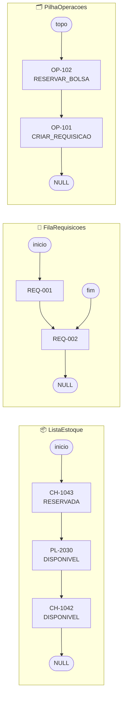

<h1 align="center"> Rotavital — Estruturas de Dados em C 🧬🩸<br>


</h1>

<p align="center">
Implementação original em <b>C99</b> das três estruturas de dados do domínio <b>Rota Vital</b>, entregue na
<b>Unidade 1 (AV1) do Projeto Integrador</b>: o estoque de bolsas, a fila de requisições hospitalares e o
histórico de operações. Toda a memória é alocada à mão com <code>malloc</code> e devolvida com <code>free</code>.
</p>

<p align="center">
<a href="../README.md">⬅️ Voltar ao README principal</a> ·
<a href="../docs/TRADUCAO_C_JAVA_AV1.md">🔁 Tradução comentada C ↔ Java</a>
</p>

<h2 align="center" id="estruturas">🧱 Estruturas Implementadas <br>

</h2>

| Estrutura | Papel no domínio | Arquivos | Equivalente em Java |
| :--- | :--- | :--- | :--- |
| 📦 **Lista encadeada simples** | Estoque de bolsas de hemocomponentes | `lista_estoque.h` · `lista_estoque.c` | [`Estoque`](../backend/src/main/java/com/rotavital/dominio/Estoque.java) |
| 🏥 **Fila dinâmica (FIFO)** | Requisições hospitalares, atendidas na ordem de chegada | `fila_requisicoes.h` · `fila_requisicoes.c` | [`FilaRequisicoesHospitalares`](../backend/src/main/java/com/rotavital/dominio/FilaRequisicoesHospitalares.java) |
| 🗂️ **Pilha dinâmica (LIFO)** | Histórico de operações, da mais recente para a mais antiga | `pilha_operacoes.h` · `pilha_operacoes.c` | [`PilhaOperacoes<T>`](../backend/src/main/java/com/rotavital/dominio/PilhaOperacoes.java) |

<details>
<summary>▶️📦 <b>Lista encadeada de estoque</b> — <code>NoBolsa</code> · <code>ListaEstoque</code></summary>

<br>

Cada nó (`NoBolsa`) guarda uma `BolsaHemocomponente` e um ponteiro para o próximo. O descritor
(`ListaEstoque`) guarda o ponteiro `inicio` e o `tamanho`.

| Função | O que faz | Custo |
| :--- | :--- | :---: |
| `lista_estoque_criar` | Aloca o descritor da lista vazia (`malloc`) | O(1) |
| `lista_estoque_adicionar` | Insere a bolsa **no início** da lista | O(1) |
| `lista_estoque_buscar_por_id` | Percorre os ponteiros `proximo` até achar o id; `NULL` se não existir | O(n) |
| `lista_estoque_remover` | Religa o nó anterior ao seguinte e libera o nó removido (`free`) | O(n) |
| `lista_estoque_filtrar_disponiveis` | Copia para um buffer as bolsas `DISPONIVEL` do componente e tipo sanguíneo pedidos | O(n) |
| `lista_estoque_tamanho` · `lista_estoque_esta_vazia` | Consultas sobre o descritor | O(1) |
| `lista_estoque_destruir` | Libera nó por nó e depois o descritor | O(n) |

</details>

<details>
<summary>▶️🏥 <b>Fila FIFO de requisições</b> — <code>NoRequisicao</code> · <code>FilaRequisicoes</code></summary>

<br>

O descritor guarda dois ponteiros, `inicio` e `fim`. Por isso tanto enfileirar quanto desenfileirar são O(1).

| Função | O que faz | Custo |
| :--- | :--- | :---: |
| `fila_requisicoes_criar` | Aloca a fila vazia (`malloc`) | O(1) |
| `fila_requisicoes_enfileirar` | Insere no `fim` (enqueue) | O(1) |
| `fila_requisicoes_desenfileirar` | Retira do `inicio` e libera o nó (dequeue); `false` se a fila estiver vazia | O(1) |
| `fila_requisicoes_consultar_proxima` | Lê o `inicio` sem retirar (peek) | O(1) |
| `fila_requisicoes_tamanho` · `fila_requisicoes_esta_vazia` | Consultas sobre o descritor | O(1) |
| `fila_requisicoes_destruir` | Libera todos os nós e a fila | O(n) |

</details>

<details>
<summary>▶️🗂️ <b>Pilha LIFO de operações</b> — <code>NoOperacao</code> · <code>PilhaOperacoes</code></summary>

<br>

O descritor guarda só o ponteiro `topo`: a última operação registrada é a primeira a sair.

| Função | O que faz | Custo |
| :--- | :--- | :---: |
| `pilha_operacoes_criar` | Aloca a pilha vazia (`malloc`) | O(1) |
| `pilha_operacoes_empilhar` | Insere no `topo` (push) | O(1) |
| `pilha_operacoes_desempilhar` | Retira do `topo` e libera o nó (pop); `false` se a pilha estiver vazia | O(1) |
| `pilha_operacoes_consultar_topo` | Lê o `topo` sem retirar (peek) | O(1) |
| `pilha_operacoes_tamanho` · `pilha_operacoes_esta_vazia` | Consultas sobre o descritor | O(1) |
| `pilha_operacoes_destruir` | Libera todos os nós e a pilha | O(n) |

</details>

<h2 align="center" id="ponteiros">🧠 Ponteiros na Prática <br>

</h2>

<p align="center">
Estado das três estruturas no meio do <code>main.c</code>, logo depois das inserções.
Como a lista insere no início, a última bolsa adicionada (<code>CH-1043</code>) fica na frente.
</p>



<h2 align="center" id="tipos">🔤 Tipos do Domínio <br>

</h2>

| Tipo | Valores / campos |
| :--- | :--- |
| `TipoComponente` | `HEMACIAS` · `PLASMA` · `PLAQUETAS` · `CRIOPRECIPITADO` |
| `TipoSanguineo` | `A_POSITIVO` · `A_NEGATIVO` · `B_POSITIVO` · `B_NEGATIVO` · `AB_POSITIVO` · `AB_NEGATIVO` · `O_POSITIVO` · `O_NEGATIVO` |
| `StatusBolsa` | `DISPONIVEL` · `RESERVADA` · `EM_TRANSITO` · `DESCARTADA` |
| `StatusRequisicao` | `PENDENTE` · `ALOCADA` · `ATENDIDA` · `CANCELADA` |
| `BolsaHemocomponente` | id, componente, tipo sanguíneo, datas de coleta e validade, lote, volume, temperatura, banco de origem, status |
| `RequisicaoHospitalar` | id, hospital (id e nome), componente, tipo sanguíneo, quantidade, data da solicitação, status |
| `OperacaoHistorico` | id, tipo da operação (ex.: `RESERVAR_BOLSA`), detalhes, data e hora |

> [!NOTE]
> Os nomes dos enums em C levam um prefixo (`COMPONENTE_`, `SANGUE_`, `STATUS_BOLSA_`, `STATUS_REQ_`), já que em C
> todos os valores de enum dividem o mesmo escopo. Os status são uma versão reduzida dos enums Java:
> `StatusBolsa` não tem `ENTREGUE` nem `UTILIZADA`, e `StatusRequisicao` usa `ATENDIDA` no lugar de
> `EM_TRANSITO`/`ENTREGUE`. As datas são texto no formato `AAAA-MM-DD`. Para mostrar os enums na tela,
> `rotavital_tipos.c` converte cada valor em texto (ex.: `SANGUE_O_POSITIVO` → `O+`).

<h2 align="center" id="arquitetura">🏰 Arquitetura dos Arquivos <br>

</h2>
<pre>
c  /
├── Makefile 
├── README.md 
├── rotavital_tipos.h 
├── rotavital_tipos.c 
├── lista_estoque.h 
├── lista_estoque.c 
├── fila_requisicoes.h 
├── fila_requisicoes.c 
├── pilha_operacoes.h 
├── pilha_operacoes.c 
└── main.c 
</pre>

<h2 align="center" id="testes">🧪 Testes <br>

</h2>

<p align="center">
O <code>main.c</code> exercita cada estrutura com <code>assert()</code>: se uma verificação falhar, o programa
para na linha do erro. Os ids de exemplo seguem o padrão do backend (<code>CH-1042</code>, <code>BS-01</code>, <code>HOSP-01</code>).
</p>

| Teste | O que valida |
| :--- | :--- |
| 1️⃣ **Lista de estoque** | Insere 3 bolsas; busca `CH-1042` por id; o filtro de `HEMACIAS / O+` devolve só a bolsa disponível e ignora a `RESERVADA`; remove `PL-2030`, que deixa de ser encontrada; libera a lista |
| 2️⃣ **Fila de requisições** | Enfileira 2 requisições; o peek mostra a primeira; desenfileira na ordem de chegada (`REQ-001` → `REQ-002`); desenfileirar com a fila vazia devolve `false` |
| 3️⃣ **Pilha de operações** | Empilha 2 operações; o peek mostra a mais recente; desempilha na ordem inversa (`OP-102` → `OP-101`); desempilhar com a pilha vazia devolve `false` |
| 🧠 **Memória** | No fim de cada teste, a estrutura é destruída com `free`. O `leaks --atExit` (macOS) relata **0 leaks** |

<details>
<summary>▶️🖥️ <b>Saída do programa</b> (<code>make run</code>)</summary>

```text
##################################################
   ROTA VITAL - ESTRUTURAS DE DADOS EM C (AV1)
   Projeto Integrador - Unidade 1
##################################################

==================================================
[TESTE 1] Lista Encadeada de Estoque (Bolsas)
==================================================
-> 3 bolsas inseridas com sucesso. Tamanho = 3
-> Consulta por ID 'CH-1042': Encontrada (CH-1042, HEMACIAS, O+)
-> Filtragem por disponíveis (HEMACIAS / O+): 1 encontrada(s)
-> Remoção de 'PL-2030': Sucesso. Novo tamanho = 2
-> Memória da lista de estoque completamente liberada via free(). [OK]

==================================================
[TESTE 2] Fila FIFO de Requisições Hospitalares
==================================================
-> 2 requisições enfileiradas. Tamanho = 2
-> Consultar próxima (Peek): REQ-001 (Hospital da Restauracao, HEMACIAS)
-> Desenfileirada 1a (FIFO): REQ-001. Restantes: 1
-> Desenfileirada 2a (FIFO): REQ-002. Restantes: 0
-> Memória da fila de requisições liberada com sucesso via free(). [OK]

==================================================
[TESTE 3] Pilha LIFO de Histórico de Operações
==================================================
-> 2 operações empilhadas. Tamanho = 2
-> Operação mais recente no topo (Peek): OP-102 - RESERVAR_BOLSA
-> Desempilhada 1a (LIFO): OP-102 (RESERVAR_BOLSA). Restantes: 1
-> Desempilhada 2a (LIFO): OP-101 (CRIAR_REQUISICAO). Restantes: 0
-> Memória da pilha de operações liberada com sucesso via free(). [OK]

>>> TODOS OS TESTES EM C EXECUTADOS COM SUCESSO! <<<
```

</details>

<h2 align="center" id="como-executar">🚀 Como Compilar e Executar <br>

</h2>

**Pré-requisitos:** um compilador C (GCC ou Clang) e, de preferência, `make`.

```bash
cd c
make        # compila com -Wall -Wextra -std=c99 -pedantic -g
make run    # compila (se preciso) e roda os testes
make clean  # apaga os .o e o executável rotavital_ed
```

<details>
<summary>🐧🍎 <b>Sem make (Linux / macOS)</b></summary>

```bash
cd c
gcc -Wall -Wextra -std=c99 -pedantic main.c rotavital_tipos.c lista_estoque.c fila_requisicoes.c pilha_operacoes.c -o rotavital_ed
./rotavital_ed
```

</details>

<details>
<summary>🪟 <b>Windows (PowerShell + MinGW)</b></summary>

```powershell
cd c
gcc -Wall -Wextra -std=c99 -pedantic main.c rotavital_tipos.c lista_estoque.c fila_requisicoes.c pilha_operacoes.c -o rotavital_ed.exe
.\rotavital_ed.exe
```

</details>

<details>
<summary>🧠 <b>Conferir vazamento de memória</b></summary>

```bash
# macOS
leaks --atExit -- ./rotavital_ed     # esperado: "0 leaks for 0 total leaked bytes."

# Linux
valgrind --leak-check=full ./rotavital_ed
```

</details>

<h2 align="center" id="traducao">🔁 Tradução C ↔ Java <br>


</h2>

<p align="center">
O backend reimplementa as mesmas estruturas em Java orientado a objetos. A comparação linha a linha está em
<a href="../docs/TRADUCAO_C_JAVA_AV1.md"><code>docs/TRADUCAO_C_JAVA_AV1.md</code></a>.
</p>

| Em C | Em Java |
| :--- | :--- |
| `ListaEstoque` + `NoBolsa`, ponteiros manuais | `Estoque`, sobre a lista de bolsas do `BancoDeSangue` |
| `lista_estoque_filtrar_disponiveis(...)` | `Estoque.buscarDisponiveis(...)` |
| `FilaRequisicoes` (`inicio` + `fim`) | `FilaRequisicoesHospitalares` (`ArrayDeque`): `adicionar` · `consultarProxima` · `retirarProxima` |
| `PilhaOperacoes` (`topo`) | `PilhaOperacoes<T>` (`ArrayDeque`): `registrar` · `consultarMaisRecente` · `removerMaisRecente` |
| Retorno `bool` + parâmetro de saída | `Optional<T>` (vazio quando a fila ou a pilha está vazia) |
| `malloc` / `free` | Coletor de lixo da JVM |
| `assert()` no `main.c` | JUnit 5: [`EstoqueTest`](../backend/src/test/java/com/rotavital/dominio/EstoqueTest.java) · [`FilaRequisicoesHospitalaresTest`](../backend/src/test/java/com/rotavital/dominio/FilaRequisicoesHospitalaresTest.java) · [`PilhaOperacoesTest`](../backend/src/test/java/com/rotavital/dominio/PilhaOperacoesTest.java) |
