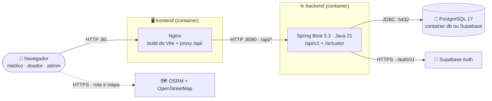
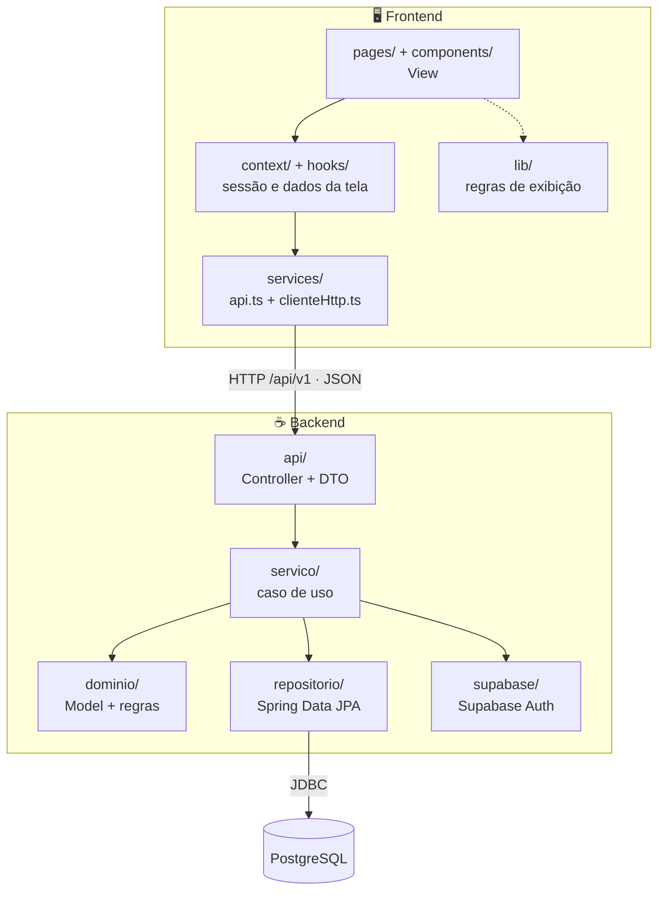
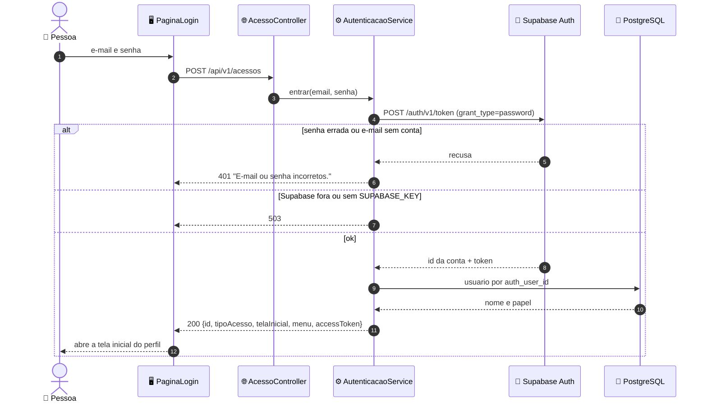
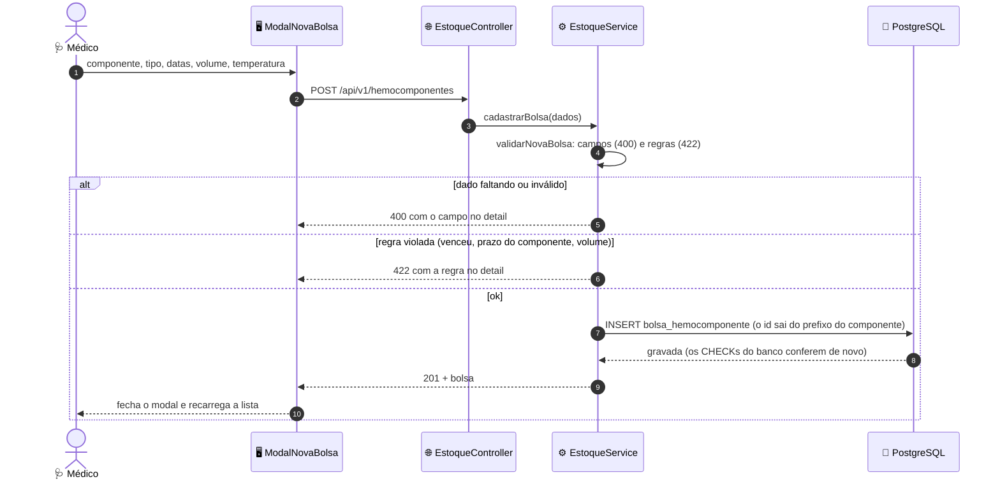
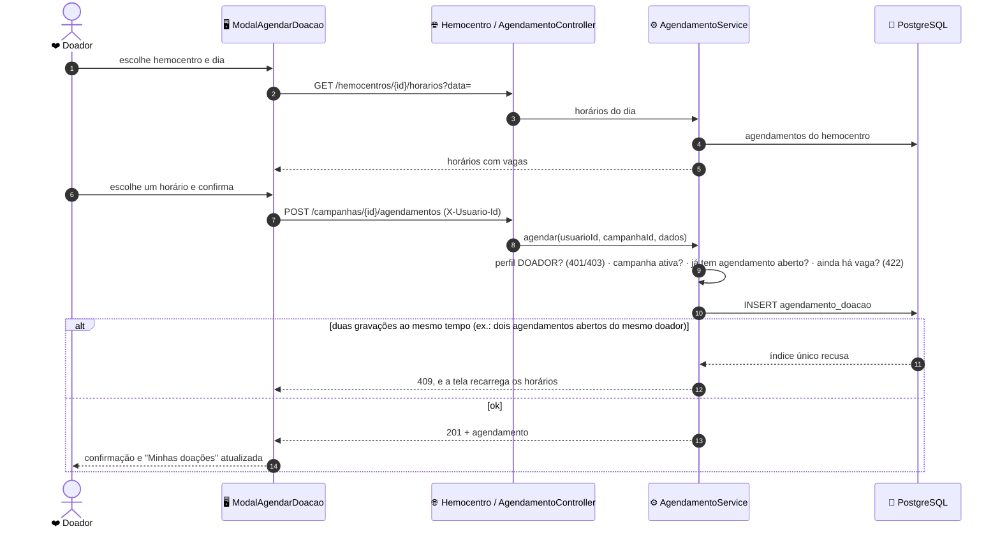
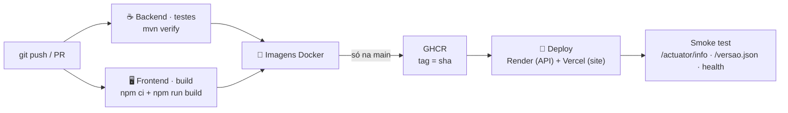

<h1 align="center">
  Rota Vital — Arquitetura 🏰   Componentes, camadas e fluxos de dados
</h1>

    
    
    
    

> Como o frontend (React + Vite), o backend (Spring Boot) e o banco (PostgreSQL/Supabase) se encaixam, onde fica
> cada responsabilidade e por onde passa cada dado. O [`README.md`](../README.md#arquitetura) traz o resumo; este
> documento, o detalhe. A visão de rede (VPC, sub-redes, portas) está em [`DIAGRAMA_ROTAVITAL.md`](DIAGRAMA_ROTAVITAL.md)
> e [`LIGACOES_E_REDES.md`](LIGACOES_E_REDES.md).

<h2 align="left">🧭 Sumário: </h2>

1. [Componentes](#1-componentes)
2. [Ambientes de execução](#2-ambientes)
3. [Separação de camadas](#3-camadas)
4. [Backend: pacotes](#4-backend)
5. [Frontend: pastas e rotas](#5-frontend)
6. [Módulos: da tela à tabela](#6-modulos)
7. [Fluxos de dados](#7-fluxos)
8. [Erros](#8-erros)
9. [Limites conhecidos](#9-limites)

<h2 align="left" id="1-componentes">🧩 1. Componentes</h2>

| Componente | Tecnologia | Porta | Papel |
| :--- | :--- | :--- | :--- |
| 🖥️ Frontend | React 18 + TypeScript + Vite + Tailwind CSS, servido pelo `nginx-unprivileged` | `8080` no container e na máquina | Entrega a SPA e repassa `/api/` e `/actuator/` para o backend ([`nginx/default.conf.template`](../frontend/nginx/default.conf.template)) |
| ☕ Backend | Spring Boot 3.3, Java 21, Spring Data JPA, Actuator | `8080` | API REST `/api/v1`; única peça que fala com o banco |
| 🐘 Banco | PostgreSQL 17 (container `db`) ou Supabase | `5432` | Dados; o schema vem só de [`supabase/migrations`](../supabase/migrations) |
| 🔑 Supabase Auth | Serviço do Supabase | HTTPS | Confere e-mail e senha no login e cria a conta do doador que se cadastra |
| 🗺️ OSRM + OpenStreetMap | Serviços públicos | HTTPS | Rota real e mapa da HU-07, chamados direto pelo navegador, com valores de exemplo se não responderem |

<h2 align="left" id="2-ambientes">🌍 2. Ambientes de execução</h2>

| Ambiente | Como sobe | Site | API | Banco |
| :--- | :--- | :--- | :--- | :--- |
| 💻 Desenvolvimento | `npm run dev` em `frontend/` + `mvn spring-boot:run` em `backend/` | Vite em `localhost:5173`, com proxy `/api` → `8080` ([`vite.config.ts`](../frontend/vite.config.ts)) | `localhost:8080` | Supabase ([`application.properties`](../backend/src/main/resources/application.properties)) |
| 🐳 Docker local | `npm run docker:local` | Nginx em `localhost:8080` | pelo Nginx, em `localhost:8080/api/` (direto em `localhost:8082`) | Postgres 17 do container `db`, volume `dados-postgres` |
| ☁️ Docker + Supabase | `npm run docker:cloud` | Nginx em `localhost:8080` | pelo Nginx, em `localhost:8080/api/` (direto em `localhost:8082`) | Supabase ([`compose.supabase.yaml`](../compose.supabase.yaml)) |
| 🚀 Produção (⏳ falta ligar as contas) | Esteira na `main` | Vercel, com rewrite `/api/` → Render ([`vercel.json`](../frontend/vercel.json)) | Render, imagem do GHCR ([`render.yaml`](../render.yaml)) | Supabase |

A mesma imagem do backend roda nos três últimos: o banco muda só pelas variáveis `SPRING_DATASOURCE_*`. Passo a passo
em [Como Executar](../README.md#como-executar).

<h2 align="left" id="3-camadas">🧱 3. Separação de camadas</h2>

O backend é um **MVC em camadas**, e a dependência anda num sentido só (de cima para baixo):

- **Controller** (`api`) só recebe o HTTP, converte JSON ↔ DTO e devolve o status. Nenhum controller injeta repositório.
- **Serviço** (`servico`) é a única camada com `@Transactional`: valida a entrada, confere o perfil pelo
  `IdentificacaoService` e chama o domínio e os repositórios.
- **Domínio** (`dominio`) guarda as regras que mais importam — compatibilidade ABO/Rh, FEFO, transições de status da
  bolsa, vagas da agenda, grafo e Dijkstra — sem depender de HTTP. Por isso elas são testadas sem subir o Spring.
- **Repositório** (`repositorio`) são interfaces do Spring Data. O Hibernate roda com `ddl-auto=validate`: só confere
  se as entidades batem com as tabelas e nunca muda o banco.

| Camada MVC | No Rota Vital |
| :--- | :--- |
| **Model** | `dominio/` (entidades e regras) + `repositorio/` |
| **View** | O frontend React inteiro; a API devolve só JSON |
| **Controller** | `api/` (+ `api/dto`), apoiado por `servico/` |

> **Por que não Clean Architecture pura:** as entidades do domínio levam as anotações JPA (`@Entity`, `@Table`), em
> vez de existir um modelo de domínio e outro de persistência com mapeadores entre eles. Para o tamanho do projeto, o
> segundo modelo dobraria o código sem trazer ganho; as regras continuam isoladas e testáveis.

<h2 align="left" id="4-backend">☕ 4. Backend: pacotes</h2>

Raiz: [`backend/src/main/java/com/rotavital`](../backend/src/main/java/com/rotavital).

| Pacote | O que tem | Principais classes |
| :--- | :--- | :--- |
| `RotaVitalApplication` | Ponto de entrada; carrega o `backend/.env` | — |
| `api` | 11 controllers REST e o `TratadorDeErros` | `AcessoController`, `DoadorController`, `EstoqueController`, `MovimentacaoDeBolsaController`, `AlertasDoEstoqueController`, `SugestaoDeLoteController`, `PacienteController`, `CampanhaController`, `AgendamentoController`, `HemocentroController`, `RotaController` |
| `api/dto/*` | Request e response por assunto: `acesso`, `comum`, `doacao`, `doador`, `estoque`, `paciente`, `requisicao`, `rota`, `telemetria` | `ErroDTO`, `BolsaHemocomponenteDTO`, `CampanhaDTO` |
| `servico` | Casos de uso, validação, permissão por perfil e as exceções que viram status HTTP | `EstoqueService`, `AgendamentoService`, `AutenticacaoService`, `IdentificacaoService` |
| `dominio` | Entidades JPA, enums e regras | `BolsaHemocomponente`, `CompatibilidadeSanguinea`, `Estoque`, `CampanhaDoacao`, `AgendaDoHemocentro`, `RedeDistribuicao` |
| `repositorio` | Interfaces Spring Data e as consultas às views do painel | `BolsaHemocomponenteRepository`, `ResumoEstoqueRepository` |
| `supabase` | Cliente REST do Supabase Auth: login (`/auth/v1/token`) e cadastro (`/auth/v1/signup`) | `SupabaseAuth` |
| `config` | CORS, relógio no fuso de Recife, log de cada requisição HTTP | `CorsConfig`, `RelogioConfig`, `HttpLoggingFilter` |
| `diagnostico` | `GET /api/v1/diagnostico`: conexão com o banco e últimas requisições | `DiagnosticoController`, `LogHttpService` |
| `benchmark` | Auditoria de telemetria sequencial × paralela (Infraestrutura de Software) | `BenchmarkController`, `AuditoriaTelemetriaService` |

Os testes ficam em [`backend/src/test`](../backend/src/test) em três níveis — unitário (JUnit 5, sem banco), integração
(Testcontainers com as migrations reais) e aceitação (Cucumber em português) —, descritos em
[Testes por nível](../README.md#cdt-testes).

<h2 align="left" id="5-frontend">🖥️ 5. Frontend: pastas e rotas</h2>

| Pasta (`frontend/src/`) | Responsabilidade |
| :--- | :--- |
| `pages/` | Uma pasta por tela |
| `components/` | Componentes de cada tela (`estoque/`, `pacientes/`, `donations/`, …) e o kit `ui/` |
| `services/` | `clienteHttp.ts` (fetch, timeout, header `X-Usuario-Id`) e `api.ts` (uma função por endpoint) |
| `context/` | Sessão (`ContextoAutenticacao`), dados compartilhados (`ContextoDados`) e avisos (`ContextoNotificacao`) |
| `hooks/` · `lib/` | Busca de hemocentros, hospitais e rotas; regras de exibição (alertas do painel, FEFO na tela) |
| `data/` | Dados de exemplo que ainda alimentam a Rede e a aba Recebidas |
| `routes/` · `types/` | Rotas do React Router e os DTOs do backend em TypeScript |

| Rota | Tela | Quem abre | De onde vêm os dados |
| :--- | :--- | :--- | :--- |
| `/login` | `PaginaLogin` | todos | `POST /acessos` |
| `/cadastro-doador` | `PaginaCadastroDoador` | qualquer pessoa | `POST /doadores` |
| `/painel` | `PaginaPainel` | médico, admin | estoque e campanhas da API; alertas calculados na tela |
| `/estoque` | `PaginaEstoque` | médico, admin | `GET`/`POST /hemocomponentes` |
| `/requisicao` | `PaginaRequisicao` | médico, admin | Campanha: `POST /campanhas` · Solicitar: estoque da API com FEFO na tela · Recebidas: exemplo |
| `/rede` | `PaginaRede` | médico, admin | dados de exemplo + OSRM |
| `/pacientes` | `PaginaPacientes` | médico (admin só consulta) | `/pacientes` |
| `/doacoes` | `PaginaDoacoes` | médico, admin | `/campanhas` e agendamentos |
| `/portal-doador` | `PaginaPortalDoador` | doador | `/campanhas`, `/agendamentos/meus`, `/doadores/eu`, `/hemocentros` |
| `/admin` | `PaginaAdmin` | admin | `GET /diagnostico` |

A proteção das rotas é feita no frontend ([`LayoutPrincipal.tsx`](../frontend/src/components/layout/LayoutPrincipal.tsx),
[`routes/index.tsx`](../frontend/src/routes/index.tsx)); na API, o que protege as ações é o perfil conferido no serviço
(ver [Limites conhecidos](#9-limites)).

<h2 align="left" id="6-modulos">📦 6. Módulos: da tela à tabela</h2>

| Módulo | Endpoints (`/api/v1`) | Serviços | Tabelas |
| :--- | :--- | :--- | :--- |
| 🔑 Acesso e Perfis | `/acessos`, `/doadores`, `/doadores/eu` | `AutenticacaoService`, `DoadorService` | `usuario` (+ `auth.users` do Supabase) |
| 📦 Estoque | `/bancos/{bancoId}/estoque`, `/resumo`, `/alertas`, `/hemocomponentes` | `EstoqueService`, `ResumoEstoqueService`, `AlertasDoEstoqueService`, `MovimentacaoDeBolsaService` | `bolsa_hemocomponente`, `ponto_rede`, `vw_estoque_por_tipo`, `vw_estoque_agrupado` |
| 🏥 Requisições | `/bancos/{bancoId}/sugestao-lote` | `SugestaoDeLoteService` | `bolsa_hemocomponente` (`requisicao_hospitalar` e `alocacao` existem só no schema) |
| ❤️ Pacientes e Doações | `/pacientes`, `/campanhas`, `/agendamentos`, `/hemocentros` | `PacienteService`, `CampanhaService`, `AgendamentoService` | `paciente`, `campanha_doacao`, `agendamento_doacao`, `ponto_rede` |
| 🚚 Rede | `/pontos`, `/conexoes`, `/rotas` | `RedeDistribuicaoService` | `ponto_rede`, `conexao` |
| 🌡️ Telemetria | só contrato | — | `entrega`, `leitura_telemetria` (só schema) |

Contrato × domínio × banco, campo a campo, em [`MODULOS.md`](MODULOS.md) e [`DER.md`](DER.md).

<h2 align="left" id="7-fluxos">🔄 7. Fluxos de dados</h2>

<h3 align="left">7.1 Login e identificação</h3>

A partir daí, o `clienteHttp.ts` manda o `id` no header `X-Usuario-Id` de toda chamada. Nas ações que exigem perfil, o
`IdentificacaoService` busca o usuário: header ausente ou id inexistente → `401`; papel sem permissão → `403`.

<h3 align="left">7.2 Cadastro de bolsa (HU-03)</h3>

O formulário usa `noValidate`: quem valida é a API, e a tela mostra a mensagem que ela devolveu. Parte das regras
também existe como `CHECK` nas migrations (ex.: prazo máximo de cada componente), então o banco recusa a bolsa
inválida mesmo numa gravação feita fora da API.

<h3 align="left">7.3 Agendamento de doação (HU-09)</h3>

<h3 align="left">7.4 Do commit à produção</h3>

Detalhes, segredos e rollback em [Pipeline e deploy](../README.md#cdt-pipeline) ([`esteira.yml`](../.github/workflows/esteira.yml)).

<h2 align="left" id="8-erros">🚨 8. Erros</h2>

Toda resposta de erro sai do [`TratadorDeErros`](../backend/src/main/java/com/rotavital/api/TratadorDeErros.java) no
formato RFC 7807 (`ErroDTO`), com a explicação em português no `detail`.

| Exceção | Status | Quando |
| :--- | :---: | :--- |
| `DadosInvalidosException`, parâmetro ou JSON ilegível | `400` | Campo faltando, valor fora do formato, enum desconhecido |
| `CredenciaisInvalidasException`, `UsuarioNaoIdentificadoException` | `401` | Login recusado; ação sem `X-Usuario-Id` ou com id inexistente |
| `AcessoNegadoException` | `403` | O perfil não pode fazer a ação (ex.: doador publicando campanha) |
| `RecursoNaoEncontradoException` | `404` | Id que não existe |
| `DataIntegrityViolationException` | `409` | Duas gravações ao mesmo tempo que o índice único do banco recusou |
| `RegraDeNegocioException` | `422` | Regra do domínio (bolsa vencida, transição de status proibida, campanha encerrada, sem vaga) |
| `AutenticacaoIndisponivelException` | `503` | Supabase Auth fora do ar ou `SUPABASE_KEY` ausente |

<h2 align="left" id="9-limites">🚧 9. Limites conhecidos</h2>

| Limite | Impacto | Onde está registrado |
| :--- | :--- | :--- |
| A API identifica o usuário pelo header `X-Usuario-Id` e ainda não confere o token do Supabase | Quem souber um id consegue agir como aquele usuário | Decisão 6 de [`PERFIS_DE_ACESSO.md`](PERFIS_DE_ACESSO.md) |
| Rede (HU-07) e aba Recebidas (HU-05) usam dados de exemplo | O mapa e os recebimentos não refletem o banco | [`MODULOS.md`](MODULOS.md) |
| Conclusão de procedimento (HU-08) não é gravada | O paciente atendido sai da fila só na sessão | `ContextoDados.tsx` |
| Requisições e Telemetria só no contrato | Sem controller nem entidade | [`openapi.yaml`](openapi.yaml) |
| `openapi.yaml` não descreve `/doadores`, `/hemocentros` e `/diagnostico` | O Swagger mostra menos que a API | [Catálogo da API](../README.md#api) |
| Produção ainda não ligada | Sem URL pública | [Evidências do E3](../README.md#cdt-evidencias-e3) |
