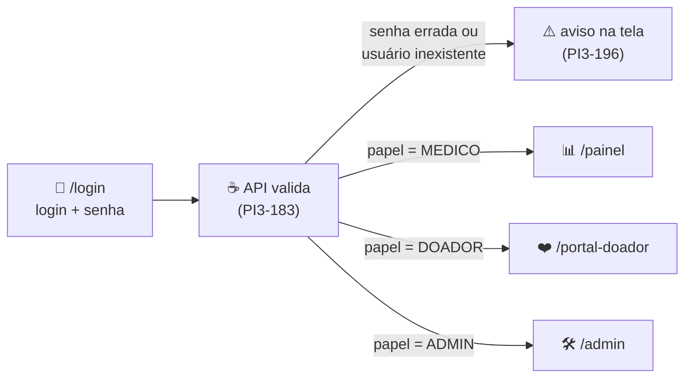

<h1 align="center">
  Perfis de Acesso 🔐   Quem entra no sistema e o que cada perfil vê
</h1>

    
    
    

> Decisão da **PI3-182** (subtask da PI3-171 · Sistema de login): quais perfis existem, como cada um entra e
> o que cada um vê e pode fazer. A situação atual foi levantada no código e no Supabase em **10/10/2026**. As
> decisões e o motivo de cada uma estão na [seção 6](#6-decisoes); o que muda em cada task está na
> [seção 7](#7-impacto). A prova de que as telas por perfil funcionam como descrito está em
> [`evidencias/PI3-182_perfis_de_acesso.md`](evidencias/PI3-182_perfis_de_acesso.md).

> [!NOTE]
> **Implementado em 14/10/2026:** PI3-183 (login validado na API com Supabase Auth), PI3-184 (cada perfil vai
> para a sua tela, inclusive o ajuste do `/portal-doador`) e a tela da PI3-196 (avisos no formulário, com a
> mesma mensagem para senha errada e e-mail sem cadastro). Evidências:
> [`evidencias/PI3-184_PI3-196_login.md`](evidencias/PI3-184_PI3-196_login.md). A seção 2 continua mostrando
> como o sistema estava antes, em 10/10/2026.

<h2 align="left">🧭 Sumário: </h2>

1. [Resumo das decisões](#1-resumo)
2. [Como está hoje](#2-hoje)
3. [Perfis: quem entra](#3-perfis)
4. [O que cada perfil vê (telas)](#4-telas)
5. [O que cada perfil pode fazer (ações)](#5-acoes)
6. [Decisões](#6-decisoes)
7. [Impacto nas outras tasks](#7-impacto)
8. [Fora do escopo desta sprint](#8-fora)

<h2 align="left" id="1-resumo">📌 1. Resumo das decisões</h2>

- **Três perfis:** `MEDICO` e `DOADOR` (os usuários do dia a dia) e `ADMIN` (equipe técnica).
- **Todos entram com login e senha.** O perfil vem do cadastro do usuário, e não de um card que a própria
  pessoa escolhe na tela de login.
- **Não existe perfil "hospital":** o hospital é a instituição do médico (`usuario.ponto_rede_id`), não uma
  pessoa que faz login.
- **As telas continuam como já são hoje** (seção 4). O que muda é a forma de entrar.

<h2 align="left" id="2-hoje">🔎 2. Como está hoje</h2>

| Ponto | Situação em 10/10/2026 | Onde |
| :--- | :--- | :--- |
| Entrada | A pessoa escolhe o card **Médico** ou **Doador** e digita o nome. Não há senha. | [`PaginaLogin.tsx`](../frontend/src/pages/Login/PaginaLogin.tsx) |
| Admin | Quem digita **"admin"** no campo de nome entra como administrador. | [`PaginaLogin.tsx`](../frontend/src/pages/Login/PaginaLogin.tsx) |
| Backend no login | `POST /api/v1/acessos` existe, mas o frontend não o chama. O enum `TipoAcesso` só tem `MEDICO` e `DOADOR`. | [`AcessoController.java`](../backend/src/main/java/com/rotavital/api/AcessoController.java), [`TipoAcesso.java`](../backend/src/main/java/com/rotavital/api/dto/acesso/TipoAcesso.java) |
| Proteção das telas | Feita no frontend: sem login vai para `/login`; doador é mandado para o portal; só admin abre `/admin`. | [`LayoutPrincipal.tsx`](../frontend/src/components/layout/LayoutPrincipal.tsx), [`routes/index.tsx`](../frontend/src/routes/index.tsx), [`PaginaPortalDoador.tsx`](../frontend/src/pages/PortalDoador/PaginaPortalDoador.tsx) |
| Menu | Mesmo menu para médico e admin; o admin vê também "Diagnóstico & Logs". | [`BarraLateral.tsx`](../frontend/src/components/layout/BarraLateral.tsx) |
| API | Nenhum endpoint exige login (contrato: "Autenticação: nenhuma no MVP"). | [`openapi.yaml`](openapi.yaml) |
| Banco | A tabela `usuario` já existe, com `papel` restrito a `MEDICO` ou `DOADOR`, `auth_user_id` apontando para o Supabase Auth e `ponto_rede_id` para a instituição do médico. Está **vazia**. | [`DER.md`, seção 4.3](DER.md), migration [`escopo_clinico`](../supabase/migrations/20260925120100_escopo_clinico.sql) |

<h2 align="left" id="3-perfis">👥 3. Perfis: quem entra</h2>

| Perfil | Quem é | Tela inicial | Como entra | No banco (`usuario`) |
| :--- | :--- | :--- | :--- | :--- |
| 🩺 **Médico** | Profissional do hospital ou do hemocentro | `/painel` | Login e senha | `papel = 'MEDICO'`, `ponto_rede_id` = instituição |
| ❤️ **Doador** | Voluntário que doa sangue | `/portal-doador` | Login e senha | `papel = 'DOADOR'`, `tipo_sanguineo` preenchido |
| 🛠️ **Admin** | Equipe técnica, para diagnóstico e demonstração | `/admin` | Login e senha | `papel = 'ADMIN'` (precisa de migration, ver [seção 7](#7-impacto)) |

**Por que não criar um perfil "hospital":**

- Nenhuma história de usuário (HU-01 a HU-10) tem "hospital" como ator.
- O card do médico na tela de login já diz "Acesso hospitalar completo".
- O banco já liga cada médico à sua instituição por `usuario.ponto_rede_id`. No domínio, hospital é um ponto
  da rede de distribuição, não uma pessoa.
- Só valeria a pena criar se aparecer alguém com permissões diferentes das do médico (por exemplo, um
  funcionário que só faz requisições e não pode ver o estoque).

<h2 align="left" id="4-telas">🖥️ 4. O que cada perfil vê (telas)</h2>

A tabela abaixo é **o que o código já faz hoje** e passa a ser a regra oficial.

| Tela | Rota | HU | 🩺 Médico | ❤️ Doador | 🛠️ Admin |
| :--- | :--- | :---: | :---: | :---: | :---: |
| Início (painel operacional) | `/painel` | HU-02 | ✅ | ❌ | ✅ |
| Estoque | `/estoque` | HU-03 | ✅ | ❌ | ✅ |
| Requisição (solicitar, recebidas, campanha) | `/requisicao` | HU-04 a 06 | ✅ | ❌ | ✅ |
| Rede hospitalar | `/rede` | HU-07 | ✅ | ❌ | ✅ |
| Pacientes | `/pacientes` | HU-08 | ✅ | ❌ | ✅ |
| Doações (versão completa, com menu) | `/doacoes` | HU-09 | ✅ | ❌ | ✅ |
| Portal do doador (versão simplificada) | `/portal-doador` | HU-10 | ❌ | ✅ | ❌ |
| Diagnóstico e logs | `/admin` | — | ❌ | ❌ | ✅ |

> [!NOTE]
> Ajuste pequeno para a PI3-184: hoje um médico ou admin que abre `/portal-doador` é mandado para `/login`
> mesmo estando logado. O esperado é ir para a sua tela inicial.

<h2 align="left" id="5-acoes">✍️ 5. O que cada perfil pode fazer (ações)</h2>

Ver uma tela não é o mesmo que poder gravar algo nela. Para as ações que gravam dados, o banco já define
quem pode fazer o quê (FKs compostas `(id, papel)` → `usuario`, ver [`DER.md`](DER.md)).

| Ação | HU | 🩺 Médico | ❤️ Doador | 🛠️ Admin | O banco já garante? |
| :--- | :---: | :---: | :---: | :---: | :--- |
| Consultar painel, estoque, rede e pacientes | HU-02, 03, 07, 08 | ✅ | ❌ | ✅ | — (só leitura) |
| Solicitar hemocomponente | HU-04 | ✅ | ❌ | ❌ | Não (`solicitante_id` é FK simples) |
| Registrar recebimento de remessa | HU-05 | ✅ | ❌ | ❌ | Não (`conferida_por` é FK simples) |
| Publicar campanha de doação | HU-06 | ✅ | ❌ | ❌ | **Sim:** `publicada_por_papel = 'MEDICO'` |
| Concluir procedimento (baixa por FEFO) | HU-08 | ✅ | ❌ | ❌ | **Sim:** `responsavel_papel = 'MEDICO'` |
| Ver pessoas que precisam de doação | HU-09, 10 | ✅ | ✅ | ✅ | — (só leitura) |
| Agendar doação | HU-09, 10 | ❌ ([decisão 5](#6-decisoes)) | ✅ | ❌ | **Sim:** `doador_papel = 'DOADOR'` |
| Ver diagnóstico do backend, Supabase e logs | — | ❌ | ❌ | ✅ | — (só tela) |

<h2 align="left" id="6-decisoes">🗳️ 6. Decisões</h2>

| # | Pergunta | Decisão | Por quê |
| :---: | :--- | :--- | :--- |
| 1 | Quais perfis existem? | `MEDICO`, `DOADOR` e `ADMIN`, sem perfil hospital | Ver [seção 3](#3-perfis) |
| 2 | O admin pode fazer ações que gravam dados (requisição, campanha, procedimento)? | **Não.** Vê todas as telas e o diagnóstico, mas não grava ações clínicas | O banco já exige `MEDICO` em campanha e procedimento; um admin gravando quebraria essas regras |
| 3 | Onde o admin fica cadastrado? | Na tabela `usuario`, com `papel = 'ADMIN'` | Todo mundo entra do mesmo jeito; só precisa incluir `ADMIN` no `CHECK` de `papel` |
| 4 | Como cada um entra? | Login e senha para os três perfis, usando o **Supabase Auth** | O schema já prevê isso: `usuario.auth_user_id` → `auth.users` (HU-F01). A alternativa seria uma coluna própria de senha (guardada como hash) |
| 5 | O médico pode agendar doação? A HU-09 diz que sim. | **Não.** O médico vê a lista e publica campanhas; quem agenda é o doador | O banco só aceita agendamento com `doador_papel = 'DOADOR'`. O texto da HU-09 no README ("médico ou doador ... agendar") fica desatualizado e precisa ser ajustado |
| 6 | A API vai bloquear por perfil (`403`) já nesta sprint? | **Não**, fica para a próxima sprint | Nesta sprint: login validado na API (PI3-183) e telas protegidas no frontend (PI3-184). Esconder telas no frontend não é segurança de verdade: a API continua aberta para quem souber a URL |

<h2 align="left" id="7-impacto">🔗 7. Impacto nas outras tasks</h2>

| Task | O que muda com estas decisões |
| :--- | :--- |
| **PI3-183** · Validação de usuário e senha na API | Autenticar contra a tabela `usuario` com o Supabase Auth (decisão 4) e devolver o `papel` e a tela inicial. Incluir `ADMIN` no `TipoAcesso` e, por migration, no `CHECK` de `usuario.papel`. Cadastrar usuários de teste dos três perfis, porque a tabela está vazia. |
| **PI3-184** · Levar cada perfil para a sua tela | Usar o `papel` devolvido pela API. Tirar da tela de login os cards de escolha de perfil e o atalho de digitar "admin". Corrigir o redirecionamento de `/portal-doador` (nota da [seção 4](#4-telas)). |
| **PI3-196** · Avisos de senha errada e usuário inexistente | Respostas de erro no formato `ErroDTO` (RFC 7807), como os outros endpoints. Recomendação: a mesma mensagem para senha errada e usuário inexistente, para não revelar quais logins existem. O título da task fala em dois avisos, então vale combinar isso com quem pegou a 196. |
| Contrato da API | Atualizar o login (`POST /acessos` ou um endpoint novo) em [`openapi.yaml`](openapi.yaml) e [`CONTRATOS_DE_API.md`](CONTRATOS_DE_API.md). |

<h2 align="left" id="8-fora">🚫 8. Fora do escopo desta sprint</h2>

- Bloqueio por perfil nos endpoints da API (`403`), conforme a decisão 6.
- Perfil de **gestor da rede** com visão de vários hemocentros (HU-F02).
- Cadastro feito pelo próprio usuário e recuperação de senha. No MVP, os usuários são cadastrados manualmente.
- Perfil **hospital** separado do médico, a não ser que surja uma necessidade (ver [seção 3](#3-perfis)).
