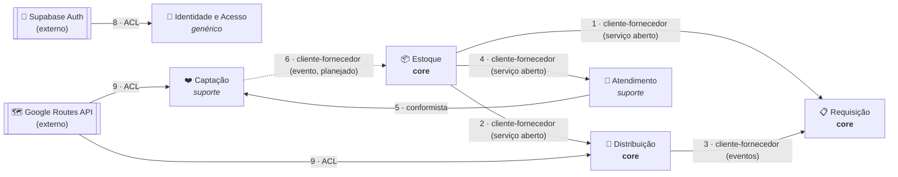

<h1 align="center"> Rota Vital — A. Remodelagem do domínio com DDD 🧩 
  

</h1>

> [!NOTE]
> Trabalho U2 · Parte 2 · Seção A (0,6). Versão final (a pré-entrega parcial foi em 17/11/2026).
> Índice e status das outras seções em [`README.md`](README.md).

<b>De onde partimos.</b> Hoje o backend é um monolito organizado por camada técnica (<code>api</code>, <code>servico</code>,
<code>dominio</code>, <code>repositorio</code>). O pacote <a href="../../backend/src/main/java/com/rotavital/dominio"><code>dominio</code></a>
tem 42 classes de assuntos diferentes — estoque, doação, rede, pacientes e acesso — que se enxergam livremente. A
remodelagem separa esse código por assunto do negócio, cada um com a sua linguagem.

**📑 Sumário**

| # | Seção | O que você encontra |
| :---: | :--- | :--- |
| A.1 | [🗂️ Subdomínios](#a1-subdominios) | Core, suporte e genérico, com a justificativa de cada um |
| A.2 | [🧭 Bounded contexts](#a2-bounded-contexts) | Os seis contextos e as classes de hoje que vão para cada um |
| A.3 | [📖 Glossário da linguagem ubíqua](#a3-glossario) | Termos do negócio, com os que mudam de sentido entre contextos |
| A.4 | [🗺️ Mapa de contextos](#a4-mapa-de-contextos) | Relações fornecedor → cliente e como estão hoje no código |
| A.5 | [📣 Eventos de domínio](#a5-eventos) | Quem publica e quem consome (opcional) |
| A.6 | [✅ Decisões depois da devolutiva](#a6-devolutiva) | As três dúvidas da pré-entrega, já decididas |

<h2 align="center" id="a1-subdominios">🗂️ A.1 Subdomínios  

</h2>

| Subdomínio | Tipo | Justificativa |
| :--- | :---: | :--- |
| 📦 Gestão do estoque de hemocomponentes |  | É onde o Rota Vital evita perda e erro: FEFO, compatibilidade ABO/Rh por componente e cadeia fria decidem qual bolsa pode ir para qual paciente. |
| 📋 Requisição hospitalar |  | O pedido do hospital é o que dispara o fluxo inteiro: ele é priorizado pela urgência e acompanhado até a entrega, ligando estoque e rede. |
| 🚚 Distribuição na rede |  | Rota mínima (Dijkstra) e transferência rastreada entre hemocentro e hospital, com previsão de chegada: é o "Rota" do nome. |
| ❤️ Captação de doadores |  | Necessária para repor o estoque (campanhas e agenda do hemocentro), mas segue regras comuns de agenda e não é o diferencial. |
| 🏥 Atendimento ao paciente |  | Cadastro e fila de pacientes por gravidade alimentam campanhas e requisições, sem regra de negócio complexa. |
| 🌡️ Monitoramento da cadeia fria |  | Leituras de temperatura durante a entrega; hoje existe só no contrato e no schema (`entrega`, `leitura_telemetria`). |
| 🔑 Identidade e acesso |  | Login e papéis são resolvidos pelo Supabase Auth; todo sistema precisa e não há o que inventar. |
| 🗺️ Geolocalização e trajetos |  | Distância e tempo pelas ruas vêm da Routes API do Google; é serviço comprado, não construído. |

<h2 align="center" id="a2-bounded-contexts">🧭 A.2 Bounded contexts  

</h2>

Seis contextos, cada um com o seu modelo. A última coluna mostra que a divisão sai do código que já existe.

| Contexto | Responsabilidade | Subdomínio | Classes de hoje que vão para ele |
| :--- | :--- | :--- | :--- |
| 📦 **Estoque** | Manter as bolsas de cada banco de sangue e decidir quais estão aptas, em que ordem (FEFO) e para qual tipo sanguíneo. | Estoque (core) | `BolsaHemocomponente`, `Estoque`, `BancoDeSangue`, `CompatibilidadeSanguinea`, `AlertaDeEstoque`, `StatusBolsa` |
| 📋 **Requisição** | Receber o pedido de hemocomponentes do hospital, priorizá-lo pela urgência e acompanhá-lo até a entrega ou o cancelamento. | Requisição (core) | `RequisicaoHospitalar`, `FilaRequisicoesHospitalares`, `StatusRequisicao`, `NivelUrgencia` (hoje só no DTO) |
| 🚚 **Distribuição** | Calcular a rota entre os pontos da rede e registrar a saída e a chegada de cada bolsa transferida. | Distribuição (core) | `RedeDistribuicao`, `Conexao`, `PontoDeRede`, `Hospital`, `RotaCalculada`, `TransferenciaDeBolsa`, `StatusTransferencia` |
| ❤️ **Captação** | Publicar campanhas de doação e agendar doadores nos horários do hemocentro. | Captação (suporte) | `CampanhaDoacao`, `AgendamentoDoacao`, `AgendaDoHemocentro`, `StatusCampanha`, `StatusAgendamento` |
| 🏥 **Atendimento** | Cadastrar os pacientes de cada hospital, ordená-los pela gravidade e registrar o procedimento que encerra o atendimento. | Atendimento (suporte) | `Paciente`, `Gravidade`, `StatusPaciente`, `Sexo` |
| 🔑 **Identidade e Acesso** | Autenticar a pessoa e dizer qual papel ela tem (médico, doador ou admin). | Identidade (genérico) | `Usuario`, `PapelUsuario`, `SupabaseAuth` |

> [!NOTE]
> - **Geolocalização** não vira contexto: não tem linguagem própria, só traduz a API do Google. Fica num módulo
>   genérico compartilhado (`compartilhado.geo`, ver [Seção C](C-tres-camadas.md#c3-estrutura-de-pacotes)).
> - **Monitoramento da cadeia fria** entra como sétimo contexto quando sair do papel; é candidato natural à
>   projeção serverless da Seção D (leituras de telemetria acionando funções).

<h2 align="center" id="a3-glossario">📖 A.3 Glossário da linguagem ubíqua  

</h2>

As duas primeiras tabelas mostram onde o modelo único de hoje mistura as coisas: <b>o mesmo termo com sentidos
diferentes</b> em dois contextos e <b>dois termos para a mesma coisa</b>.

<h4 align="left">⚠️ Mesmo termo, sentidos diferentes</h4>

| Termo | Contexto | Significado |
| :--- | :--- | :--- |
| **Bolsa** | Estoque | Unidade física de hemocomponente com validade, volume, temperatura e status (`DISPONIVEL` → `RESERVADA` → …); é o que se reserva, descarta ou usa. |
| **Bolsa** | Distribuição | Item de carga de uma transferência: interessam origem, destino, trajeto, quem despachou e quando chega. A validade só é conferida na saída. |
| **Paciente** | Atendimento | Pessoa internada num hospital, com tipo sanguíneo, gravidade (crítico, atenção, estável) e status na fila. |
| **Paciente** | Captação | O beneficiário de uma campanha: o doador só precisa saber quem é, de que tipo sanguíneo precisa e em que hospital está. |

Hoje cada par é **uma classe só**: `TransferenciaDeBolsa` guarda a `BolsaHemocomponente` inteira, e `CampanhaDoacao`
guarda o `Paciente` inteiro. Na remodelagem, cada contexto tem o seu modelo (relações 2 e 5 do [mapa](#a4-mapa-de-contextos)).

<h4 align="left">🔁 Termos diferentes, mesma coisa</h4>

| Termo | Contexto | Significado |
| :--- | :--- | :--- |
| **Banco de sangue** | Estoque | Ponto da rede que é dono de um estoque de bolsas. |
| **Hemocentro** | Captação | O **mesmo** ponto da rede (mesma linha de `ponto_rede`) visto pelo doador: endereço, expediente e horários com vaga. |

<h4 align="left">📚 Demais termos</h4>

| Termo | Contexto | Significado |
| :--- | :--- | :--- |
| Hemocomponente | Compartilhado | Hemácias, plasma, plaquetas ou crioprecipitado; cada um tem faixa de temperatura e prazo máximo de validade. |
| Tipo sanguíneo | Compartilhado | Grupo ABO mais fator Rh (8 valores), do doador, da bolsa ou do paciente. |
| Compatibilidade | Estoque | Regra que diz se uma bolsa pode ir para um receptor, por componente: nas hemácias, O− serve a todos e Rh+ nunca vai para Rh−; no plasma, o ABO se inverte. |
| Bolsa apta | Estoque | Disponível, dentro da validade (vencer hoje ainda vale) e dentro da faixa de temperatura do componente. |
| FEFO | Estoque | *First Expired, First Out*: entre as bolsas aptas, sai primeiro a que vence primeiro. |
| Lote sugerido | Estoque | Bolsas aptas e compatíveis, ordenadas com o mesmo tipo primeiro (para poupar O−) e depois por FEFO. |
| Requisição | Requisição | Pedido de um hospital por N bolsas de um componente e tipo, com urgência; vai de `PENDENTE` a `ENTREGUE` ou `CANCELADA`. |
| Transferência | Distribuição | Saída de uma bolsa do hemocentro para um hospital, com trajeto, chegada prevista e confirmação de recebimento. |
| Rota mínima | Distribuição | Menor caminho entre dois pontos da rede (Dijkstra sobre a distância das conexões), com aviso se cabe na janela de entrega. |
| Trajeto | Geolocalização | Distância e tempo pelas ruas entre dois pontos, com a fonte: Google, estimativa em linha reta ou conexões da rede. |
| Campanha | Captação | Chamada pública por doadores para um paciente; fica `ATIVA` até ser encerrada. |
| Agendamento | Captação | Horário de um doador num hemocentro para uma campanha: `AGENDADO` → `REALIZADO`, `CANCELADO` ou `FALTOU`. |
| Papel | Identidade e Acesso | `MEDICO`, `DOADOR` ou `ADMIN`; define as telas e as ações permitidas. |

<h2 align="center" id="a4-mapa-de-contextos">🗺️ A.4 Mapa de contextos  

</h2>

Setas do contexto <b>fornecedor (upstream)</b> para o <b>cliente (downstream)</b>. Números iguais aos da tabela abaixo.

| # | Fornecedor → Cliente | Padrão | O que passa entre eles | Como está hoje no código |
| :---: | :--- | :--- | :--- | :--- |
| 1 | Estoque → Requisição | Cliente-fornecedor; serviço aberto do Estoque | A Requisição pede o lote sugerido e a reserva das bolsas; fica sabendo de bolsa descartada pelo evento `BolsaDescartada` | `Estoque.sugerirLotes`, exposto em `GET /bancos/{id}/sugestao-lote`; a requisição ainda não é gravada |
| 2 | Estoque → Distribuição | Cliente-fornecedor; serviço aberto do Estoque | A Distribuição pede ao Estoque para liberar a saída da bolsa (`conferirEnvio`) e para registrar a chegada; fica sabendo de descarte pelo `BolsaDescartada` | `TransferenciaDeBolsa.despachar` e `receber` chamam `bolsa.despacharPara` e `bolsa.receberEm` direto, na mesma transação |
| 3 | Distribuição → Requisição | Cliente-fornecedor, por eventos | `BolsaDespachada` e `TransferenciaRecebida` levam a requisição a `EM_TRANSITO` e `ENTREGUE` | Não existe: a transferência não aponta para nenhuma requisição |
| 4 | Estoque → Atendimento | Cliente-fornecedor; serviço aberto do Estoque | Ao concluir o procedimento do paciente (HU-08), o Atendimento pede a baixa por FEFO; a resposta diz quantas unidades faltaram | A tela de Pacientes baixa por FEFO só na sessão do navegador (`ContextoDados.tsx`); no backend, a baixa é o `PATCH /hemocomponentes/{id}` para `UTILIZADA` |
| 5 | Atendimento → Captação | Conformista | A campanha usa o paciente como o Atendimento o define; o evento `PacienteAtualizado` mantém a cópia em dia | `CampanhaDoacao` guarda o `Paciente` inteiro e o `CampanhaDTO` devolve o `PacienteDTO` completo |
| 6 | Captação → Estoque | Cliente-fornecedor, por evento (planejado) | `DoacaoRealizada` vira bolsa nova no estoque | Não existe |
| 7 | Identidade e Acesso → todos | Conformista | Quem é a pessoa e qual o papel dela | `IdentificacaoService` lê o header `X-Usuario-Id` em cada ação |
| 8 | Supabase Auth → Identidade e Acesso | Camada anticorrupção | Respostas do Supabase viram `SessaoAutenticada` e `ContaCriada` | **Já existe:** interfaces `VerificadorDeCredenciais` e `CriadorDeContas`, implementadas por `SupabaseAuth` |
| 9 | Google Routes → Distribuição e Captação | Camada anticorrupção | A resposta da Routes API vira `Trajeto` (km, minutos, fonte) | **Já existe:** interface `CalculadoraDeTrajeto`, implementada por `GoogleRoutes` |
| 10 | Estoque, Requisição, Atendimento e Captação | Núcleo compartilhado | `TipoSanguineo` e `TipoComponente` | Enums do pacote `dominio`, usados por todos |

As relações 7 e 10 ficam fora do desenho porque ligam todos os contextos; o desenho mostra só as que mudam
alguma coisa na remodelagem.

<h4 align="left">🧭 Como lemos a direção das setas</h4>

A seta sai de quem **define o contrato** (a API ou o evento) e chega em quem se adapta a ele. Com essa regra, cada
par de contextos tem **uma direção só**:

- **O Estoque é o dono da bolsa: só ele muda o status dela.** Requisição, Distribuição e Atendimento pedem pelo serviço
  aberto do Estoque (reservar, liberar a saída, registrar a chegada, dar baixa) e ficam sabendo do resto pelos eventos
  que ele publica. Por isso ele é o fornecedor dos três (relações 1, 2 e 4).
- **O Estoque não escuta o despacho nem a chegada.** A Distribuição pede ao Estoque e depois publica `BolsaDespachada`
  e `TransferenciaRecebida`, que quem escuta é a Requisição (relação 3).
- **Entre os contextos do negócio, só uma seta chega ao Estoque: a da Captação** (relação 6). A doação é um fato da
  Captação, e o Estoque se adapta a ele.

> [!IMPORTANT]
> **O que muda em relação a hoje.** As relações 2 e 5 são os pontos onde um contexto mexe no modelo do outro. Na
> remodelagem, a Distribuição pede ao Estoque para liberar a saída e registrar a chegada da bolsa (em vez de mudar o
> status dela direto), e a Captação guarda só o que precisa do paciente (nome, tipo sanguíneo e hospital), em vez da
> entidade inteira.

<h2 align="center" id="a5-eventos">📣 A.5 Eventos de domínio  

</h2>

Cada evento corre no mesmo sentido de uma seta do <a href="#a4-mapa-de-contextos">mapa</a>: quem publica é o fornecedor.

| Evento | Publica | Consomem | Relação | Hoje |
| :--- | :--- | :--- | :---: | :--- |
| 🚚 `BolsaDespachada` | Distribuição | Requisição (`EM_TRANSITO`) | 3 | Não existe: o despacho muda a bolsa direto e não há requisição |
| 📥 `TransferenciaRecebida` | Distribuição | Requisição (`ENTREGUE`) | 3 | Não existe: a chegada muda a bolsa direto (`bolsa.receberEm`) |
| 🗑️ `BolsaDescartada` | Estoque | Distribuição (cancela a transferência em trânsito), Requisição (pede outro lote) | 2 e 1 | `MovimentacaoDeBolsaService` cancela a transferência direto |
| ✏️ `PacienteAtualizado` | Atendimento | Captação (atualiza o paciente divulgado na campanha) | 5 | A campanha guarda o `Paciente` inteiro e vê a mudança sem evento (`PacienteService`) |
| ❤️ `DoacaoRealizada` | Captação | Estoque (registra a bolsa nova) | 6 | Não existe |

> [!NOTE]
> O que muda a bolsa **não é evento**: reservar, liberar a saída, registrar a chegada e dar baixa no procedimento
> (HU-08) são pedidos ao serviço aberto do Estoque (relações 1, 2 e 4). Assim nenhum evento entra no Estoque vindo de
> quem depende dele.

Esses eventos são a base da comunicação entre serviços e da saga da Seção D.

<h2 align="center" id="a6-devolutiva">✅ A.6 Decisões depois da devolutiva  

</h2>

Na pré-entrega o squad deixou três dúvidas abertas. A decisão de cada uma:

| # | Ponto | Decisão | Por quê |
| :---: | :--- | :--- | :--- |
| 1️⃣ | **Requisição como core** | **Mantida como core** | A requisição tem regra própria que diferencia o Rota Vital: prioridade por urgência, ciclo `PENDENTE → ALOCADA → EM_TRANSITO → ENTREGUE` e a saga da [Seção D](D-microsservicos.md#d3-saga), que ela orquestra. Escolher as bolsas continua no Estoque. |
| 2️⃣ | **Atendimento separado da Requisição** | **Mantido separado** | "Paciente" tem dois sentidos e o Atendimento muda por motivos diferentes (cadastro e gravidade). Juntar os dois esconderia o termo duplo e acoplaria a fila do hospital à reserva de bolsas. |
| 3️⃣ | **Contexto core da Seção B** | **Estoque, agregado `Bolsa`** | É onde a devolutiva pediu domínio rico: as invariantes já existem e estão testadas, e três delas ainda estão fora do objeto (no `EstoqueService`). A [Seção B](B-modelo-tatico.md) trata disso. |

<a href="README.md">⬅️ Índice</a> · <a href="B-modelo-tatico.md">B. Modelo tático ➡️</a>

