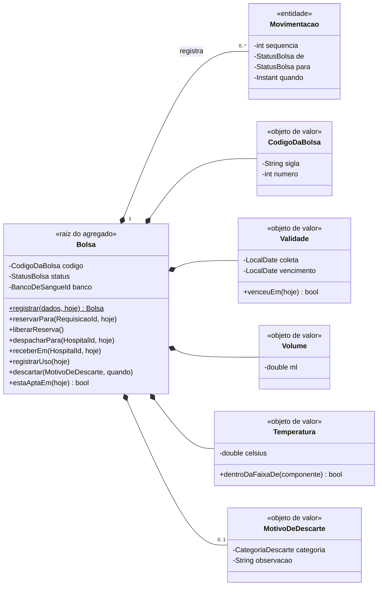

<h1 align="center"> Rota Vital — B. Modelo tático do Estoque 🧠<br>
 <br>


</h1>

> [!NOTE]
> Trabalho U2 · Parte 2 · Seção B (0,4). Contexto escolhido: **Estoque** (core), como proposto na
> [A.6](A-remodelagem-ddd.md#a6-devolutiva). Responde ao ponto 1 da devolutiva de 17/11: **modelo de domínio rico, sem
> entidades anêmicas**.

**📑 Sumário**

| # | Seção | O que você encontra |
| :---: | :--- | :--- |
| B.1 | [🔎 De onde partimos](#b1-diagnostico) | O que já é rico e o que ainda é anêmico no código de hoje |
| B.2 | [🧱 O agregado Bolsa](#b2-agregado) | Raiz, entidade, objetos de valor e diagrama |
| B.3 | [🛡️ Invariantes](#b3-invariantes) | O que a raiz protege, e onde isso está hoje |
| B.4 | [📖 História âncora](#b4-historia) | HU-11, persona e critérios de aceite |
| B.5 | [🥒 Cenário Gherkin](#b5-gherkin) | O cenário que a Parte 3 executa |

<h2 align="center" id="b1-diagnostico">🔎 B.1 De onde partimos: o que já é rico e o que é anêmico</h2>

Levantamento feito em 22/11/2026 sobre as 42 classes de `backend/src/main/java/com/rotavital/dominio` (contagem
automática de métodos públicos). Nenhuma classe do domínio tem **setter**, mas parte delas só guarda dados e deixa a
regra para o serviço:

| Situação | Classes | Problema |
| :--- | :--- | :--- |
| ✅ **Ricas** | `BolsaHemocomponente` (14 comportamentos), `Estoque`, `StatusBolsa`, `RedeDistribuicao`, `TransferenciaDeBolsa`, `AgendamentoDoacao`, `CompatibilidadeSanguinea` | Regras e transições no próprio objeto, com teste de domínio |
| ⚠️ **Anêmicas** | `BancoDeSangue`, `Conexao`, `Endereco`, `PontoDeRedeBase`, `RotaCalculada`, `Paciente` (12 getters, 2 comportamentos) | Só getters; a validação do paciente está em `ValidadorPaciente` (serviço, 118 linhas) |
| ⚠️ **Regra fora do domínio** | `EstoqueService.conferirRegras` | Prazo máximo de validade, volume máximo (700 ml), faixa do sensor (−80 °C a 60 °C) e coleta no futuro são regras **da bolsa**, mas vivem no serviço |
| ❌ **Porta dos fundos** | `BolsaHemocomponente.reservar()` e `descartar()` sem parâmetro | Mudam o status **sem conferir nada**. Só os testes usam, mas qualquer serviço poderia reservar uma bolsa vencida |
| ❌ **Obsessão por primitivos** | `volumeMl` e `temperaturaCelsius` (`double`), `id` e `loteSintetico` (`String`), `dataColeta`/`dataValidade` soltas | Nada impede volume negativo ou código `PQ-1042` para hemácias |
| ❌ **Domínio preso ao framework** | 11 classes com anotações JPA (10 `@Entity` e o `@Embeddable` `Endereco`); `BolsaHemocomponente` implementa `Persistable` (Spring Data) | Quebra a regra 5 da [Seção C](C-tres-camadas.md#c2-regra-de-dependencia) |

<h2 align="center" id="b2-agregado">🧱 B.2 O agregado Bolsa</h2>

A **Bolsa** é a raiz: é a única porta de entrada para mudar uma bolsa, e todo o resto do agregado só muda através dela.
O agregado é pequeno de propósito (uma bolsa = uma transação), porque o lote sugerido e a reserva de várias bolsas são
coordenados pelo caso de uso, não por um agregado gigante "Estoque".

| Papel | Elemento | Responsabilidade |
| :--- | :--- | :--- |
| 🔴 **Raiz** | `Bolsa` | Identidade (`CodigoDaBolsa`), status e todas as operações: `registrar`, `reservarPara`, `liberarReserva`, `conferirEnvio`, `despacharPara`, `receberEm`, `registrarUso`, `descartar`, `corrigirCadastro` |
| 🟠 **Entidade** | `Movimentacao` | Cada mudança de status com momento, status anterior e novo, e a requisição ou motivo. Tem identidade própria (sequência dentro da bolsa) e só é criada pela raiz |
| 🔵 **Objeto de valor** | `CodigoDaBolsa` | `CH-1042`: sigla coerente com o componente e número dentro da faixa dele (hemácias 1001–1999) |
| 🔵 **Objeto de valor** | `Validade` | Coleta + vencimento; sabe `venceuEm(hoje)`, `diasAteVencer(hoje)` e recusa prazo maior que o do componente |
| 🔵 **Objeto de valor** | `Volume` | Mililitros; maior que zero e no máximo 700 ml |
| 🔵 **Objeto de valor** | `Temperatura` | Graus Celsius dentro do que o sensor mede (−80 a 60); sabe `dentroDaFaixaDe(componente)` |
| 🔵 **Objeto de valor** | `MotivoDeDescarte` | `CategoriaDescarte` + observação; "Validade expirada" só com bolsa vencida |
| 🔵 **Objeto de valor** | `TipoSanguineo`, `TipoComponente`, `Lote` | Já existem como enums ou texto; `TipoComponente` guarda faixa de temperatura e prazo máximo |
| ⚪ **Referência** | `BancoDeSangueId`, `RequisicaoId` | Outros agregados entram **só pelo id**, nunca como objeto |



<h2 align="center" id="b3-invariantes">🛡️ B.3 Invariantes que a raiz protege</h2>

| # | Invariante | Hoje | Na Parte 3 |
| :---: | :--- | :--- | :--- |
| I1 | O status só muda pelas transições permitidas (`DISPONIVEL → RESERVADA → EM_TRANSITO → ENTREGUE → UTILIZADA`; `DESCARTADA` e `UTILIZADA` são finais) | ✅ `StatusBolsa.podePassarPara` | Mantida |
| I2 | Bolsa vencida só pode ser descartada (vencer hoje ainda vale) | ✅ `alterarStatus` | Mantida, com `Validade.venceuEm` |
| I3 | **Só bolsa apta** (disponível, na validade e na faixa de temperatura do componente) **pode ser reservada** ou sair para um hospital | ⚠️ Só o envio confere a temperatura; `reservar()` não confere nada | Fechada pela **HU-11** |
| I4 | A validade é depois da coleta e não passa do prazo máximo do componente (hemácias 42 dias, plaquetas 7, plasma 730, crio 365) | ❌ No `EstoqueService` | No objeto de valor `Validade` |
| I5 | Volume entre 0 e 700 ml; temperatura dentro do que o sensor mede | ❌ No `EstoqueService` | Nos objetos de valor `Volume` e `Temperatura` |
| I6 | O código combina com o componente (`CH` só para hemácias) | ⚠️ Garantido só por quem gera o id | No objeto de valor `CodigoDaBolsa` |
| I7 | Descarte exige categoria; "Validade expirada" só para bolsa vencida | ✅ `descartar(categoria, …)` | Mantida; o `descartar()` sem motivo sai |
| I8 | Dados de cadastro só podem ser corrigidos enquanto a bolsa está `DISPONIVEL` | ✅ `conferirSePodeSerCorrigida` | Mantida |

> [!IMPORTANT]
> **O que fica fora do agregado:** "um lote gera no máximo uma bolsa de cada componente" envolve **várias** bolsas,
> então não cabe numa raiz só. Ele fica no caso de uso `RegistrarBolsa`, que consulta a porta `BolsaRepository` antes
> de chamar `Bolsa.registrar`.

<h2 align="center" id="b4-historia">📖 B.4 História âncora: HU-11 · Reserva só de bolsa apta</h2>

> **Persona:** Marina, responsável técnica do banco de sangue BS-01 (papel `ADMIN`), separa as bolsas que vão atender
> as requisições dos hospitais.
>
> **Como** responsável técnica do banco de sangue,<br>
> **quero** reservar para uma requisição apenas bolsas aptas,<br>
> **para que** nenhuma bolsa vencida ou com a cadeia fria rompida seja separada para um paciente.

**Ligação com o agregado:** invariante **I3** (e I1 e I2, que ela reaproveita).

| # | Critério de aceite (testável) |
| :---: | :--- |
| CA1 | Dada uma bolsa `DISPONIVEL`, dentro da validade e da faixa de temperatura, ao reservá-la para a requisição `R-001` ela fica `RESERVADA` e a movimentação registra `R-001` |
| CA2 | Uma bolsa que **vence hoje** ainda pode ser reservada |
| CA3 | Uma bolsa vencida é recusada com "A bolsa CH-1090 venceu em 30/09/2026 e só pode ser descartada." e continua `DISPONIVEL` |
| CA4 | Uma bolsa fora da faixa é recusada com "A bolsa CH-1077 está a 9.5 °C, fora da faixa de 2.0 °C a 6.0 °C do componente HEMACIAS, e não pode ser reservada." e continua `DISPONIVEL` |
| CA5 | Uma bolsa que não está `DISPONIVEL` é recusada pela transição (ex.: "A bolsa CH-1043 está UTILIZADA e não pode passar para RESERVADA.") |
| CA6 | Pela API, a recusa volta como **422** no formato `ErroDTO` (RFC 7807), e um usuário sem papel `ADMIN` recebe **403** |

<h2 align="center" id="b5-gherkin">🥒 B.5 Cenário Gherkin</h2>

O arquivo completo está em [`HU-11-reserva-de-bolsa-apta.feature`](HU-11-reserva-de-bolsa-apta.feature). Na Parte 3 ele
vai para `backend/src/test/resources/features/` e roda no `AceitacaoIT` junto com os das HU-02, 03, 04 e 08 (o
vocabulário "Dado que hoje é…" e a tabela de bolsas já existem em `PassosDeDados`).

```gherkin
# language: pt
@HU-11
Funcionalidade: HU-11 — Reserva só de bolsa apta

  Contexto:
    Dado que hoje é 01/10/2026
    E o banco de sangue "BS-01" com as bolsas:
      | id      | componente | tipo | validade   | temperatura | status     |
      | CH-1042 | hemácias   | O-   | 20/10/2026 | 4.0         | disponível |
      | CH-1050 | hemácias   | O-   | 01/10/2026 | 4.0         | disponível |
      | CH-1090 | hemácias   | B-   | 30/09/2026 | 4.0         | disponível |
      | CH-1077 | hemácias   | A+   | 25/10/2026 | 9.5         | disponível |

  Cenário: Reservar bolsa apta para a requisição
    Quando reservo a bolsa "CH-1042" para a requisição "R-001"
    Então a bolsa "CH-1042" fica "reservada" no estoque
    E a última movimentação da bolsa "CH-1042" aponta a requisição "R-001"

  Esquema do Cenário: Bolsa que não está apta não é reservada
    Quando reservo a bolsa "<bolsa>" para a requisição "R-001"
    Então a movimentação é recusada com a mensagem "<mensagem>"
    E a bolsa "<bolsa>" continua "disponível" no estoque

    Exemplos:
      | bolsa   | mensagem                                                                                                |
      | CH-1090 | A bolsa CH-1090 venceu em 30/09/2026 e só pode ser descartada.                                          |
      | CH-1077 | A bolsa CH-1077 está a 9.5 °C, fora da faixa de 2.0 °C a 6.0 °C do componente HEMACIAS, e não pode ser reservada. |
```

<p align="center">
<a href="A-remodelagem-ddd.md">⬅️ A. Remodelagem com DDD</a> · <a href="README.md">Índice</a> · <a href="C-tres-camadas.md">C. Três camadas ➡️</a>
</p>
