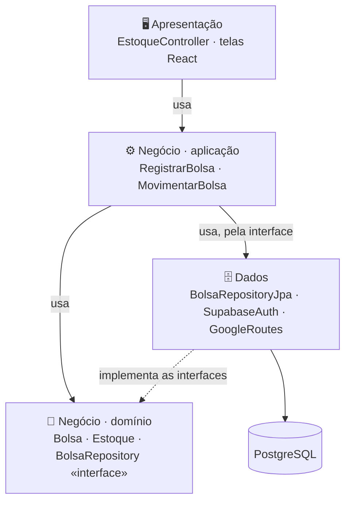
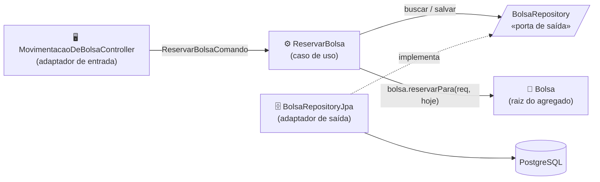
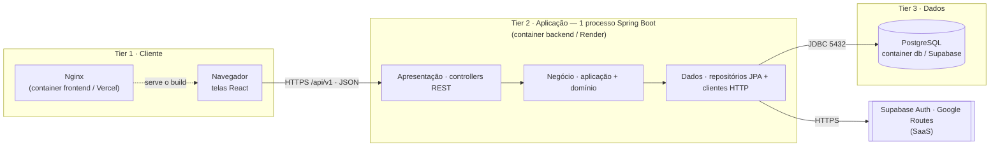

<h1 align="center"> Rota Vital — C. Arquitetura em três camadas 🧱 
  

</h1>

> [!NOTE]
> Trabalho U2 · Parte 2 · Seção C (0,5). Versão final, revista depois da devolutiva de 17/11 (ponto 2: **camadas com
> Clean Architecture**). Os contextos usados aqui vêm da [Seção A](A-remodelagem-ddd.md#a2-bounded-contexts). Índice em
> [`README.md`](README.md).

**📑 Sumário**

| # | Seção | O que você encontra |
| :---: | :--- | :--- |
| C.1 | [🧱 As três camadas](#c1-camadas) | O que fica em cada camada, hoje e na proposta |
| C.2 | [⬇️ Regra de dependência](#c2-regra-de-dependencia) | Quem pode usar quem, as 6 regras e como corrigir as 2 quebradas |
| C.2.1 | [🎯 Clean Architecture](#c21-clean-architecture) | Como as três camadas viram portas e adaptadores, com o caso de uso da HU-11 |
| C.3 | [📁 Estrutura de pacotes](#c3-estrutura-de-pacotes) | Pacotes por contexto e, dentro dele, por camada |
| C.4 | [🖥️ Camada lógica × tier físico](#c4-camada-x-tier) | Onde cada camada roda, no Docker local e em produção |

<h2 align="center" id="c1-camadas">🧱 C.1 As três camadas e o que fica em cada uma  

</h2>

| Camada | O que fica nela | Hoje | Na proposta |
| :--- | :--- | :--- | :--- |
| 🖥️ **Apresentação** | Telas React; controllers REST que convertem JSON ↔ DTO, devolvem o status HTTP e o erro no formato RFC 7807 | `frontend/src/pages` e `components`; `api/` e `api/dto/` | `frontend/` + `<contexto>.apresentacao` |
| ⚙️ **Negócio · aplicação** | Casos de uso: abrem a transação, conferem o papel de quem chama, carregam pelo repositório, chamam o domínio e gravam | `servico/` | `<contexto>.negocio.aplicacao` |
| 🧠 **Negócio · domínio** | Entidades, objetos de valor, regras e invariantes, e as **interfaces** de que o negócio precisa (repositórios, trajeto, credenciais) | `dominio/` | `<contexto>.negocio.dominio` |
| 🗄️ **Dados** | Implementações dos repositórios com JPA, entidades de persistência, consultas às views, migrations e clientes de integração (Supabase Auth, Google Routes) | `repositorio/`, `supabase/`, `google/`, `supabase/migrations` | `<contexto>.dados` |

<h2 align="center" id="c2-regra-de-dependencia">⬇️ C.2 Regra de dependência  

</h2>

Cada camada só usa a de baixo. A aplicação usa os dados <b>através de interfaces declaradas no domínio</b>: o caso de
uso chama <code>BolsaRepository</code>, e <code>BolsaRepositoryJpa</code> (em dados) é quem implementa. Assim o domínio
compila sem saber que existe banco, Spring ou HTTP.

<h4 align="left">📏 As regras, e como o código está hoje em relação a cada uma</h4>

| # | Regra | Hoje |
| :---: | :--- | :--- |
| 1 | A apresentação só chama a aplicação; nunca um repositório ou cliente externo | ✅ Nenhum controller importa `repositorio`, `supabase` ou `google` |
| 2 | Transação e conferência de papel ficam só na aplicação | ✅ `@Transactional` e `IdentificacaoService` só aparecem em `servico` |
| 3 | Cliente externo fica em dados, atrás de uma interface do negócio | ✅ `CalculadoraDeTrajeto` → `GoogleRoutes`; `VerificadorDeCredenciais` e `CriadorDeContas` → `SupabaseAuth` |
| 4 | O domínio não importa apresentação, aplicação nem dados | ✅ Nenhuma classe de `dominio` importa `api`, `servico` ou `repositorio` |
| 5 | O domínio não depende de banco nem de framework | ❌ 11 das 42 classes de `dominio` usam anotações JPA (`@Entity`, `@Table`), 4 usam anotações do Hibernate e `BolsaHemocomponente` implementa `Persistable`, do Spring Data |
| 6 | Um contexto não mexe no domínio de outro; usa a aplicação dele ou um evento | ❌ `TransferenciaDeBolsa` (Distribuição) muda o status da bolsa (Estoque) direto, e `MovimentacaoDeBolsaService` (Estoque) cancela a transferência (Distribuição) |

<h4 align="left">🛠️ Como corrigimos as regras 5 e 6 na Parte 3</h4>

| Regra | Correção |
| :---: | :--- |
| 5️⃣ | As anotações JPA saem do domínio e vão para classes de persistência em `dados` (`BolsaEntity`), com um mapeador entre `Bolsa` e `BolsaEntity`. A interface `BolsaRepository` fica no domínio e `BolsaRepositoryJpa`, em dados, a implementa com Spring Data. Começamos pelo **Estoque**, o contexto core da Seção B. Isso revê a decisão registrada em [`ARQUITETURA.md` §3](../ARQUITETURA.md#3-camadas) ("por que não Clean Architecture pura"): o custo dos mapeadores passa a valer a pena quando os contextos são separados. |
| 6️⃣ | A Distribuição para de mexer na bolsa: pede ao serviço aberto do Estoque para liberar a saída e registrar a chegada ([relação 2 do mapa](A-remodelagem-ddd.md#a4-mapa-de-contextos)). E o Estoque para de mexer na transferência: publica `BolsaDescartada`, e a Distribuição cancela a transferência dela ([Seção A.5](A-remodelagem-ddd.md#a5-eventos)). |

> [!TIP]
> **Para a regra não voltar a ser quebrada:** um teste de arquitetura com ArchUnit no `mvn verify`, que falha se
> alguma classe de `..negocio.dominio..` importar `jakarta.persistence`, `org.hibernate` ou `org.springframework`.
> Como a esteira da Parte 1 já roda `mvn verify`, quem quebrar a regra não consegue fazer o merge.

<h3 align="center" id="c21-clean-architecture">🎯 C.2.1 Três camadas com Clean Architecture</h3>

As três camadas continuam as mesmas; a Clean Architecture diz <b>para onde apontam as dependências</b>: sempre para o
centro. O domínio não conhece ninguém, a aplicação só conhece o domínio e as <b>portas</b> (interfaces) que ela mesma
declara, e quem está fora (Spring, JPA, HTTP, Supabase, Google) entra como <b>adaptador</b> que implementa uma porta.

| Anel da Clean Architecture | Camada do enunciado | Pacote | Exemplo no Estoque |
| :--- | :--- | :--- | :--- |
| 🧠 Entidades | Negócio · domínio | `estoque.negocio.dominio` | `Bolsa`, `Validade`, `Temperatura`, `StatusBolsa` (Java puro, sem anotação) |
| ⚙️ Casos de uso | Negócio · aplicação | `estoque.negocio.aplicacao` | `ReservarBolsa`, `RegistrarBolsa`, `DescartarBolsa`; portas de saída `BolsaRepository`, `Relogio`, `PublicadorDeEventos` |
| 🔌 Adaptadores de interface | Apresentação e dados | `estoque.apresentacao`, `estoque.dados` | `MovimentacaoDeBolsaController` (entrada); `BolsaRepositoryJpa` + `BolsaEntity` + `BolsaMapper` (saída) |
| 🧰 Frameworks e drivers | Fora do código de negócio | `config`, Spring Boot, Hibernate, PostgreSQL, React | Injeção de dependência liga a porta ao adaptador em `EstoqueConfig` |

O caso de uso da HU-11 fica assim, e é exatamente o que os testes da Parte 3 exercitam:

1. O controller converte o JSON em `ReservarBolsaComando(codigo, requisicaoId)` e chama `ReservarBolsa`.
2. `ReservarBolsa` confere o papel `ADMIN`, carrega a bolsa pela porta `BolsaRepository` e chama
   `bolsa.reservarPara(requisicao, hoje)`. **A regra (I1, I2, I3) está na `Bolsa`, não no caso de uso.**
3. Se a bolsa recusar, ela lança `MovimentacaoInvalidaException` e o `TratadorDeErros` devolve 422; se aceitar, o caso
   de uso salva pela porta e publica `BolsaReservada`.

Como o domínio é Java puro, o teste da `Bolsa` não sobe Spring nem banco, e o teste do caso de uso usa um
`BolsaRepository` em memória (o `RepositorioFalso` que já existe nos testes de serviço).

<h2 align="center" id="c3-estrutura-de-pacotes">📁 C.3 Estrutura de pacotes  

</h2>

Por contexto e, dentro dele, por camada. Mantemos a raiz <code>com.rotavital</code>, que é a atual. As classes novas
estão listadas logo depois da árvore; as demais já existem e só mudam de pacote.

<pre>
com.rotavital
├── estoque 
│   ├── apresentacao   (EstoqueController, MovimentacaoDeBolsaController, SugestaoDeLoteController,
│   │                   AlertasDoEstoqueController, EstatisticasDoEstoqueController)
│   ├── negocio
│   │   ├── aplicacao  (RegistrarBolsa, ReservarBolsa, DescartarBolsa, CorrigirBolsa, ConsultarEstoque,
│   │   │               SugerirLote, ResumirPerdas; portas BolsaRepository, BancoDeSangueRepository,
│   │   │               PublicadorDeEventos)
│   │   └── dominio    (Bolsa, Movimentacao, CodigoDaBolsa, Validade, Volume, Temperatura, MotivoDeDescarte,
│   │                   StatusBolsa, CategoriaDescarte, Estoque, BancoDeSangue, CompatibilidadeSanguinea, AlertaDeEstoque,
│   │                   ResumoDePerdas, EstatisticaDescritivaDoEstoque, BolsaReservada, BolsaDescartada)
│   └── dados          (BolsaRepositoryJpa, BolsaEntity, MovimentacaoEntity, BolsaMapper,
│                       BancoDeSangueRepositoryJpa, ResumoEstoqueRepository)
├── requisicao 
│   ├── apresentacao   (RequisicaoController)                         ← hoje só no openapi.yaml
│   ├── negocio
│   │   ├── aplicacao  (AbrirRequisicao, AcompanharRequisicao, CancelarRequisicao)
│   │   └── dominio    (RequisicaoHospitalar, FilaRequisicoesHospitalares, StatusRequisicao, NivelUrgencia)
│   └── dados          (RequisicaoRepositoryJpa)                      ← tabelas requisicao_hospitalar e alocacao já existem
├── distribuicao 
│   ├── apresentacao   (RotaController, RotaNoMapaController, TransferenciaController)
│   ├── negocio
│   │   ├── aplicacao  (RedeDistribuicaoService, RotaNoMapaService, TransferenciaService)
│   │   └── dominio    (RedeDistribuicao, Conexao, PontoDeRede, Hospital, RotaCalculada,
│   │                   TransferenciaDeBolsa, StatusTransferencia)
│   └── dados          (PontoDeRedeRepository, ConexaoRepository, HospitalRepository, TransferenciaDeBolsaRepository)
├── captacao 
│   ├── apresentacao   (CampanhaController, AgendamentoController, HemocentroController, DoadorController,
│   │                   RotaAteHospitalController)
│   ├── negocio
│   │   ├── aplicacao  (CampanhaService, AgendamentoService, DoadorService, RotaAteHospitalService)
│   │   └── dominio    (CampanhaDoacao, AgendamentoDoacao, AgendaDoHemocentro, Hemocentro, Beneficiario,
│   │                   StatusCampanha, StatusAgendamento)
│   └── dados          (CampanhaDoacaoRepository, AgendamentoDoacaoRepository)
├── atendimento 
│   ├── apresentacao   (PacienteController)
│   ├── negocio
│   │   ├── aplicacao  (PacienteService, ValidadorPaciente)
│   │   └── dominio    (Paciente, Gravidade, StatusPaciente, Sexo)
│   └── dados          (PacienteRepository)
├── acesso 
│   ├── apresentacao   (AcessoController)
│   ├── negocio
│   │   ├── aplicacao  (AutenticacaoService, IdentificacaoService)
│   │   └── dominio    (Usuario, PapelUsuario, VerificadorDeCredenciais «interface», CriadorDeContas «interface»)
│   └── dados          (UsuarioRepository, SupabaseAuth)
├── compartilhado 
│   ├── dominio        (TipoSanguineo, TipoComponente, Coordenada, Endereco)   ← núcleo compartilhado
│   ├── geo            (CalculadoraDeTrajeto «interface», Trajeto, FonteDoTrajeto; dados: GoogleRoutes)
│   └── web            (TratadorDeErros, ErroDTO, CorsConfig, HttpLoggingFilter, RelogioConfig)
└── operacao  (diagnostico, benchmark — ferramentas de operação)
</pre>

<h4 align="left">🆕 Classes novas</h4>

**No Estoque (Parte 3, entrega de 01/12):** `Bolsa` (a `BolsaHemocomponente` renomeada e sem JPA), `Movimentacao`,
`CodigoDaBolsa`, `Validade`, `Volume`, `Temperatura`, `MotivoDeDescarte`, os casos de uso `RegistrarBolsa`,
`ReservarBolsa`, `DescartarBolsa`, `CorrigirBolsa` (que substituem `EstoqueService`, `MovimentacaoDeBolsaService` e
`CorrecaoDeBolsaService`), a porta `BolsaRepository` e, em dados, `BolsaEntity`, `MovimentacaoEntity`, `BolsaMapper` e
`BolsaRepositoryJpa`.

**Nos outros contextos (depois de 01/12):** `RequisicaoController`, `AbrirRequisicao`, `AcompanharRequisicao`,
`CancelarRequisicao`, `RequisicaoRepositoryJpa`, `Hemocentro` e `Beneficiario`. `Hospital` e `BancoDeSangue` deixam de
ser a mesma hierarquia: cada contexto guarda o próprio modelo do ponto da rede e eles se referem uns aos outros pelo
`id`. O plano completo, com datas, está em [`F-plano-de-refatoracao.md`](F-plano-de-refatoracao.md).

<h4 align="left">🖥️ E no frontend</h4>

As telas já são separadas por pasta em `frontend/src/pages` e se agrupam pelos mesmos contextos:

| Contexto | Telas (rota do frontend) |
| :--- | :--- |
| 📦 Estoque | `/painel`, `/estoque` |
| 📋 Requisição | `/requisicao` |
| 🚚 Distribuição | `/rede` |
| ❤️ Captação | `/doacoes`, `/portal-doador` |
| 🏥 Atendimento | `/pacientes` |
| 🔑 Acesso | `/login`, `/cadastro-doador` |

<h2 align="center" id="c4-camada-x-tier">🖥️ C.4 Camada lógica × tier físico  

</h2>

<b>Camada</b> é como o código está organizado; <b>tier</b> é a máquina ou o processo onde ele roda. O Rota Vital tem
três camadas e três tiers, mas eles <b>não coincidem um para um</b>: o container do backend carrega um pedaço de cada
camada.

| Camada lógica | 🐳 Docker local (`docker compose up`) | ☁️ Produção planejada |
| :--- | :--- | :--- |
| 🖥️ Apresentação · telas | Navegador + container `frontend` (Nginx) | Vercel |
| 🖥️ Apresentação · controllers REST | Container `backend` | Render |
| ⚙️ Negócio · aplicação e domínio | Container `backend` | Render |
| 🗄️ Dados · repositórios e clientes de integração | Container `backend` | Render |
| 🗄️ Dados · banco | Container `db` (PostgreSQL 17) | Supabase (PostgreSQL gerenciado) |
| 🗄️ Dados · serviços externos | Supabase Auth e Google Routes (SaaS) | Os mesmos |

> [!IMPORTANT]
> **Consequência:** controllers, negócio e repositórios sobem, caem e escalam juntos, porque estão no mesmo processo.
> Separar os contextos em pacotes (C.3) organiza o código, mas continua sendo **um único deploy**: é um monolito
> modular. Separar também os tiers por contexto é o que a Seção D discute.

<a href="A-remodelagem-ddd.md">⬅️ A. Remodelagem do domínio com DDD</a> · <a href="README.md">Índice ➡️</a>

