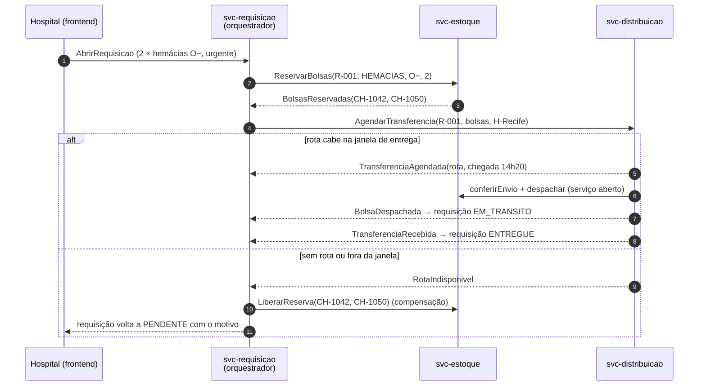

<h1 align="center"> Rota Vital — D. Projeção com microsserviços 🧭 
  

</h1>

> [!NOTE]
> Trabalho U2 · Parte 2 · Seção D (0,3). Isto é uma **projeção**: o Rota Vital continua um monolito modular na Parte 3
> ([ADR 0001](adr/0001-decomposicao.md)). Aqui mostramos como ele ficaria se precisasse virar microsserviços, e o que
> mudaria em comunicação, dados e consistência.

**📑 Sumário**

| # | Seção | O que você encontra |
| :---: | :--- | :--- |
| D.1 | [🧩 Quais contextos viram serviços](#d1-servicos) | Os quatro serviços e o motivo de cada um |
| D.2 | [📡 Comunicação e dados](#d2-comunicacao) | REST, eventos, fila e um banco por serviço |
| D.3 | [🔁 Saga "Atender requisição"](#d3-saga) | O fluxo que atravessa três contextos, com a compensação |
| D.4 | [⚡ Projeção serverless (opcional)](#d4-serverless) | O que vira função e o que não vira |
| D.5 | [⚖️ Comparação](#d5-comparacao) | Monolito modular × microsserviços × serverless |
| D.6 | [📝 ADRs](#d6-adrs) | As decisões registradas em `adr/` |

<h2 align="center" id="d1-servicos">🧩 D.1 Quais contextos viram serviços, e por quê</h2>

| Serviço | Contextos | Por que separar | Carga típica |
| :--- | :--- | :--- | :--- |
| 📦 `svc-estoque` | Estoque | Core e dono da bolsa: é o serviço mais consultado (painel, sugestão de lote, alertas) e o único que muda status de bolsa | Leitura alta, escrita moderada |
| 📋 `svc-requisicao` | Requisição | Core e **orquestrador da saga**: guarda o estado do pedido do hospital do início ao fim | Baixa, mas crítica |
| 🚚 `svc-distribuicao` | Distribuição | Core com perfil diferente: CPU para o Dijkstra e chamadas à Google Routes; escala separado e isola a falha da API externa | Picos de CPU |
| ❤️ `svc-captacao` | Captação **+ Atendimento** | Os dois são suporte e o Atendimento já é fornecedor conformista da Captação (relação 5 do mapa): juntos, a cópia do paciente deixa de atravessar a rede. O portal do doador é público e tem picos em campanha | Picos sazonais |
| 🔑 Identidade | Identidade e Acesso | **Não vira serviço nosso:** continua no Supabase Auth; o API gateway valida o JWT e repassa o papel | — |

Um **API gateway** (ou BFF do frontend) fica na frente: valida o token, roteia `/api/v1/estoque/**` para o
`svc-estoque` e assim por diante, e mantém o contrato que o frontend já usa (`docs/openapi.yaml`).

<h2 align="center" id="d2-comunicacao">📡 D.2 Comunicação e dados</h2>

| Tipo | Quando | Exemplos |
| :--- | :--- | :--- |
| 🔵 **REST síncrono** | Consulta que precisa da resposta para continuar | Requisição → Estoque `GET /sugestao-lote`; frontend → gateway |
| 🟣 **Comando por fila** | Passo da saga, que pode demorar ou falhar e precisa ser repetido | `ReservarBolsas`, `AgendarTransferencia`, `LiberarReserva` |
| 🟢 **Evento publicado** | Fato que outros contextos querem saber, sem o publicador esperar | `BolsaDescartada`, `BolsaDespachada`, `TransferenciaRecebida`, `PacienteAtualizado`, `DoacaoRealizada` |

- **Broker:** RabbitMQ (ou SNS + SQS na AWS). Cada evento sai pelo padrão **outbox**: grava-se o evento na mesma
  transação da mudança, numa tabela `outbox`, e um publicador envia depois. Assim nunca se muda a bolsa sem avisar, nem
  se avisa uma mudança que foi desfeita.
- **Um banco por serviço:** `estoque_db` (bolsa, banco de sangue, movimentação), `requisicao_db` (requisição, alocação),
  `distribuicao_db` (pontos, conexões, transferências) e `captacao_db` (campanhas, agendamentos, pacientes). Nenhuma
  chave estrangeira entre bancos: os serviços se referem por **id** e guardam cópias de leitura alimentadas pelos
  eventos (a Distribuição guarda só código, componente e validade da bolsa). Primeiro passo possível: um schema por
  serviço no mesmo Postgres do Supabase, cada um com o seu usuário.
- **Consistência:** dentro de um serviço, transação ACID; entre serviços, **eventual**, garantida pela saga.

<h2 align="center" id="d3-saga">🔁 D.3 Saga "Atender requisição" (orquestrada pela Requisição)</h2>

| Passo | Serviço | Ação | Compensação se um passo seguinte falhar |
| :---: | :--- | :--- | :--- |
| 1 | Requisição | Abre a requisição (`PENDENTE`) | Cancela a requisição (`CANCELADA`) |
| 2 | Estoque | Reserva as bolsas aptas (HU-11) | **`LiberarReserva`**: as bolsas voltam a `DISPONIVEL` (transição permitida) |
| 3 | Distribuição | Agenda a transferência e calcula a rota | Cancela a transferência agendada |
| 4 | Distribuição → Estoque | Despacha (`EM_TRANSITO`) | Sem volta: a partir daqui só **descarte** (cadeia fria rompida publica `BolsaDescartada`) e a Requisição pede outro lote (volta ao passo 2) |

Cada comando tem um id e é **idempotente** (reservar duas vezes a mesma bolsa para a mesma requisição não muda nada),
porque a fila pode entregar a mesma mensagem mais de uma vez.

<h2 align="center" id="d4-serverless">⚡ D.4 Projeção serverless (opcional)</h2>

| Vira função? | O quê | Gatilho | Motivo |
| :---: | :--- | :--- | :--- |
| ✅ | **Emitir a guia de transporte** | Evento `TransferenciaAgendada` | Curta, sem estado, uso irregular (foi a função da Atividade individual 1) |
| ✅ | **Alerta diário de validade** | Agendamento (cron) às 6h | Roda segundos por dia; pagar por execução é mais barato que um servidor ligado |
| ✅ | **Processar leitura de telemetria** da cadeia fria | Mensagem de cada sensor | Rajadas imprevisíveis; escala sozinha; publica `BolsaForaDaFaixa` |
| ✅ | **Avisar doadores** de uma campanha nova | Evento `CampanhaPublicada` | Fan-out de mensagens, sem estado |
| ❌ | API do Estoque | — | Transação, pool de conexões com o Postgres e Spring Boot com cold start de segundos |
| ❌ | Cálculo de rota | — | O grafo da rede fica em memória; recriá-lo a cada cold start custa mais que o cálculo |
| ❌ | Orquestrador da saga | — | Guarda estado por horas, até a entrega: passa do limite de 15 min do Lambda |

<h2 align="center" id="d5-comparacao">⚖️ D.5 Comparação para o Rota Vital</h2>

| Critério | 🧱 Monolito modular (Parte 3) | 🧩 Microsserviços | ⚡ Serverless (só as funções da D.4) |
| :--- | :--- | :--- | :--- |
| Unidade de deploy | Um jar / uma imagem Docker | Um por serviço (4 + gateway) | Uma por função |
| Escala | O processo inteiro, na horizontal | Cada serviço no seu ritmo (Distribuição por CPU, Estoque por leitura) | Automática por evento, até zero |
| Consistência dos dados | Transação ACID única | Eventual entre serviços; saga + outbox | Eventual; função idempotente |
| Custo (cenário moderado, Seção E) | ~US$ 171/mês | Mais 3 serviços ligados, broker e gateway: várias vezes mais | Centavos por milhão de execuções; só para tarefas curtas |
| Complexidade de operação | Baixa: um pipeline, um log, um banco | Alta: rastreio distribuído, versões de contrato, filas, vários bancos | Média: muitas peças pequenas, cold start, limite de tempo |

<h2 align="center" id="d6-adrs">📝 D.6 ADRs</h2>

| ADR | Decisão | Arquivo |
| :---: | :--- | :--- |
| 0001 | **Monolito modular por bounded context** agora, com fronteiras preparadas para extrair a Distribuição primeiro se o cenário alto chegar | [`adr/0001-decomposicao.md`](adr/0001-decomposicao.md) |
| 0002 | **Domínio puro (Clean Architecture):** sem JPA nem Spring no domínio, com portas e adaptadores | [`adr/0002-dominio-puro-clean-architecture.md`](adr/0002-dominio-puro-clean-architecture.md) |
| 0003 | **Especificação e teste antes do código (SDD + TDD)**, com cobertura mínima e ArchUnit na esteira | [`adr/0003-especificacao-e-teste-antes-do-codigo.md`](adr/0003-especificacao-e-teste-antes-do-codigo.md) |

<a href="C-tres-camadas.md">⬅️ C. Três camadas</a> · <a href="README.md">Índice</a> · <a href="E-cenarios-e-orcamento.md">E. Cenários e orçamento ➡️</a>

