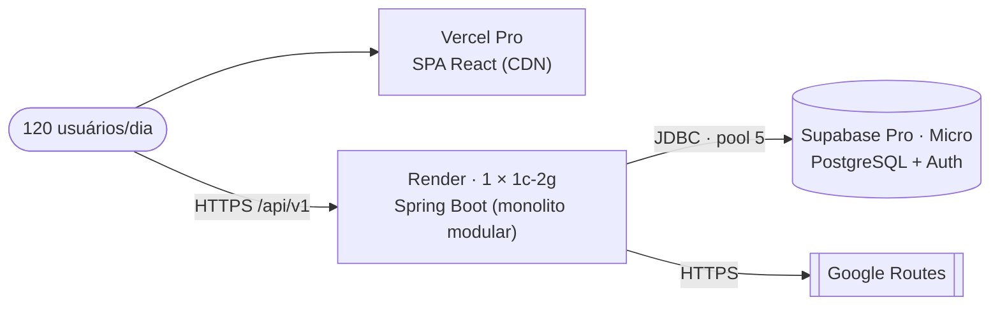
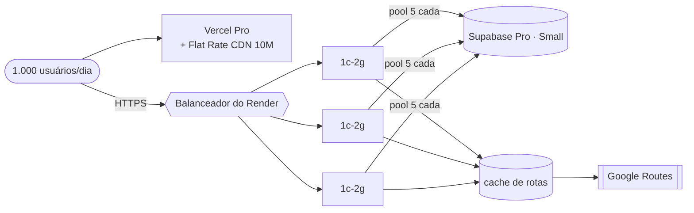
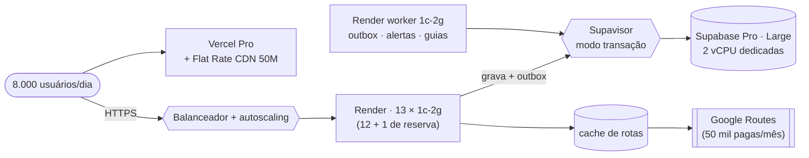

<h1 align="center"> Rota Vital — E. Três cenários com orçamento 💰 
  

</h1>

> [!NOTE]
> Trabalho U2 · Parte 2 · Seção E (0,7). Provedores: os que o Rota Vital já usa no deploy (**Render** para o backend,
> **Vercel** para o frontend, **Supabase** para o banco e o login) e a **Google Routes API**. Preços on-demand em dólar,
> consultados nas páginas oficiais em **22/11/2026**. A planilha com as fórmulas está em
> [`orcamento/orcamento-cenarios.xlsx`](orcamento/orcamento-cenarios.xlsx) (e em CSV:
> [`orcamento/orcamento.csv`](orcamento/orcamento.csv)).

**📑 Sumário**

| # | Seção | O que você encontra |
| :---: | :--- | :--- |
| E.1 | [📋 Premissas de carga](#e1-premissas) | Usuários, pedidos, pico e disponibilidade |
| E.2 | [🧮 Lei de Little](#e2-little) | A conta do pico: instâncias e conexões com o banco |
| E.3 | [🗺️ Diagramas](#e3-diagramas) | Um por cenário e o que muda de um para o outro |
| E.4 | [💵 Orçamento](#e4-orcamento) | Item, quantidade, preço, custo, região, fonte, data e custo por pedido |

<h2 align="center" id="e1-premissas">📋 E.1 Premissas de carga</h2>

| Premissa | 🟢 Baixo | 🟡 Moderado | 🔴 Alto |
| :--- | ---: | ---: | ---: |
| Abrangência | 1 hemocentro, 15 hospitais (piloto) | 8 hemocentros, 150 hospitais (um estado) | 40 hemocentros, 900 hospitais (uma região) |
| Usuários cadastrados | 300 | 3.000 | 30.000 |
| Usuários ativos por dia | 120 | 1.000 | 8.000 |
| **Pedidos por dia** (requisições hospitalares) | **150** | **1.200** | **9.000** |
| Chamadas HTTP à API por dia | 30.000 | 250.000 | 2.000.000 |
| **Pico de requisições por segundo (λ)** | **5** | **40** | **300** |
| **Disponibilidade desejada** | **99,0 %** (≈ 7 h fora/mês) | **99,5 %** (≈ 3,6 h) | **99,9 %** (≈ 43 min) |

Premissas comuns, que o teste de carga da Parte 3 (k6) vai confirmar ou corrigir:

- **W = 0,30 s**: tempo médio de resposta do backend no pico.
- **W_db = 0,06 s**: tempo médio em que uma requisição segura uma conexão do banco. Só a transação segura a conexão,
  porque `spring.jpa.open-in-view=false` já está no `application.properties`.
- **Capacidade de uma instância de 1 CPU e 2 GB: 8 requisições simultâneas** com folga.
- **Redundância N+1** quando a disponibilidade pedida é de 99,5 % ou mais: se uma instância cair, as outras seguram o pico.
- O pico é cerca de 14 vezes a média do dia, porque o uso se concentra no horário de trabalho dos hospitais.
- Resposta média de 4 KB. Cada usuário ativo abre 5 telas por dia, e cada tela faz 20 requisições à CDN.
- Rotas do Google com **cache por par origem → destino** por 24 h.

<h2 align="center" id="e2-little">🧮 E.2 Lei de Little no pico</h2>

**L = λ × W**: o número médio de requisições dentro do sistema é a taxa de chegada vezes o tempo que cada uma fica
lá. Com W = 0,30 s e W_db = 0,06 s:

| Conta | 🟢 Baixo | 🟡 Moderado | 🔴 Alto |
| :--- | ---: | ---: | ---: |
| **L = λ × W** (requisições simultâneas) | 5 × 0,30 = **1,5** | 40 × 0,30 = **12** | 300 × 0,30 = **90** |
| Instâncias = ⌈L ÷ 8⌉ | ⌈0,19⌉ = 1 | ⌈1,5⌉ = 2 | ⌈11,25⌉ = 12 |
| \+ redundância N+1 | 0 | 1 | 1 |
| **Instâncias 1c-2g** | **1** | **3** | **13** |
| **L_db = λ × W_db** (conexões ocupadas) | 5 × 0,06 = **0,3** | 40 × 0,06 = **2,4** | 300 × 0,06 = **18** |
| Pool por instância (folga de 2×, mínimo 5) | 5 | 5 | 5 |
| **Conexões abertas no banco** | **5** | **15** | **65** |
| Limite do Supabase (direto / pooler) | Micro 60 / 200 | Small 90 / 400 | Large 160 / 800 |

**Leitura:** o banco não é o gargalo em nenhum cenário: mesmo no alto, 65 conexões ficam bem abaixo das 800 do pooler.
O que cresce é a CPU do backend. Por isso o cenário alto passa a falar com o banco pelo **Supavisor em modo
transação** (porta 6543) e troca o compute do Supabase para Large, com CPU dedicada. Sem o ajuste do pool, o padrão do
Hikari (10 conexões por instância) abriria 130 conexões sem necessidade.

<h2 align="center" id="e3-diagramas">🗺️ E.3 Diagramas por cenário</h2>

<h4 align="left">🟢 Baixo: tudo no mínimo, uma instância</h4>

<h4 align="left">🟡 Moderado: redundância e CDN maior</h4>

<h4 align="left">🔴 Alto: autoscaling, pooler, worker assíncrono</h4>

| O que muda | 🟢 → 🟡 | 🟡 → 🔴 |
| :--- | :--- | :--- |
| Backend | 1 → 3 instâncias atrás do balanceador (N+1) | 3 → 13 instâncias com autoscaling |
| Workspace do Render | Hobby → Pro (25 GB de banda, autoscaling) | Mantém Pro; a banda passa de 25 GB e é cobrada |
| Banco | Micro → Small | Small → Large com CPU dedicada; conexões pelo Supavisor em modo transação; disco de 20 GB |
| Frontend | Plano Pro → + Flat Rate CDN 10M | CDN 10M → 50M |
| Trabalho assíncrono | — | Worker separado publica o outbox, roda os alertas de validade e emite as guias |
| Google Routes | Dentro das 10 mil grátis | 60 mil chamadas/mês, 50 mil pagas; sem o cache seriam 270 mil |

<h2 align="center" id="e4-orcamento">💵 E.4 Orçamento mensal (on-demand, US$)</h2>

| Item | Qtd 🟢 | Qtd 🟡 | Qtd 🔴 | Preço unitário | 🟢 Baixo | 🟡 Moderado | 🔴 Alto | Região | Fonte |
| :--- | ---: | ---: | ---: | ---: | ---: | ---: | ---: | :--- | :--- |
| Render · workspace (Hobby / Pro) | 1 | 1 | 1 | 0 / 25,00 | 0,00 | 25,00 | 25,00 | — | [render.com/pricing](https://render.com/pricing) |
| Render · web service 1 CPU / 2 GB | 1 | 3 | 13 | 25,00 | 25,00 | 75,00 | 325,00 | Ohio | [render.com/pricing](https://render.com/pricing) |
| Render · background worker 1c-2g | — | — | 1 | 25,00 | — | — | 25,00 | Ohio | [render.com/pricing](https://render.com/pricing) |
| Render · banda além da franquia (GB) | 0 | 5 | 215 | 0,15 | 0,00 | 0,75 | 32,25 | Ohio | [render.com/pricing](https://render.com/pricing) |
| Supabase · plano Pro | 1 | 1 | 1 | 25,00 | 25,00 | 25,00 | 25,00 | us-east-2 | [supabase.com/pricing](https://supabase.com/pricing) |
| Supabase · compute (Micro / Small / Large) | 1 | 1 | 1 | 10 / 15 / 110 | 10,00 | 15,00 | 110,00 | us-east-2 | [Compute and Disk](https://supabase.com/docs/guides/platform/compute-and-disk) |
| Supabase · crédito de compute do Pro | 1 | 1 | 1 | −10,00 | −10,00 | −10,00 | −10,00 | us-east-2 | [supabase.com/pricing](https://supabase.com/pricing) |
| Supabase · disco além de 8 GB (GB) | 0 | 0 | 12 | 0,125 | 0,00 | 0,00 | 1,50 | us-east-2 | [Compute and Disk](https://supabase.com/docs/guides/platform/compute-and-disk) |
| Vercel · plano Pro (1 assento, US$ 20 de crédito) | 1 | 1 | 1 | 20,00 | 20,00 | 20,00 | 20,00 | CDN global | [Vercel Pro](https://vercel.com/docs/plans/pro-plan) |
| Vercel · Flat Rate CDN (10M / 50M) | — | 1 | 1 | 20 / 100 | — | 20,00 | 100,00 | CDN global | [Flat Rate CDN](https://vercel.com/blog/introducing-flat-rate-cdn) |
| Google Routes · Compute Routes (pagas) | 0 | 0 | 50.000 | 5,00 / mil | 0,00 | 0,00 | 250,00 | global | [Maps pricing](https://developers.google.com/maps/billing/pricing) |
| **Total mensal** | | | | | **70,00** | **170,75** | **903,75** | | |
| Pedidos por mês (pedidos/dia × 30) | | | | | 4.500 | 36.000 | 270.000 | | |
| **Custo por pedido** | | | | | **US$ 0,0156** | **US$ 0,0047** | **US$ 0,0033** | | |

Todos os preços foram consultados em **22/11/2026**. O custo por pedido **cai** com a escala: os planos fixos (Supabase
Pro, Vercel Pro, workspace) se diluem em mais pedidos. No cenário alto, a Google Routes já é **28 %** do total; sem o cache de
rotas seriam cerca de 270 mil chamadas por mês (uma por pedido), mais de quatro vezes as 60 mil do orçamento.

> [!WARNING]
> **Riscos que o orçamento não cobre:** não encontramos SLA contratual de 99,9 % no plano Pro do Supabase nem no Render
> com uma região só. Para o cenário alto valer de verdade, falta orçar backup com recuperação pontual (PITR) e, se o
> contrato exigir, um plano com SLA. O
> plano Hobby da Vercel foi descartado porque é só para uso pessoal, não comercial. E os preços mudam: a planilha guarda a
> data de cada consulta.

<a href="D-microsservicos.md">⬅️ D. Microsserviços</a> · <a href="README.md">Índice</a> · <a href="F-plano-de-refatoracao.md">F. Plano de refatoração ➡️</a>

