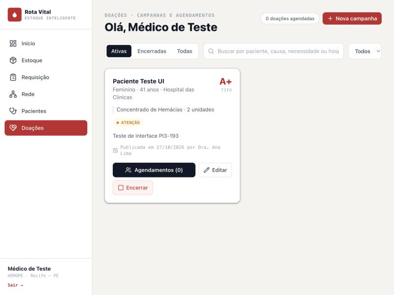
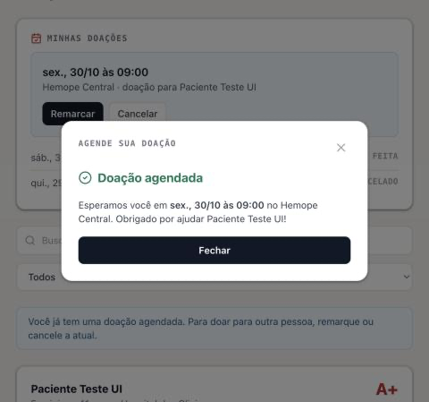

<h1 align="center">Evidências · PI3-174 · Campanhas e agendamentos de doação <br>


</h1>

> Sistema rodando localmente em **27/10/2026** (frontend Vite na porta `5173`, backend Spring Boot na `8080`
> ligado ao Supabase). Cobre a PI3-174 e as subtarefas PI3-191 (campanhas), PI3-192 (agendamentos) e PI3-193
> (tela de Doações sem dados de exemplo). Contrato: [`CONTRATOS_DE_API.md`, seção 2.5](../CONTRATOS_DE_API.md#2-5-doacoes)
> e [`openapi.yaml`](../openapi.yaml). Regras de perfil: decisões 2 e 5 de [`PERFIS_DE_ACESSO.md`](../PERFIS_DE_ACESSO.md).

## O que mudou

- **Backend:** `CampanhaController` e `AgendamentoController`, com 10 endpoints gravando nas tabelas `paciente`,
  `campanha_doacao` e `agendamento_doacao`. Quem age vem do header `X-Usuario-Id` (o `id` do `POST /acessos`).
- **Tela de Doações** (médico e admin): campanhas do backend em abas Ativas / Encerradas / Todas, com editar,
  encerrar e a lista de agendamentos de cada campanha. O médico registra doação feita, falta ou cancelamento.
- **Requisição › Campanha:** o formulário grava no backend e pede hospital, data de nascimento e unidades.
- **Portal do Doador:** agendamento com dia e horário, e a seção "Minhas doações" (remarcar e cancelar).
- Saiu o `pessoasMock`: Doações, Pacientes, Painel e o portal mostram as campanhas ativas do banco.

## 1. Testes unitários (JUnit)

`mvn test` depois do merge com a `main`: **232 testes, 0 falhas**. Os novos são
[`CampanhaServiceTest`](../../backend/src/test/java/com/rotavital/servico/CampanhaServiceTest.java) (9) e
[`AgendamentoServiceTest`](../../backend/src/test/java/com/rotavital/servico/AgendamentoServiceTest.java) (15),
com os repositórios em memória e o relógio fixo.

## 2. API rodando contra o Supabase

O backend subiu com `ddl-auto=validate`, então o mapeamento das entidades novas foi conferido contra o schema
real. O script [`PI3-174/teste_doacoes.py`](PI3-174/teste_doacoes.py) fez **56 checagens, 0 falhas** (rodado
antes e depois do merge com a `main`). Resumo:

| # | Perfil | Cenário | Esperado | Obtido |
| :---: | :--- | :--- | :--- | :---: |
| 1 | — | `GET /campanhas` | `200` | ✅ |
| 2 | — | `?status=XYZ` | `400` · "Valores aceitos: ATIVA, ENCERRADA." | ✅ |
| 3 | — | Campanha inexistente | `404` | ✅ |
| 4 | — | Publicar sem `X-Usuario-Id` | `401` · "Entre no sistema para publicar campanha de doação." | ✅ |
| 5 | — | `X-Usuario-Id: abc` | `400` | ✅ |
| 6 | Doador / Admin | Publicar campanha | `403` · "Só médico pode publicar campanha de doação." | ✅ |
| 7 | Médico | Corpo com campos vazios | `400` com os 9 campos na mesma mensagem | ✅ |
| 8 | Médico | `hospitalId` de um banco de sangue | `400` · "Nenhum hospital encontrado com id BS-01." | ✅ |
| 9 | Médico | Publicar | `201` · `ATIVA`, paciente criado, idade calculada (36) | ✅ |
| 10 | Médico | Editar unidades e gravidade | `200` · 3 unidades, `ATENCAO` | ✅ |
| 11 | Doador | Editar | `403` | ✅ |
| 12 | Médico | Agendar | `403` · "Só doador pode agendar doação." | ✅ |
| 13 | Doador | Agendar no domingo / às 6h | `422` · fora do atendimento (seg a sáb, 07h–19h) | ✅ |
| 14 | Doador | Agendar no passado | `422` · "precisa ser no futuro" | ✅ |
| 15 | Doador | `agendadoPara: "29/10/2026"` | `400` · formato com fuso | ✅ |
| 16 | Doador | Banco `BS-99` | `400` | ✅ |
| 17 | Doador | Agendar quinta 10h | `201` · `AGENDADO` | ✅ |
| 18 | Doador | Segundo agendamento em aberto | `422` · "Você já tem uma doação agendada…" | ✅ |
| 19 | — | Lista de campanhas | `agendamentosEmAberto: 1` | ✅ |
| 20 | Doador | `GET /agendamentos/meus` | `200` · 1 agendamento | ✅ |
| 21 | Médico | `GET /agendamentos/meus` | `403` | ✅ |
| 22 | Doador / Admin | Agendamentos da campanha | `403` / `200` | ✅ |
| 23 | Doador | Remarcar para sábado 18h30 | `200` | ✅ |
| 24 | Médico | Remarcar | `403` | ✅ |
| 25 | Doador | Marcar como realizado | `403` · "O doador só pode cancelar…" | ✅ |
| 26 | Médico | Falta antes do horário | `422` | ✅ |
| 27 | Médico | Status `AGENDADO` | `400` | ✅ |
| 28 | Admin | Mudar status | `403` | ✅ |
| 29 | Médico | Doação feita | `200` · `REALIZADO` | ✅ |
| 30 | Médico | Alterar agendamento fechado | `422` · "já foi realizado" | ✅ |
| 31 | Admin | Encerrar campanha | `403` | ✅ |
| 32 | Médico | Encerrar com 1 agendamento em aberto | `200` · `ENCERRADA`, agendamento `CANCELADO` | ✅ |
| 33 | Médico | Encerrar de novo / editar encerrada | `422` | ✅ |
| 34 | Doador | Agendar em campanha encerrada | `422` | ✅ |

## 3. Telas, no navegador

Backend real em todos os passos. Para entrar como médico e como doador sem digitar as senhas reais numa
ferramenta automatizada, a sessão foi gravada no `sessionStorage` com os mesmos campos que o `POST /acessos`
devolve (como na evidência da PI3-184).

| # | Perfil | Passo | Print |
| :---: | :--- | :--- | :--- |
| 1 | Médico | Publica a campanha em Requisição › Campanha | [01](PI3-174/01_campanha_publicada.png) |
| 2 | Médico | A campanha aparece em Doações, publicada pelo médico de teste | [02](PI3-174/02_doacoes_lista_campanha.png) |
| 3 | Médico | Edita: 4 unidades e gravidade Emergência (cartão mostra "Crítico") | [03](PI3-174/03_campanha_editada.png) |
| 4 | Doador | Portal mostra a campanha e o histórico em "Minhas doações" | [04](PI3-174/04_portal_minhas_doacoes.png) |
| 5 | Doador | Abre "Agende sua doação" | [05](PI3-174/05_agendar_doacao.png) |
| 6 | Doador | Escolhe domingo: aviso e botão desabilitado | [06](PI3-174/06_aviso_domingo.png) |
| 7 | Doador | Agenda sexta 09h; o portal passa a mostrar a doação em aberto | [07](PI3-174/07_doacao_agendada.png) |
| 8 | Doador | Remarca para sábado 10h30 | [08](PI3-174/08_doacao_remarcada.png) |
| 9 | Médico | "Faltou" antes do horário: o aviso do backend aparece no modal | [09](PI3-174/09_falta_antes_do_horario.png) ¹ |
| 10 | Médico | "Doação feita": status atualizado e contador zerado | [10](PI3-174/10_doacao_feita.png) |
| 11 | Médico | Confirmação do encerramento; depois a campanha sai de Ativas e aparece em Encerradas | [11](PI3-174/11_encerrar_campanha.png) |

¹ Print tirado antes de um ajuste no `Modal`: o `space-y-6` da página dava margem ao fundo escuro e deixava uma
faixa sem cobrir no topo. A correção (`!m-0`) está no mesmo PR; os prints 10 e 11 já são depois dela.

 

## Como reproduzir

```bash
# terminal 1 — backend (backend/.env com SUPABASE_DB_PASSWORD)
cd backend && mvn spring-boot:run

# terminal 2 — checagens da API (ajuste as datas do script para o futuro)
python3 docs/evidencias/PI3-174/teste_doacoes.py

# terminal 3 — frontend
cd frontend && npm run dev
```

O script e os testes manuais gravam dados de verdade no Supabase. Para limpar depois (o nome do paciente é o
que o teste usou):

```sql
delete from agendamento_doacao where campanha_id in (
  select c.id from campanha_doacao c join paciente p on p.id = c.paciente_id where p.nome = 'Paciente Teste PI3-174');
delete from campanha_doacao where paciente_id in (select id from paciente where nome = 'Paciente Teste PI3-174');
delete from paciente where nome = 'Paciente Teste PI3-174';
```

Os dados criados nestes testes já foram apagados: as três tabelas voltaram a ficar vazias.
