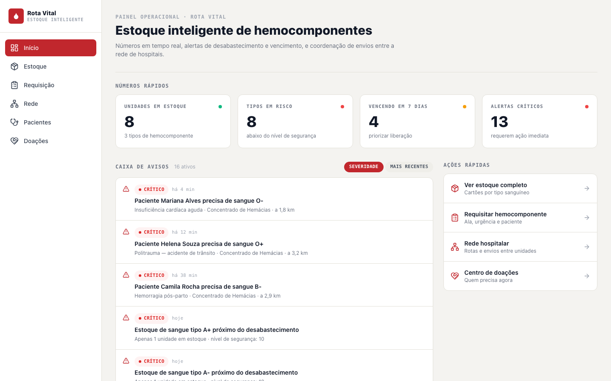
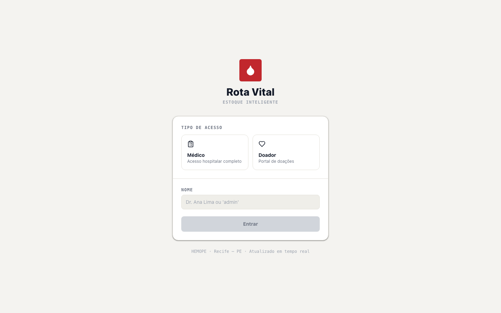
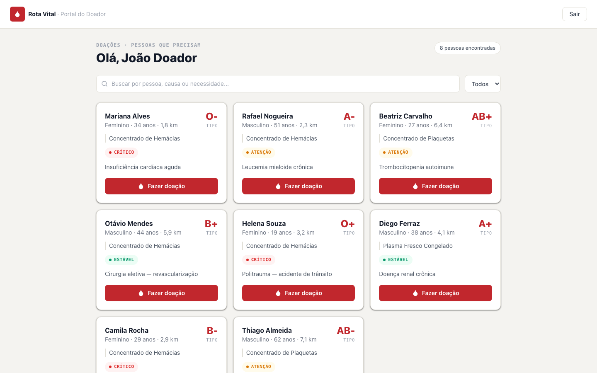

<h1 align="center">Evidências · PI3-182 · Perfis de acesso <br>

</h1>

> Navegação real no sistema rodando localmente (frontend Vite na porta `5173` e backend Spring Boot na porta
> `8080`, conectado ao Supabase), feita em **10/10/2026** a partir do código-base `ab778c5` com um navegador
> automatizado (Playwright · Chromium headless · janela 1440×900). Cada cenário começa numa aba nova, sem
> sessão anterior. Regra de referência: [`PERFIS_DE_ACESSO.md`, seção 4](../PERFIS_DE_ACESSO.md#4-telas).

**Resultado:** 9/9 cenários terminaram na rota esperada.

| # | Perfil | Cenário | Rota esperada | Rota obtida | Menu lateral | |
|---|---|---|---|---|---|---|
| 1 | Sem login | Abre `/painel` direto | `/login` | `/login` | — | ✅ |
| 2 | Médico | Entra pelo login | `/painel` | `/painel` | Início, Estoque, Requisição, Rede, Pacientes, Doações | ✅ |
| 3 | Médico | Tenta abrir `/admin` | `/painel` | `/painel` | Início, Estoque, Requisição, Rede, Pacientes, Doações | ✅ |
| 4 | Médico | Tenta abrir `/portal-doador` | `/login` ¹ | `/login` | — | ✅ |
| 5 | Doador | Entra pelo login | `/portal-doador` | `/portal-doador` | — (portal sem menu) | ✅ |
| 6 | Doador | Tenta abrir `/estoque` | `/portal-doador` | `/portal-doador` | — | ✅ |
| 7 | Doador | Tenta abrir `/admin` | `/portal-doador` | `/portal-doador` | — | ✅ |
| 8 | Admin | Entra pelo login | `/admin` | `/admin` | Início, Estoque, Requisição, Rede, Pacientes, Doações, **Diagnóstico & Logs** | ✅ ² |
| 9 | Admin | Abre `/estoque` | `/estoque` | `/estoque` | Início, Estoque, Requisição, Rede, Pacientes, Doações, **Diagnóstico & Logs** | ✅ |

¹ Comportamento de hoje, registrado na nota da [seção 4](../PERFIS_DE_ACESSO.md#4-telas): o médico logado é
mandado para o login em vez da tela inicial dele. O ajuste está previsto na PI3-184.

² A tela de diagnóstico abriu, mas o console registrou 2 respostas `500` de `GET /api/v1/diagnostico`. O erro
já existia e não tem relação com perfis: o `DiagnosticoController` usa `@CrossOrigin(origins = "*")` e o
`CorsConfig` global liga `allowCredentials(true)`, combinação que o Spring recusa. Só o campo "Uptime" fica
vazio.

## Como reproduzir à mão

```bash
# terminal 1 — backend (precisa do backend/.env com SUPABASE_DB_PASSWORD)
cd backend && mvn spring-boot:run

# terminal 2 — frontend
cd frontend && npm run dev
```

Abra http://localhost:5173 e repita os cenários da tabela:

- **Médico:** clique no card "Médico", digite um nome e clique em "Entrar".
- **Doador:** clique no card "Doador", digite um nome e clique em "Entrar".
- **Admin:** digite `admin` no nome e clique em "Entrar como Admin →".
- **Rotas proibidas:** com o perfil logado, digite a rota na barra de endereço.
- **Trocar de perfil:** use "Sair" ou abra uma janela anônima.

## Prints

### 1. Sem login · abre `/painel` → vai para `/login`


### 2. Médico · entra → `/painel`, com o menu operacional


### 3. Médico · tenta abrir `/admin` → volta para `/painel`


### 4. Médico · tenta abrir `/portal-doador` → vai para `/login` ¹


### 5. Doador · entra → `/portal-doador`, sem o menu operacional


### 6. Doador · tenta abrir `/estoque` → volta para `/portal-doador`


### 7. Doador · tenta abrir `/admin` → volta para `/portal-doador`


### 8. Admin · entra → `/admin`, com "Diagnóstico & Logs" no menu


### 9. Admin · abre `/estoque` → permitido, com os dados do Supabase

